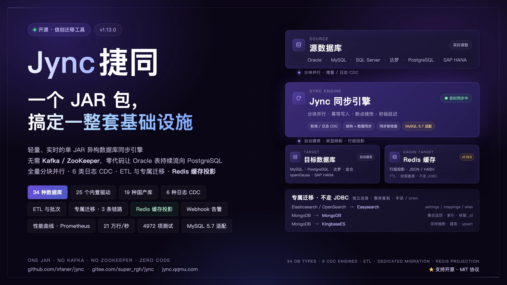
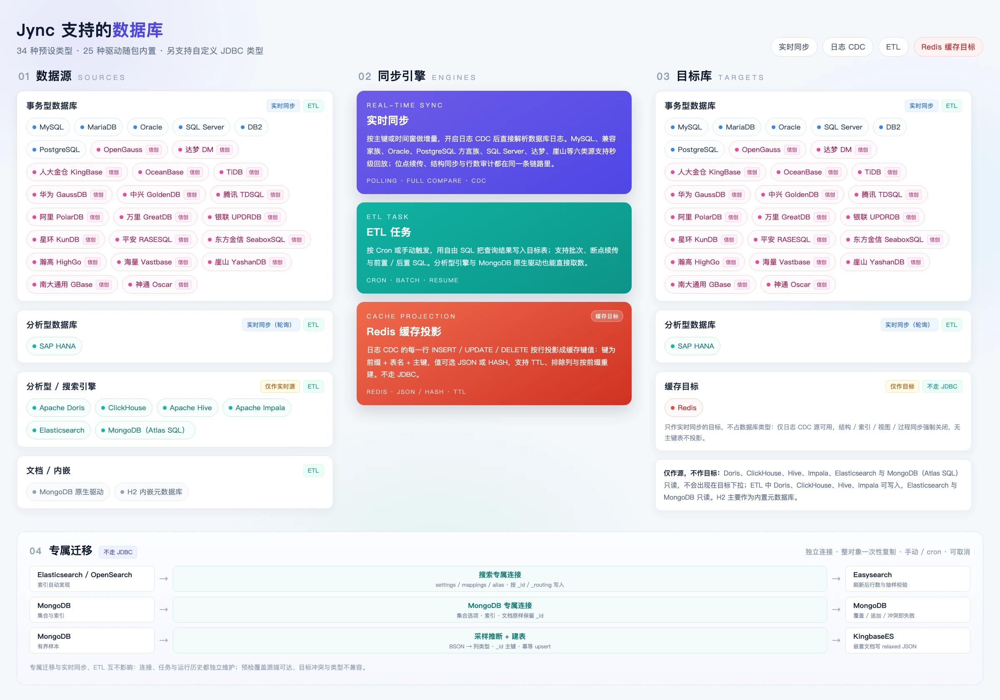
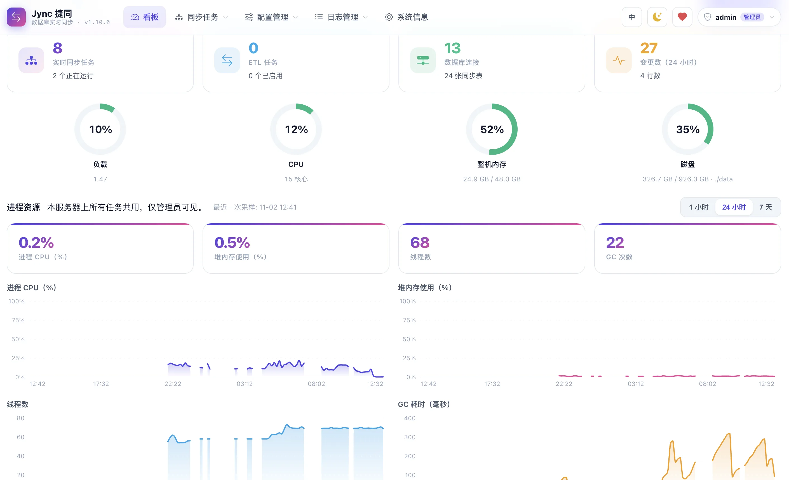
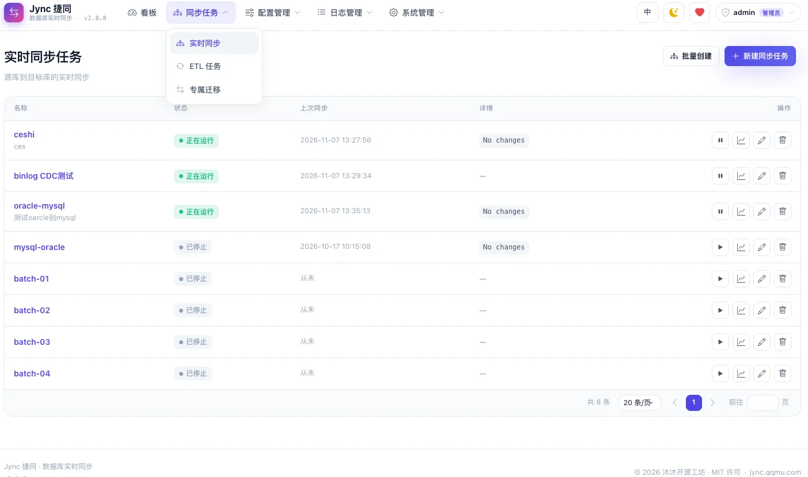
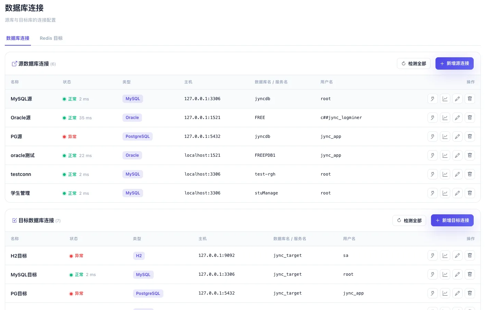

# Jync 捷同 · 异构数据库实时同步工具

> **Jync**，读作 "sync" —— **J** 代表 Java；**捷同**：敏捷同步，两库皆同。
> 单 JAR 交付的异构数据库同步引擎：**分块并行的全量、只读零侵入的增量、秒级的日志 CDC**，外加按 SQL 取数的 ETL 与 Webhook 告警。

**简体中文** | [English](README_EN.md)

[](LICENSE)
[](https://openjdk.org/)
[](https://spring.io/projects/spring-boot)
[](https://github.com/vfaner/jync)
[](https://github.com/vfaner/jync)
[](https://gitee.com/super_rgh/jync)
[](https://gitee.com/super_rgh/jync)



在**异构数据库**之间持续同步**结构与数据**的开箱即用 Web 应用：单个 jar 启动，浏览器点选即可在内置的 **34 种数据库（另支持自定义类型）** 之间建立同步或 ETL 链路；搜索与文档型数据另有三条不走 JDBC 的**专属迁移**链路（Elasticsearch / OpenSearch → Easysearch、MongoDB → MongoDB、MongoDB → KingbaseES）。不需要 Kafka、Flink、ZooKeeper，也不需要编写一行作业代码。

- **零外部依赖**：Spring Boot 单体 + Thymeleaf 服务端渲染 + Quartz + H2 内嵌元数据库，内网离线可用。
- **全量不是批量查询导入**：主键 keyset 分块、单表内并行、结果集流式读取、逐块提交与检查点，单表吞吐可达 **20 万行/秒量级**。
- **增量只有一条索引查询**：默认轮询模式只读游标之后的变化，一个只读账号即可；六类源库可切换日志 CDC，做到秒级延迟。
- **结构与数据一起走**：目标库缺失时自动建表 / 索引 / 视图 / 存储过程，内置各方言类型映射与函数转换。
- **可靠续传**：停机、断网、进程被杀都能从检查点继续，写入全部幂等，停机期间源库的变更重启后自动补齐。
- **另有专属迁移**：三条不走 JDBC 的整库复制链路，使用独立的连接模型，与实时同步、ETL 互不影响。
- **出了问题会通知你**：同步失败、CDC 停摆、数据漂移等七类故障可推送到钉钉、企业微信、飞书或自定义 Webhook。

| 资源 | 地址 |
|---|---|
| **下载** | [Gitee 发行版（分卷）](https://gitee.com/super_rgh/jync/releases/latest) · [GitHub Releases（完整 jar）](https://github.com/vfaner/jync/releases/latest) |
| **文档** | [官网](https://jync.qqmu.com) · [用户操作手册](https://jync.qqmu.com/docs/jync-user-guide.pdf) · [部署与运维手册](https://jync.qqmu.com/docs/jync-ops-guide.pdf) · [产品介绍](https://jync.qqmu.com/docs/jync-overview.pdf) |
| **演示** | [Bilibili · 14 分钟，从建连接到实时同步](https://www.bilibili.com/video/BV1iHYJ6vEEd) |
| **更新日志** | [各版本发布说明](docs/release-notes/)（当前 v2.0.0） |
| **源码** | [GitHub](https://github.com/vfaner/jync) · [Gitee](https://gitee.com/super_rgh/jync) · [AtomGit 镜像](https://atomgit.com/vfaner/jync)（代码与发布包同步，国内加速） |

> 下载、问题反馈与 PR 以 Gitee / GitHub 为准；AtomGit 为只读镜像。

---

## 项目背景

政企系统从 MySQL、Oracle、SQL Server 迁移到达梦、金仓、OceanBase 等国产数据库时，迁移往往不是一次性搬完：新旧系统双轨运行、分批割接、历史库只读共存，都要求两个库在数周甚至数月里**持续保持一致**。

现成方案总有一步对不上。商业同步工具按节点授权，采购周期长、成本高；Debezium、Flink CDC 能力强，但要先搭 Kafka、Flink 与作业编排；DataX、Kettle 擅长一次性搬运，长期增量、结构同步与断点续传通常需要自己编排。**Jync 把这些逻辑做成一个可交付的软件**：一个 jar，实施人员用浏览器完成建连接、选表、配置调度、启动同步。MIT 协议开源，可完全私有化部署。

---

## 核心能力

| 分类 | 能力 |
|---|---|
| 全量加载 | 主键 keyset 分块 + 单表内并行 + 结果集流式读取 + 逐块检查点；空表 INSERT-first、延迟二级索引；单表 20 万行/秒量级 |
| 增量同步 | 时间戳 / 行级 SCN / 自增列 / 全表比对自动选策略；一条游标区间查询；水位线安全回退；游标提交后推进 |
| 日志 CDC | MySQL binlog、Oracle LogMiner、达梦 LogMiner、PostgreSQL 系逻辑解码、SQL Server CDC、崖山 YStream；长驻线程流式回放，秒级延迟 |
| Redis 缓存投影 | 实时同步的目标也可以是 Redis：按 CDC 把每一行投影成 `<前缀><表>:<主键>` 的 JSON 或 HASH，基线 + 回放 + 前缀清扫重建；只支持日志 CDC，缓存语义与边界见[已知限制](docs/known-limitations.md) |
| 结构同步 | 表、索引、视图、存储过程/函数；类型映射、函数转换、标识符引号、分页语法、DDL 覆盖 |
| ETL | 按客户取数 SQL 复制结果行；7 种分析型引擎；多语句脚本；覆盖 / 追加 / 范围覆盖；断点续跑；同源同目标的表可组成**批次**共享连接与调度 |
| 专属迁移 | Elasticsearch / OpenSearch → Easysearch、MongoDB → MongoDB、MongoDB → KingbaseES 三种整库复制，连接模型独立于 JDBC；带预检，手动或 cron 运行，可取消并查看运行历史 |
| 数据加工 | 列清洗（13 种规则，含手机号/身份证/姓名/邮箱掩码与 SHA-256 哈希）、表名映射、只读数据预览、按需行数核对、任务克隆、批量建任务（按表大小分箱） |
| 系统管理 | 配置包导出/导入（口令加密、可选运行状态、目标密钥重加密）、元数据库连接测试器、强制 HTTPS 页面开关、应用内 TLS 证书上传（PKCS#12 / JKS / PEM） |
| AI 辅助（可选） | 模型起草存储过程/函数的候选 SQL，人工审阅后才落库；AI 永不参与同步 |
| 告警通知 | Webhook 推送同步失败、轮询卡死、项目未运行、CDC 停摆、数据漂移、连接健康、PG slot 积压；钉钉 / 企业微信 / 飞书 / 通用 JSON；冷却与恢复通知 |
| 可靠性与可观测 | 幂等 upsert、检查点续传、数据库租约锁、at-least-once；看板、变更 / 审计 / 系统日志、性能曲线、可选 Prometheus 指标端点 |
| 交付形态 | jar / Docker / Kubernetes；中英双语、昼夜主题；响应式布局；本地账号与三种统一认证 |

---

## 支持的数据库

内置 **34 种**预设类型，其中 25 种驱动随包内置。下图是官网的数据库能力地图：上半部分是 JDBC 的实时同步 / ETL 矩阵，底部是独立的**专属迁移**链路；点图可看完整说明。

[](https://jync.qqmu.com/database.html)

- **自定义数据库**：JDBC URL + 驱动类名 + 驱动 jar 路径，运行时用独立 `URLClassLoader` 加载，可选方言家族。
- **需自备驱动**：GBase、神通 Oscar、华为 GaussDB、SAP HANA、ClickHouse、Hive、Impala、Elasticsearch、MongoDB（Atlas SQL）的构件不可再分发，需自备 jar；驱动类名与预设不同时可在同一张卡片覆盖。
- **分析型 / 搜索型引擎**：Doris、ClickHouse、Hive、Impala、Elasticsearch、MongoDB 没有日志 CDC，**只作实时同步的源**（轮询 / 全表比对）；ETL 中除 Elasticsearch 与 MongoDB 外都可写入。
- **Redis 是同步目标，不是数据库**：在项目页选「目标类型 = Redis」，连接管理里单独维护 Redis 目标（单机或 Cluster，不支持 Sentinel）；源端仍是数据库连接，且必须走日志 CDC。它不是 `DatabaseType`，不出现在数据库能力矩阵与 ETL 引擎列表里。
- **专属迁移不走 JDBC**：三条链路由独立的「专属连接」与迁移任务完成，不进入 JDBC 能力矩阵；边界见[已知限制](docs/known-limitations.md)。GaussDB 与 openGauss 的差异、TDSQL / PolarDB 分版本、HANA 的 CDC 限制见[官网数据库页](https://jync.qqmu.com/database.html)。

---

## 界面速览

<table>
  <tr>
    <td align="center" width="33%"><a href="docs/images/jync_kanban.webp" target="_blank" rel="noopener"></a><br><sub><b>看板</b> · 资源、任务与 24h 趋势</sub></td>
    <td align="center"><a href="docs/images/jync_xiangmu.webp" target="_blank" rel="noopener"></a><br><sub><b>实时同步任务</b> · 状态、上次同步与详情</sub></td>
    <td align="center"><a href="docs/images/jync_db.webp" target="_blank" rel="noopener"></a><br><sub><b>连接管理</b> · 源 / 目标分栏</sub></td>
  </tr>
</table>

> 其余界面（日志 CDC、性能曲线、列清洗、告警、AI 起草、暗色主题等）见[官网功能页](https://jync.qqmu.com/features.html)。

---

## 同步引擎

Jync 有三条数据通路，分别解决"第一次怎么搬""之后怎么追""如何做到秒级"：

```
首次全量：  keyset 分块 → N 个 worker 并行 → 流式读取 → 逐批提交 → 检查点
增量轮询：  cursor > 上次值 AND cursor <= 水位线 → 批量 upsert → 推进游标
日志 CDC：  记录位点 → 分块基线 → 长驻线程连续回放 → 提交后推进位点
```

- **全量**：结果集按 `fetch-size` 流式获取，堆内存不随表大小增长；有主键的表按 keyset 分块，单列整数主键切成互不相交的区间并行加载，每块单独提交并写检查点，崩溃最多重读一块。
- **增量**：每张表每轮只有一条游标区间查询；游标列自动识别（`TIMESTAMP` / `ROW_SCN` / `IDENTITY`），水位线回退让晚提交的事务在下一轮被幂等吸收；**游标在目标库提交之后才推进**，故障恢复是 at-least-once。
- **日志 CDC**：六类源库可按任务切换，直接解析源库日志看到 `INSERT / UPDATE / DELETE`；先记位点 → 分块基线 → 长驻线程回放，多实例用数据库租约互斥，持锁节点宕机后 ≤ 60s 由其他节点接管。
- **CDC 前提**（探测逐项检查）：MySQL `binlog_format=ROW`、`binlog_row_image=FULL`，账号具备 `REPLICATION SLAVE` / `REPLICATION CLIENT`；Oracle `ARCHIVELOG` 与库级 / 表级 `SUPPLEMENTAL LOG DATA (ALL) COLUMNS`（LogMiner）；达梦归档模式与 `RLOG_APPEND_LOGIC=2`；PostgreSQL 系 `wal_level=logical`；SQL Server 开启库级 CDC；崖山 YStream 需逐表补充日志。完整清单见[配置与调优](docs/configuration.md)。
- **默认的轮询模式不碰源库 binlog，也不建触发器**，只需一个只读账号。

容器单机基准（50 万行 Oracle 表）全量实测 **21.6 万行/秒**，日志 CDC 端到端延迟**秒级**。调优参数、调度规则与性能曲线见[配置与调优](docs/configuration.md)与[部署与运维手册](https://jync.qqmu.com/docs/jync-ops-guide.pdf)。

---

<a id="deploy"></a>

## 快速开始

| 项 | 要求 |
|---|---|
| JDK | **17+** |
| 端口 | 默认 `8080` |
| 内存 / 磁盘 | 建议堆 ≥ 512MB，预留 1GB；大字段同步按最大单值放大堆 |
| 工作目录 | 必须固定：`./data`（元数据库与密钥）与 `./logs` 相对进程工作目录生成 |

从 [Gitee Releases](https://gitee.com/super_rgh/jync/releases/latest) 或 [GitHub Releases](https://github.com/vfaner/jync/releases/latest) 下载发布包（Gitee 为分卷，见下）；源码编译为 `mvn clean package -DskipTests`，产物 `target/jync.jar`。

> **Gitee 分卷**：Gitee 单附件上限 100 MB，v2.0.0 起 jar 拆为 `jync.jar.part00` / `jync.jar.part01`。手动下载后执行 `cat jync.jar.part00 jync.jar.part01 > jync.jar`；应用内一键升级会自动合并。GitHub / AtomGit 为完整 jar。

```bash
mkdir -p /opt/jync && cd /opt/jync
java -Xms512m -Xmx2g -Duser.timezone=Asia/Shanghai \
  -jar jync.jar --spring.config.additional-location=file:./application.yml
```

> ⚠️ 必须使用 `--spring.config.additional-location`（叠加覆盖）。替换式的 `spring.config.location` 会丢掉 jar 内置配置，症状是登录页显示 `??login.title_zh_CN??`、全新部署不建表。
>
> 🕐 `-Duser.timezone` 同时决定 Cron 的求值时区；服务器默认是 UTC 时务必显式指定。

最小 `application.yml`（完整键见[配置与调优](docs/configuration.md)）：

```yaml
server:
  port: 8080
sync:
  poll-interval: 2000
  full-load-parallelism: 2
  max-pool-size: 5
  crypto-password: ""   # 留空自动生成，保存到 data/<库名>.key
  crypto-salt: ""
```

首次访问 `http://<服务器>:8080`，使用 `admin / 123456`（管理员）或 `view / 123456`（访客），**首次登录强制修改密码**（未修改前只能停留在改密页）。生产部署、外部元数据库、systemd、Docker / Kubernetes、反向代理与 HTTPS、升级备份见[部署与运维手册](https://jync.qqmu.com/docs/jync-ops-guide.pdf)、[部署页](https://jync.qqmu.com/deploy.html)与[容器部署说明](docs/deploy-container.md)。HTTPS 有两种方式：前置反向代理终止 TLS（推荐），或直接在「系统管理 → 系统配置」上传 PKCS#12 / JKS 密钥库或 PEM 证书与私钥，由 Jync 自己监听 HTTPS，重启后生效；同一页还可开关强制 HTTPS、导出/导入配置包、测试候选元数据库——细节见[配置文档](docs/configuration.md)。

> 🔐 升级前备份 `./data`（连同 `<库名>.key`）、`./logs` 与 `application.yml`。密钥丢失后，已保存的连接密码、AI 密钥与告警地址将无法解密。

---

## 使用流程

1. **数据库连接** → 新建源 / 目标连接 → "测试连接"确认可用。
2. **实时同步 → 新建同步任务**，选定源库与目标库。
3. **任务详情** → 勾选表 / 视图 / 存储过程；需要改目标表名时直接在右侧填写（留空即同名）。
4. 按需配置**捕获策略、调度、全量加载性能与列清洗**。
5. "**立即同步**"验证一次，或"**开启自动同步**"进入持续增量。
6. 在"**变更日志**"查看每轮明细，在"**看板**"查看整体状态；需要确认两边数据是否一致时，在任务详情点「**核对行数**」。

**ETL**：**同步任务 → ETL 任务**新建任务或批次 → 填写取数 SQL 与目标表 → 选择写模式与调度 → 启动。

**专属迁移**：**同步任务 → 专属迁移** → 管理连接 → 选择迁移类型 → 勾选对象、目标命名与写入方式 → 先预检 → 保存后「立即运行」或启用 cron。三种类型都只复制运行那一刻的数据，重复运行 OVERWRITE 可让目标收敛。

**告警**：**配置管理 → 告警通知** → 填写 Webhook 地址、选择消息格式与分类 → 保存后可发一条测试消息。

---

## 架构与技术栈

**技术栈**：Java 17 · Spring Boot 4.1 · Spring Data JPA / Hibernate · Quartz · H2 / MySQL / PostgreSQL 元数据库 · Thymeleaf 服务端渲染 · 原生 JavaScript（无 CDN、无前端构建）。

```text
com.qqmu.jync
├── config / controller / dto / model / repository   配置、MVC 与数据模型
├── service
│   ├── connection / metadata / converter            连接、元数据与方言转换
│   ├── sync / cdc / etl / migration                 四条数据通路
│   └── alert / task / lob / ai                      告警、调度与锁、大字段、AI
└── util                                             工具类
```

- **三层锁**：Quartz `@DisallowConcurrentExecution` → JVM 内按任务 `ReentrantLock` → 数据库租约锁（跨重启与跨实例）。
- **链路隔离**：实时同步与 ETL 走 JDBC 连接与任务；专属迁移有自己的连接模型与运行记录，不占用 JDBC 连接池，也不进入 JDBC 能力矩阵。

---

## 文档与测试

- **配置、调度与调优**：[docs/configuration.md](docs/configuration.md)（`sync.*` / `sync.cdc.*` 键、调度规则、列清洗、CDC 前提与性能参数）
- **容器部署与运维**：[docs/deploy-container.md](docs/deploy-container.md)（环境变量、TLS、多实例、升级与排障）
- **数据边界与离线部署**：[docs/security-data-boundary.md](docs/security-data-boundary.md)（出网点清单、air-gap 关闭清单、字段加密/脱敏/国密的能力边界）
- **已知限制与边界**：[docs/known-limitations.md](docs/known-limitations.md)（CDC 边界、无主键表、大字段、内容校验、过程转换）
- **真实数据库验证矩阵**：[docs/verification-matrix.md](docs/verification-matrix.md)（每个产品验证到哪一步：版本/镜像、驱动、策略、验证级别与运行命令）

```bash
mvn test
```

5300+ 单元测试，覆盖方言与 SQL 改写、全量与续传、六类 CDC 前提与位点纪律、Redis 投影与专属迁移、ETL 与告警、安全（加密存储、访客 POST 全拒、CSRF）、页面国际化，以及升级双通道兜底。

真实库集成测试（`*IT`，默认不进套件，需 Docker）：Oracle 23ai 并行全量与 `ROWDEPENDENCIES`；MySQL 8 binlog 基线 → 流式、崩溃重跑、十万行一致与故障注入。运行加 `-Dapi.version=1.44`（Docker Engine ≥ 29）。

---

## 参与贡献

| 渠道 | 账号 |
|------|------|
| QQ | [817094](https://wpa.qq.com/msgrd?v=3&uin=817094&site=qq&menu=yes) / [2912167928](https://wpa.qq.com/msgrd?v=3&uin=2912167928&site=qq&menu=yes) |
| QQ 群 | [426669837 · 沐沐开源工坊](https://qun.qq.com/universal-share/share?ac=1&authKey=xm%2BfgdraFGDpH8GHkV4DbuMjArg6BsPdNnXKUqcWvFXI1ocS56TcioSRYOVBvn5Q&busi_data=eyJncm91cENvZGUiOiI0MjY2Njk4MzciLCJ0b2tlbiI6Ind0V1pMYlVieXJkQmtnMVgveUFsOHFnbFhTd28wUE03dy9uVUErVExBdnlkMENnMis0UmhqWlJjcURzRHFnUEMiLCJ1aW4iOiI4MTcwOTQifQ%3D%3D&data=tZVIfZoO6N9QWSJE6ZbdZR15OmuLpSVucid5TicWYaMgb9Go1B975NZk0iZOo69AEzXQ4XucFtenImLltzFI5w&svctype=4&tempid=h5_group_info) |
| 微信 | qqmu66 |
| 邮箱 | [vfaner@88.com](mailto:vfaner@88.com) |
| 官网 | <https://jync.qqmu.com> |

问题反馈、功能建议与 PR 欢迎通过以上任一渠道联系。如果 Jync 对你有帮助，欢迎点一个 **Star** ⭐。

### 赞赏支持

[](https://jync.qqmu.com/donate.html)

Jync 全部能力免费开源。如果它帮到了你，欢迎点上面的按钮赞赏支持一杯咖啡；赞助时留下备注，即可登记进**赞赏支持名单**。

---

## 许可证

[MIT License](LICENSE)，商业与非商业用途均可。内置第三方 JDBC 驱动各自适用原厂许可证，见 [THIRD_PARTY_LICENSES.md](THIRD_PARTY_LICENSES.md)。

项目由沐沐开源工坊维护：GitHub [@vfaner](https://github.com/vfaner)、Gitee [@super_rgh](https://gitee.com/super_rgh)、AtomGit [@vfaner](https://atomgit.com/vfaner)。唯一的请求是不要把「Jync / 捷同」名称、logo 与作者署名替换成自己的，详见 [TRADEMARK.md](TRADEMARK.md)。
