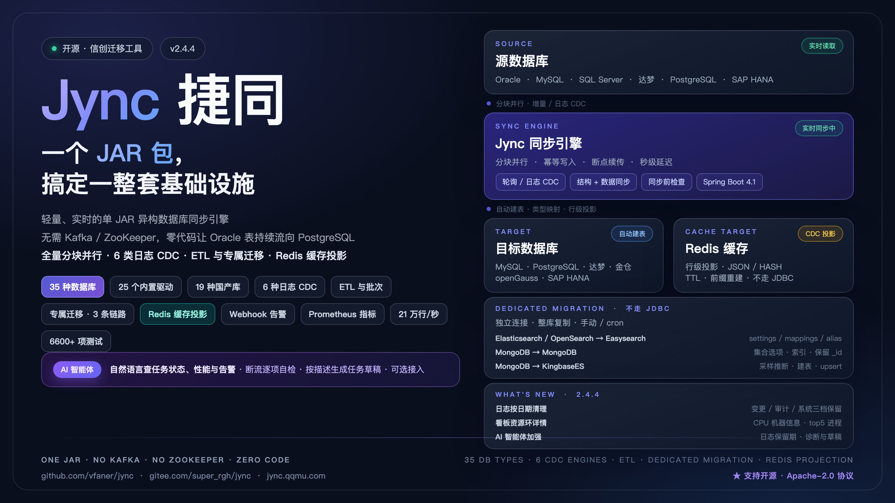
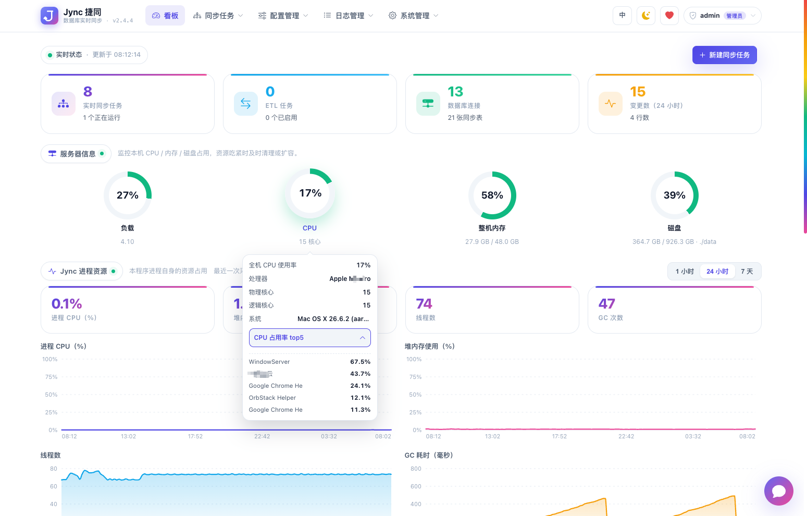
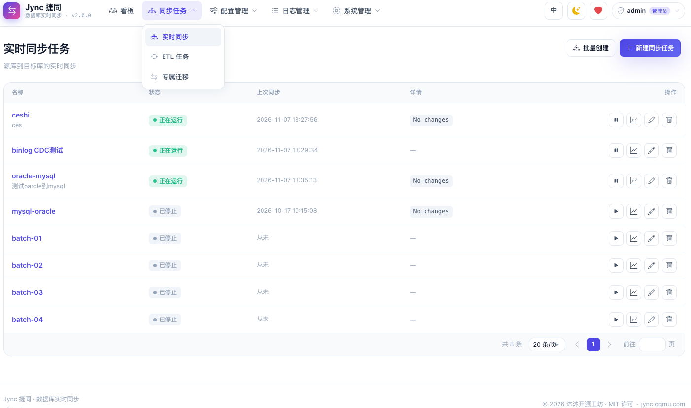
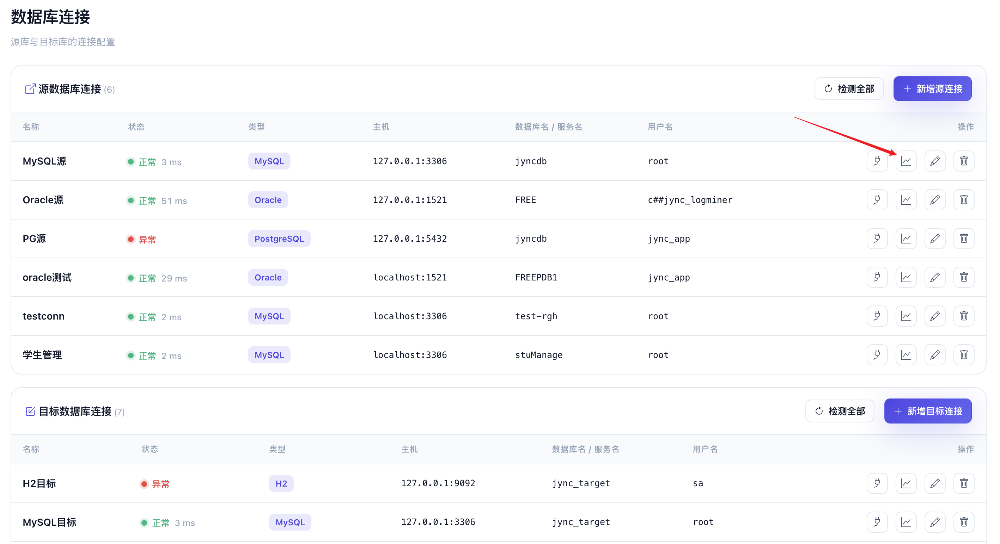
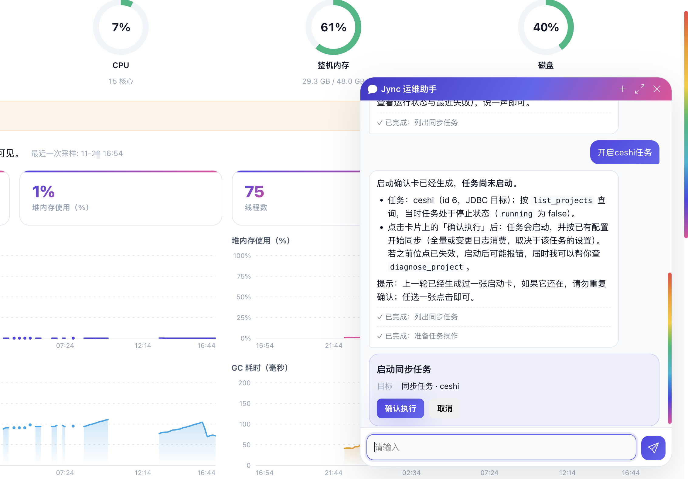
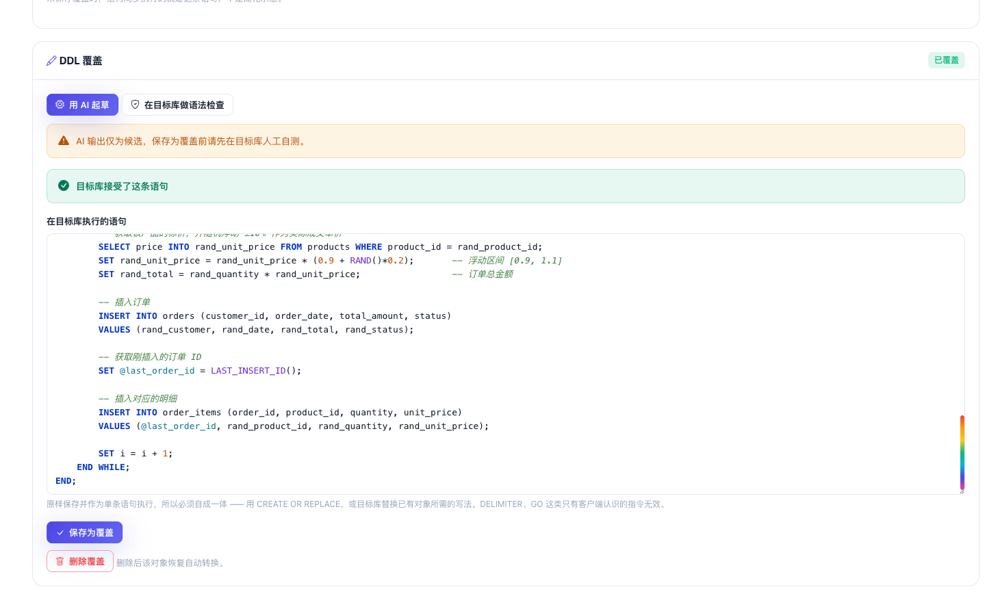
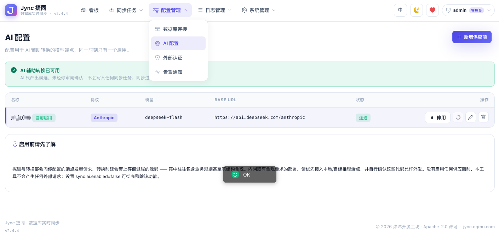
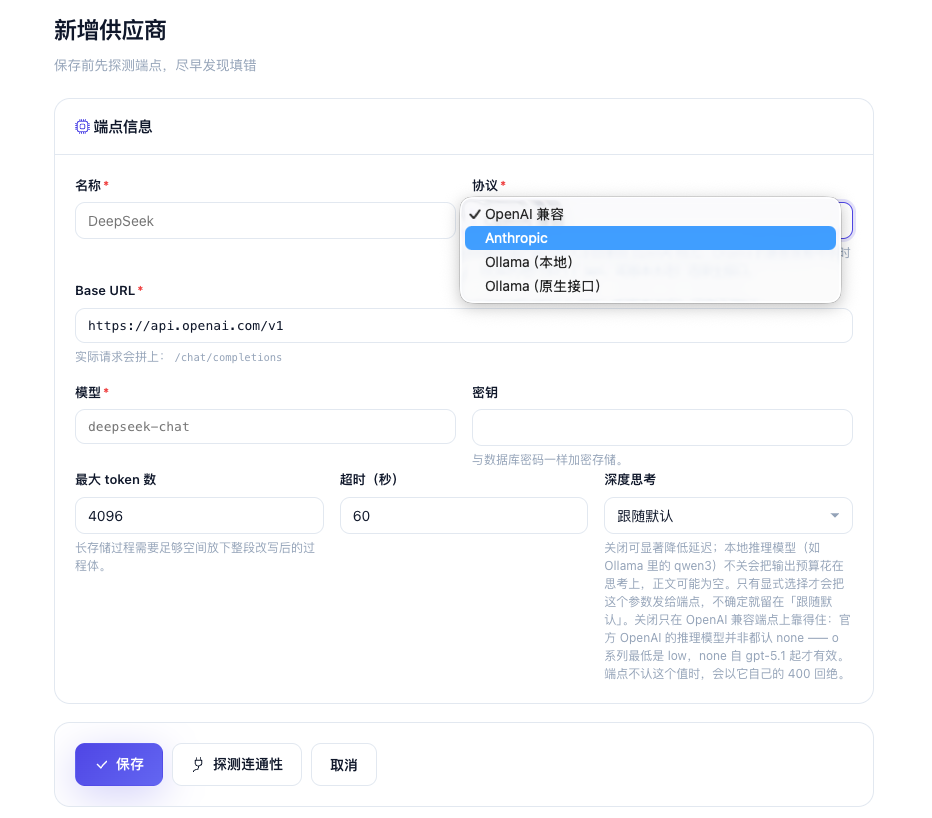
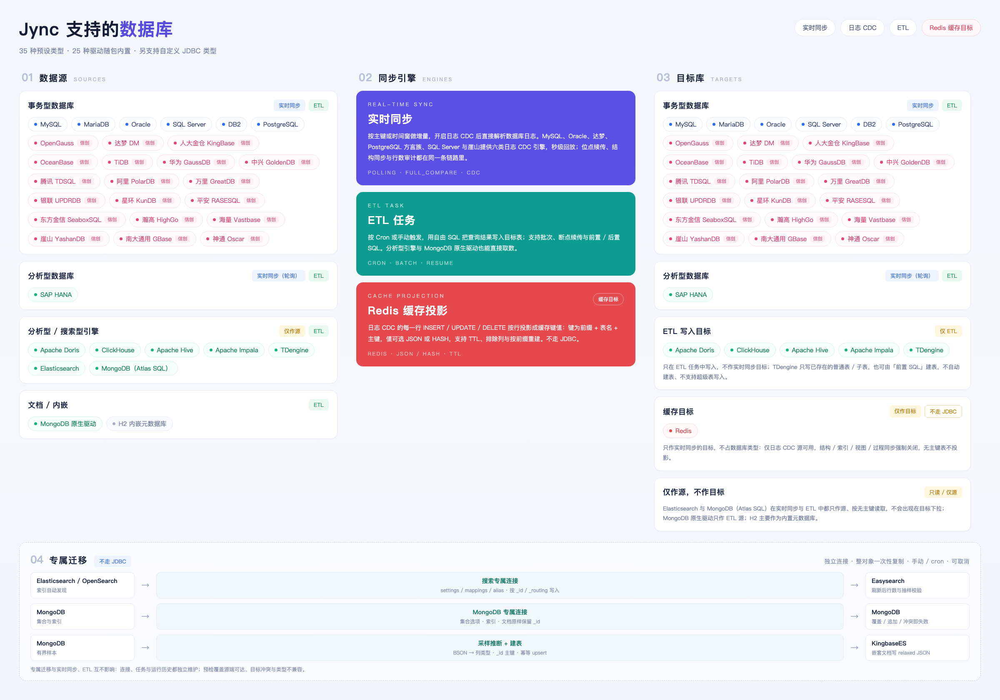

# Jync 捷同 · 异构数据库实时同步工具

> **Jync**：**J** 代表 Java，**ync** 是 sync 的缩写；中文名 **捷同**，寓意敏捷同步、两库皆同。
> 单 JAR 交付的异构数据库同步引擎：分块并行的全量、只读零侵入的增量、秒级的日志 CDC，外加按 SQL 取数的 ETL、专属迁移与 Redis 缓存投影。

**简体中文** | [English](README_EN.md)

[](LICENSE)
[](https://openjdk.org/)
[](https://spring.io/projects/spring-boot)
[](https://github.com/vfaner/jync/releases)
[](https://hub.docker.com/r/vfaner/jync)
[](https://github.com/vfaner/jync)
[](https://gitee.com/super_rgh/jync)



Jync 是面向**信创迁移与异构数据集成**的开源同步工具：单个 jar 启动，浏览器完成建连接、选表、配调度与启动；在 **35 种数据库（另支持自定义 JDBC 类型）** 之间持续同步**结构与数据**，另有三条不走 JDBC 的专属迁移链路（Elasticsearch / OpenSearch → Easysearch、MongoDB → MongoDB、MongoDB → KingbaseES）。

不需要 Kafka、Flink、ZooKeeper，也不需要编写作业代码；Apache-2.0 协议，可完全私有化部署、内网离线运行。覆盖全量、轮询、日志 CDC、ETL、Redis 缓存投影与一源多目标分发，并提供可选 AI 运维助手。

## 核心亮点

- **一个 JAR 就够**：Spring Boot 单体 + Thymeleaf 服务端渲染 + Quartz + H2 内嵌元数据库，零外部依赖，内网离线可用。
- **全量快而稳**：主键 keyset 分块、单表内并行、流式读取、逐块提交与检查点；实测 1000 万行约 40 秒。
- **增量很轻**：轮询只读游标之后的变化；六类源库可切换日志 CDC，做到秒级延迟。
- **一源多目标**：一份源数据同时分发到多个目标，各自独立位点与中转，基线、DDL 与补数按目标推进。
- **结构与数据一起走**：缺表自动建表、索引、视图与存储过程，内置各方言类型映射与函数转换。
- **ETL 取数**：按一条 SQL 从源库取数写入 JDBC 目标；OVERWRITE / APPEND / RANGE_OVERWRITE / UPSERT 四种写入模式，支持变量、断点续跑、预检与运行历史。
- **Redis 缓存投影**：把选中的表投影到 Redis（键前缀、TTL、值格式可选），CDC 变更同步更新或删除。
- **专属迁移**：Elasticsearch / OpenSearch → Easysearch、MongoDB → MongoDB、MongoDB → KingbaseES；独立连接模型，带预检、进度 / 取消与运行记录。
- **安全与 HTTPS**：管理员 / 运维 / 访客三角色与资源归属；BCrypt 口令、连接密码与 Webhook 加密存储、CSRF 防护；支持应用内 TLS 1.2/1.3 或前置代理 HTTPS；元数据库可换 MySQL / PostgreSQL / Oracle，内网离线运行。
- **断点续传**：停机、断网、进程被杀都能从检查点继续；写入幂等，停机期间的变更自动补齐。
- **角色与告警**：管理员 / 运维 / 访客按资源归属隔离；同步失败、CDC 停摆、数据漂移等可推送钉钉、企业微信、飞书或 Webhook。
- **可选 AI 运维助手**：自然语言查状态、逐表进度与性能，断流自检、粘贴日志分析，生成任务草稿并按确认卡调参。

## 界面速览

<table>
  <tr>
    <td align="center" width="33%"><a href="docs/images/jync_kanban.png" target="_blank" rel="noopener"></a><br><sub><b>看板</b> · 资源、任务与 24h 趋势</sub></td>
    <td align="center"><a href="docs/images/jync_xiangmu.png" target="_blank" rel="noopener"></a><br><sub><b>实时同步任务</b> · 状态、上次同步与详情</sub></td>
    <td align="center"><a href="docs/images/jync_db.png" target="_blank" rel="noopener"></a><br><sub><b>连接管理</b> · 源 / 目标分栏</sub></td>
  </tr>
</table>

> 更多界面（日志 CDC、性能曲线、列清洗、告警、暗色主题等）见[官网功能页](https://jync.qqmu.com/features.html)。

## AI 智能体（可选）

AI 只做**助手**，不参与同步链路：未启用供应商时不产生任何外部请求，`sync.ai.enabled=false` 可整体移除。

<table>
  <tr>
    <td align="center" width="50%"><a href="docs/images/jync_ai_kefu.png" target="_blank" rel="noopener"></a><br><sub><b>AI 智能体</b> · 自然语言查状态、诊断与自检</sub></td>
    <td align="center"><a href="docs/images/jync_xiangmu_suoyin_ai.png" target="_blank" rel="noopener"></a><br><sub><b>结构转换 AI 起草</b> · 候选 SQL 人工审阅后保存</sub></td>
  </tr>
  <tr>
    <td align="center" width="50%"><a href="docs/images/jync_ai.png" target="_blank" rel="noopener"></a><br><sub><b>AI 配置</b> · 协议、模型与深度思考</sub></td>
    <td align="center"><a href="docs/images/jync_ai_add.png" target="_blank" rel="noopener"></a><br><sub><b>新增供应商</b> · 探测端点，密钥加密存储</sub></td>
  </tr>
</table>

- **问状态不用翻页面**：任务状态、进度与吞吐、源/目标行数、数据库指标、当前告警、ETL 最近结果，都有对应的只读工具。
- **排障成体系**：CDC 断流时逐项自检前提（连接、权限、位点、跳过计数），按「告警 → 任务 → 日志流 → 自检 → 文档」给出依据明确的结论。
- **运行态变更由页面完成**：AI 负责准备动作与影响说明，真正执行由页面按钮发起，并再次校验角色与资源归属；AI 不执行 SQL、不改上述调优以外的配置、不删任务；连接只改 JDBC extraParams，主机/账号/密码/URL 与 10 项白名单以外的 application.yml 设置仍只给建议。
- **知识库随包**：产品用法、参数前提与已知限制来自随包文档，不联网检索；没有的就说没查到，不编造。
- **接入任意模型**：OpenAI 兼容（含多数国产端点与自建服务）、Anthropic、Ollama（原生 / 兼容层）；密钥加密存储，页面不回显。

## 支持的数据库

内置 **35 种**预设类型（含 19 种国产 / 信创库），其中 25 种驱动随包内置；下图是官网的数据库能力地图（上半部分为 JDBC 实时同步 / ETL 矩阵，底部为独立的专属迁移链路）。

[](https://jync.qqmu.com/database.html)

- **六类日志 CDC**：MySQL binlog、Oracle LogMiner、达梦 LogMiner、PostgreSQL 系逻辑解码、SQL Server CDC、崖山 YStream。
- **只作源的引擎**：Doris、ClickHouse、Hive、Impala、TDengine、Elasticsearch、MongoDB 没有日志 CDC，走轮询或全表比对。
- **Redis 是同步目标**：把每一行按 CDC 投影为 JSON / HASH 缓存，支持 TTL、前缀清扫与基线重建。
- **自定义数据库**：JDBC URL + 驱动类名 + 驱动 jar，运行时独立类加载，可选方言家族。
- **需自备驱动**：GBase、神通 Oscar、华为 GaussDB、SAP HANA、ClickHouse、Hive、Impala、TDengine、Elasticsearch、MongoDB 的构件不可再分发，需自备 jar。

### CDC 前提（任务页「自检」逐项检查）

- **MySQL binlog**：`binlog_format=ROW`、`binlog_row_image=FULL`，账号需 `REPLICATION SLAVE` 与 `REPLICATION CLIENT`。
- **Oracle LogMiner / 达梦 LogMiner**：开启 `ARCHIVELOG`，并配置库级或表级 `SUPPLEMENTAL LOG DATA (ALL) COLUMNS`。
- **PostgreSQL 系**：`wal_level=logical`；SQL Server 开启库级 CDC；崖山 YStream 需逐表补充日志。
- 默认轮询模式不碰源库 binlog，也不建触发器，一个只读账号即可；完整清单见[配置与调优](docs/configuration.md)。

## 快速开始

默认使用内置 H2 元数据库，单个 `jync.jar` 即可启动；生产环境建议使用 MySQL / PostgreSQL / Oracle 元数据库。

| 项 | 要求 |
|---|---|
| JDK | **17+** |
| 端口 | 默认 `8080` |
| 内存 / 磁盘 | 堆建议 ≥ 512MB，磁盘预留 ≥ 1GB |
| 工作目录 | `./data`（元数据库 / 密钥 / TLS 证书）与 `./logs` |

从 [Gitee Releases](https://gitee.com/super_rgh/jync/releases/latest) 或 [GitHub Releases](https://github.com/vfaner/jync/releases/latest) 下载 `jync.jar`；源码构建执行 `mvn clean package -DskipTests`，产物为 `target/jync.jar`。

### 1. JAR（默认 H2）

```bash
mkdir -p /opt/jync && cd /opt/jync
java -Xms512m -Xmx2g -Duser.timezone=Asia/Shanghai -jar jync.jar
```

访问 `http://<服务器>:8080`，使用 `admin / 123456`、`ops / 123456` 或 `view / 123456` 登录，首次登录强制修改密码。

需要覆盖配置时，使用叠加式配置：

```bash
java -jar jync.jar --spring.config.additional-location=file:./application.yml
```

不要使用 `spring.config.location`，否则会丢掉 jar 内置配置。

### 2. JAR + 外部元数据库

先创建空库和账号；MySQL 示例：

```sql
CREATE DATABASE jync CHARACTER SET utf8mb4 COLLATE utf8mb4_general_ci;
```

启动前设置环境变量：

```bash
export SPRING_DATASOURCE_URL='jdbc:mysql://db.example.com:3306/jync?useSSL=false&allowPublicKeyRetrieval=true&serverTimezone=Asia/Shanghai&characterEncoding=UTF-8'
export SPRING_DATASOURCE_USERNAME='jync'
export SPRING_DATASOURCE_PASSWORD='change-me'
export SPRING_DATASOURCE_DRIVER_CLASS_NAME='com.mysql.cj.jdbc.Driver'
export SYNC_CRYPTO_PASSWORD='a-long-random-secret'
export SYNC_CRYPTO_SALT='0123456789abcdef'  # 偶数位十六进制
java -jar jync.jar
```

`SYNC_CRYPTO_SALT` 必须是偶数位十六进制字符串；示例值上线前要换掉。PostgreSQL 使用 `jdbc:postgresql://db.example.com:5432/jync` / `org.postgresql.Driver`，Oracle 使用 `jdbc:oracle:thin:@//db.example.com:1521/FREEPDB1` / `oracle.jdbc.OracleDriver`。新库由 `ddl-auto: update` 自动建表。

`SYNC_CRYPTO_*` 必须显式设置并长期保持不变；更换后已保存的连接密码将无法解密。已有 H2 数据不能只改连接串，需先在旧实例导出配置包，启动新实例后导入，详见[元数据库迁移](docs/configuration.md#元数据库迁移)。

### 3. Docker（默认 H2）

```bash
docker pull vfaner/jync:latest
docker compose -f docker-compose.release.yml up -d
```

官方镜像支持 linux/amd64 与 linux/arm64；备用镜像为 `ghcr.io/vfaner/jync:latest`。数据在 `./data` 与 `./logs`，重建容器不会丢失。

### 4. Docker + 外部元数据库

Jync 镜像本身不包含数据库服务。最简方式是在 `docker-compose.release.yml` 的 `environment` 下取消 MySQL / PostgreSQL / Oracle 对应注释，填入真实地址和密码；保持与 `TZ` 相同的 6 个空格缩进，不要使用 Tab。然后执行：

```bash
docker compose -f docker-compose.release.yml up -d
```

也可以直接用 `deploy/` 下的组合示例，让数据库与 Jync 一起启动：

```bash
docker compose -f deploy/docker-compose.mysql.yml up -d --build
# 也可换成 postgres / oracle 示例
```

使用已有托管数据库时，保留 `SPRING_DATASOURCE_*` 环境变量并删除数据库服务。示例默认从源码构建；使用官方镜像时把 `build` 换成 `image: vfaner/jync:latest`。修改 Compose 环境变量后要执行 `docker compose up -d`，`restart` 不会重新读取。

### 5. Kubernetes 与生产部署

Kubernetes 清单在 `deploy/k8s/`；HTTPS、外部元数据库迁移、升级备份和更多参数见[部署说明](docs/deploy-container.md)与[部署与运维手册](https://jync.qqmu.com/docs/jync-ops-guide.pdf)。

## 技术栈与架构

**技术栈**：Java 17 · Spring Boot 4.1 · Spring Data JPA / Hibernate · Quartz · H2 / MySQL / PostgreSQL 元数据库 · Thymeleaf 服务端渲染 · 原生 JavaScript（无 CDN、无前端构建）。

```text
com.qqmu.jync
├── config / controller / dto / model / repository   配置、MVC 与数据模型
├── service
│   ├── connection / metadata / converter            连接、元数据与方言转换
│   ├── sync / cdc / etl / migration                 四条数据通路
│   └── alert / task / lob / ai                      告警、调度与锁、大字段、AI
└── util                                             工具类
```

- **三层锁**：Quartz `@DisallowConcurrentExecution` → JVM 内按任务 `ReentrantLock` → 数据库租约锁（跨重启与跨实例）。
- **链路隔离**：实时同步与 ETL 使用 JDBC 连接与任务；专属迁移有独立连接模型与运行记录。

## 文档与测试

- **配置与调优**：[docs/configuration.md](docs/configuration.md)
- **容器部署**：[docs/deploy-container.md](docs/deploy-container.md)
- **安全与数据边界**：[docs/security-data-boundary.md](docs/security-data-boundary.md)
- **已知限制**：[docs/known-limitations.md](docs/known-limitations.md)
- **真库验证矩阵**：[docs/verification-matrix.md](docs/verification-matrix.md)
- **发布说明**：[docs/release-notes/](docs/release-notes/)

`mvn test` 运行全量单元测试，覆盖方言与 SQL 改写、全量与续传、六类 CDC、Redis 投影、专属迁移、ETL、告警、角色归属、AI 助手与安全。真库集成测试（`*IT`）需 Docker，命令见验证矩阵。

## 参与贡献

| 渠道 | 账号 |
|---|---|
| QQ | [817094](https://wpa.qq.com/msgrd?v=3&uin=817094&site=qq&menu=yes) / [2912167928](https://wpa.qq.com/msgrd?v=3&uin=2912167928&site=qq&menu=yes) |
| QQ 群 | [426669837 · 沐沐开源工坊](https://qun.qq.com/universal-share/share?ac=1&authKey=xm%2BfgdraFGDpH8GHkV4DbuMjArg6BsPdNnXKUqcWvFXI1ocS56TcioSRYOVBvn5Q&busi_data=eyJncm91cENvZGUiOiI0MjY2Njk4MzciLCJ0b2tlbiI6Ind0V1pMYlVieXJkQmtnMVgveUFsOHFnbFhTd28wUE03dy9uVUErVExBdnlkMENnMis0UmhqWlJjcURzRHFnUEMiLCJ1aW4iOiI4MTcwOTQifQ%3D%3D&data=tZVIfZoO6N9QWSJE6ZbdZR15OmuLpSVucid5TicWYaMgb9Go1B975NZk0iZOo69AEzXQ4XucFtenImLltzFI5w&svctype=4&tempid=h5_group_info) |
| 微信 | qqmu66 |
| 邮箱 | [vfaner@88.com](mailto:vfaner@88.com) |
| 官网 | <https://jync.qqmu.com> |

问题反馈、功能建议与 PR 欢迎通过以上任一渠道联系；如果 Jync 对你有帮助，欢迎点一个 **Star** ⭐。

## 开源协议

[Apache License, Version 2.0](LICENSE)：可商用、可修改、可私有化部署。内置第三方 JDBC 驱动各自适用原厂许可证，见 [THIRD_PARTY_LICENSES.md](THIRD_PARTY_LICENSES.md)。

项目由沐沐开源工坊维护：GitHub [@vfaner](https://github.com/vfaner)、Gitee [@super_rgh](https://gitee.com/super_rgh)、AtomGit [@vfaner](https://atomgit.com/vfaner)。Apache-2.0 不包含商标授权，「Jync / 捷同」名称与 logo 的使用边界见 [TRADEMARK.md](TRADEMARK.md)。
