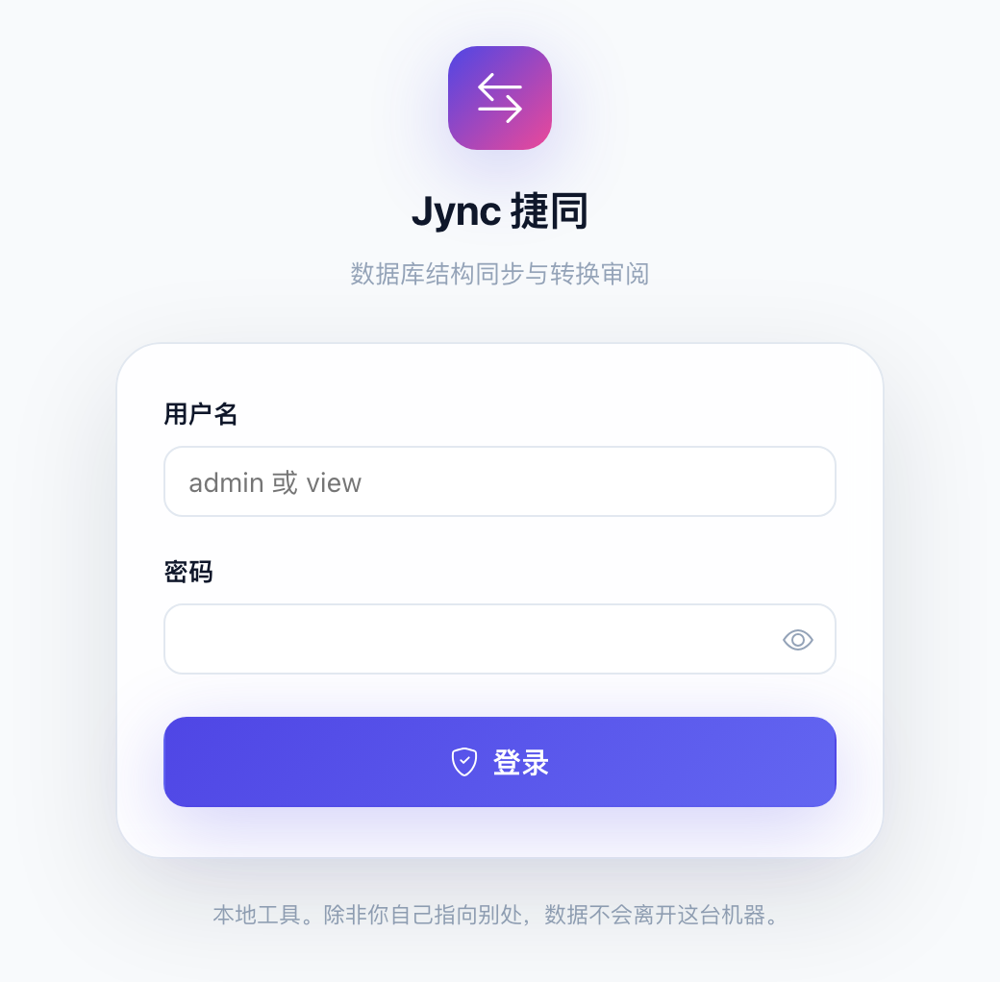
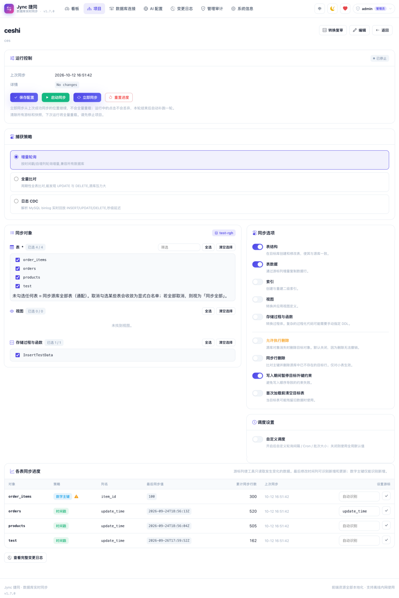
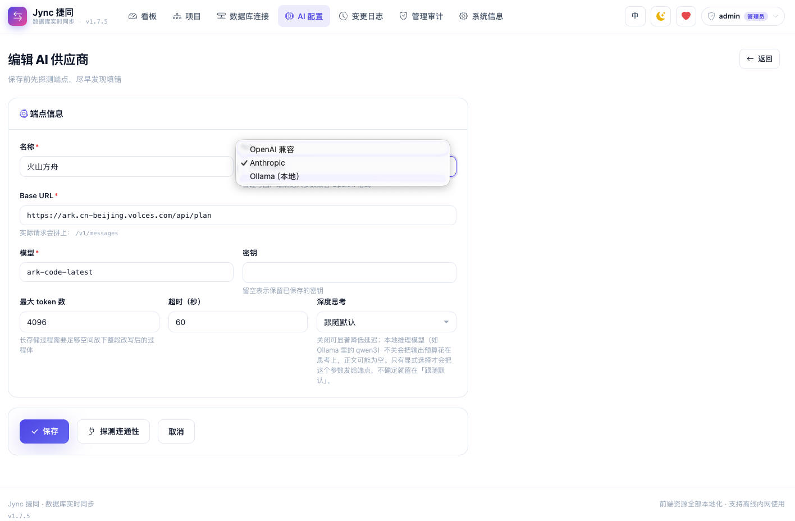

# Jync 捷同 · 异构数据库实时同步工具

> **Jync**，读作 "sync" —— **J** 代表 Java；**捷同**：敏捷同步，两库皆同。
> 单 JAR 开箱即用 —— 不要 Kafka，不要 ZooKeeper，不要一行代码。

**简体中文** | [English](README_EN.md)

[](LICENSE)
[](https://openjdk.org/)
[](https://spring.io/projects/spring-boot)


在**异构数据库**之间实时同步**结构与数据**的开箱即用 Web 应用：单个 jar 启动，浏览器点几下即可在**内置 17 种数据库（另支持自定义类型）之间任意两种**建立持续同步链路。增量检测默认轮询（零侵入），MySQL / Oracle / PostgreSQL / SQL Server 源库可切换**日志 CDC** 做到秒级延迟。Spring Boot 2.7 单体 + Thymeleaf 服务端渲染 + Quartz + H2 内嵌元数据库，**零外部依赖，内网离线可用**。

- 项目地址：<https://github.com/vfaner/jync>　国内镜像：<https://gitee.com/super_rgh/jync>
- 视频演示：<https://www.bilibili.com/video/BV1iHYJ6vEEd>（14 分钟，从建连接到实时同步）

---

## 界面速览

<table>
  <tr>
    <td align="center" width="50%"><br><sub><b>登录</b> · 口令门禁，初始密码未改时全页挂警告</sub></td>
    <td align="center" width="50%"><br><sub><b>看板</b> · 项目/连接/表数、24h 变更量与最近活动</sub></td>
  </tr>
  <tr>
    <td align="center"><br><sub><b>暗色主题</b> · 整套配色随 <code>data-theme</code> 一起换</sub></td>
    <td align="center"><br><sub><b>英文界面</b> · 中 / EN 一键切换，默认按时区推断</sub></td>
  </tr>
  <tr>
    <td align="center"><br><sub><b>连接管理</b> · 源 / 目标分栏，各自独立分页</sub></td>
    <td align="center"><br><sub><b>新增连接</b> · 类型选好后 JDBC URL 自动拼装，先测通再保存</sub></td>
  </tr>
  <tr>
    <td align="center"><br><sub><b>项目列表</b> · 多任务并行启停，分页可跳页</sub></td>
    <td align="center"><br><sub><b>新建项目</b> · 源与目标各选一条已测通的连接</sub></td>
  </tr>
  <tr>
    <td align="center"><br><sub><b>项目详情 · 轮询</b> · 逐表勾选、游标策略标注与手动指定</sub></td>
    <td align="center"><br><sub><b>项目详情 · 日志 CDC</b> · 位点 / 落后秒数 / 吞吐 / 跳过计数面板</sub></td>
  </tr>
  <tr>
    <td align="center"><br><sub><b>变更日志</b> · 对象、类型、行数、耗时与错误详情</sub></td>
    <td align="center"><br><sub><b>AI 配置</b> · 多供应商共存，同一时刻只启用一个</sub></td>
  </tr>
  <tr>
    <td align="center"><br><sub><b>新增供应商</b> · 保存前发真实请求探测端点</sub></td>
    <td align="center"><br><sub><b>AI 起草</b> · 候选 SQL 流式进编辑器，保存前人工审阅</sub></td>
  </tr>
  <tr>
    <td align="center" colspan="2"><br><sub><b>系统信息</b> · 运行参数、版本与更新内容只读集中展示</sub></td>
  </tr>
</table>

---

## 核心功能

| 分类 | 能力 |
|---|---|
| 项目 / 连接 | 多项目并行互不干扰；连接按源 / 目标分栏独立分页；保存前可测连通并预览自动拼装的 JDBC URL |
| 对象与结构 | 表 / 视图 / 存储过程分组勾选（搜索 + 批量）；目标库缺失时按目标方言自动建表 / 索引 / 视图 / 过程 |
| 方言适配 | 类型映射、函数名转换、标识符引号、分页语法、存储过程包装 |
| 实时同步 | 轮询（默认 2s）或 Cron 编排；四种日志 CDC（MySQL binlog / Oracle LogMiner / PG 逻辑解码 / SQL Server CDC），捞到数据立即进入下一轮、真空闲才休眠，秒级延迟 |
| 可靠性 | 全量按主键 keyset 分块 + 检查点续传；单列整数主键表内并行（上限 8）；重启从游标继续并补齐停机变更；写入全部幂等 |
| 控制与观测 | 启停 / 立即同步（运行中点击合并为一轮补跑）；看板 + 变更日志（CDC 期间按表 10s 聚合落点，带 SCN/LSN/ binlog 位点）+ 行数审计 |
| 前端 | 中 / 英切换（默认按时区推断）、昼夜主题（跟随系统）、无 CDN 无 webfont，静态资源约 440KB 全本地化 |

---

## 支持的数据库

MySQL、MariaDB、Oracle、SQL Server、DB2、PostgreSQL、OpenGauss、**达梦**、**人大金仓**、**OceanBase**、**TiDB**、**瀚高**、**海量**、**崖山**、**南大通用 (GBase)**、**神通 (Oscar)**、H2，以及**自定义数据库**（JDBC URL + 驱动类名 + 驱动 jar 路径，运行时动态加载）。

除 **GBase** 与 **神通** 外驱动均随包内置；这两家未在 Maven Central 发布官方构件，需自备 jar 并在连接配置填路径（独立 `URLClassLoader` 加载，不污染主程序）。驱动版本与许可证见 [THIRD_PARTY_LICENSES.md](THIRD_PARTY_LICENSES.md)。PolarDB 按兼容协议选 MySQL / PostgreSQL 类型即可。

---

## 快速开始

| 项 | 要求 |
|---|---|
| JDK | **17+**（Maven 3.6+ 仅构建时需要） |
| 端口 / 内存 / 磁盘 | 默认 `8080`；建议 ≥ 512MB 堆；预留 1GB |

```bash
git clone https://github.com/vfaner/jync.git   # 国内：git clone https://gitee.com/super_rgh/jync.git
cd jync && mvn clean package -DskipTests
java -jar target/jync.jar                      # 访问 http://localhost:8080
```

首次启动在**当前工作目录**创建 `./data`（H2 元数据库）与 `./logs`；请固定目录启动，或用绝对路径覆盖配置。

### 生产环境配置

jar 同级目录建 `application.yml`，只写要覆盖的键：

```yaml
server:
  port: 8080
spring:
  datasource:
    url: jdbc:h2:file:/opt/jync/data/jync;MODE=MySQL;AUTO_SERVER=TRUE
sync:
  # 加密密钥：全新部署留空即可，首次启动会自动生成强密钥并保存到数据库同目录的
  # <库名>.key（如 /opt/jync/data/jync.key）。想自己管密钥（环境变量 / Secret）再显式填写。
  #crypto-password: 请改成你自己的强口令
  #crypto-salt: 请改成你自己的16位十六进制盐
logging:
  file:
    path: /opt/jync/logs
```

```bash
java -jar jync.jar --spring.config.additional-location=file:./application.yml
```

> ⚠️ 必须用 `additional-location`（叠加覆盖），不要用替换式的 `spring.config.location`：后者会丢掉 jar 内置配置（i18n basename、`ddl-auto`、`app.github-url`），症状是登录页 `??login.title_zh_CN??`、全新部署不建表甚至启动失败。
>
> 🔐 `crypto-password` / `crypto-salt` 是数据库连接密码的 AES 加密密钥。**全新部署不用配**：首次启动会生成一个强密钥写到数据库同目录的 `<库名>.key`（如 `/opt/jync/data/jync.key`），之后每次启动都从那里读。两点务必记住：
> 1. **备份数据库时要连 `<库名>.key` 一起备份**——数据文件和服务都在、只丢了这个文件，已保存的连接密码就解不开了（在界面上重填即可恢复）。
> 2. **从旧版本升级过来的部署保持默认值不动**：发行包里的默认值是历史密文的解密钥匙，改了会让所有已存连接密码失效。
>
> 想自己管理密钥（比如统一走环境变量或 K8s Secret）就直接显式配置这两项，填了完全以你为准，不会再生成文件。

**后台常驻**：systemd 单元把 `ExecStart` 指向上面的启动命令（`WorkingDirectory=/opt/jync`，`Restart=always`）即可；快速验证用 nohup，同样建议带上外部配置：

```bash
cd /opt/jync
nohup java -jar jync.jar --spring.config.additional-location=file:./application.yml \
  > /dev/null 2>&1 &
```

**容器部署（Docker / Compose / Kubernetes）**：仓库自带多阶段构建 `Dockerfile`（运行镜像仅 JRE、非 root 运行、内置 HEALTHCHECK）、`docker-compose.yml` 与 `deploy/k8s/`（Kustomize）。一条命令起服务，元数据与日志落在宿主机 `./data`、`./logs`，重建镜像不丢数据：

```bash
docker compose up -d --build      # 或：docker build -t jync:1.7.5 . && docker run -d \
                                  #   -p 8080:8080 -v "$PWD/data:/app/data" -v "$PWD/logs:/app/logs" \
                                  #   --restart unless-stopped jync:1.7.5
```

环境变量覆盖、TLS、多实例扩容、镜像升级与排障见 [docs/deploy-container.md](docs/deploy-container.md)。

**升级**：停服 → 替换 jar → 启动，表结构随 `ddl-auto: update` 自动演进，**升级前备份 `./data`**；停机期间源库变更重启后自动补齐。设置页内置版本检查与一键升级（管理员）：先查 GitHub、5 秒不通转 Gitee，双源失败提示稍后重试；新版可在页面内直接下载替换 jar 并引导重启，详见下文「版本检查与一键升级」。

---

## 登录与权限

| 用户名 | 角色 | 初始密码 | 权限 |
|---|---|---|---|
| `admin` | 管理员 | `123456` | 全部操作 |
| `view` | 访客 | `123456` | 只读 |

首次启动种入（表非空则跳过，不重置任何人的密码）；**第一次登录后请立即改密**。权限按 HTTP 方法判定，只有一条规则：**POST 一律要求管理员** —— 访客能看全部页面与数据、能复制 SQL，但界面上没有任何写按钮，构造请求也会被拒。改密入口：右上角用户名 → 修改密码（`/account/password`）；密码 BCrypt 存储，**忘记无法找回**，只能删 `app_user` 对应行后重启重新种入。

---

## 使用流程

1. **数据库连接** → 新建源 / 目标连接 → 「测试连接」确认可用
2. **项目** → 新建项目，选定源库与目标库
3. **项目详情** → 勾选表 / 视图 / 存储过程，配置同步选项后保存
4. 「**立即同步**」验证一次，或「**启动同步**」开始持续增量
5. 「**变更日志**」查看每次同步明细

---

## 版本检查与一键升级

系统信息页的更新检查先查 GitHub API（单次请求默认 5 秒超时），失败或超时自动改查 Gitee；两边都不可达才提示「更新检查失败，稍后会自动重试」（失败结果缓存 1 分钟后台重试，成功缓存 10 分钟）。检查始终跑在后台线程，不阻塞页面渲染；纯内网可设 `app.update-check.enabled=false` 关闭。

发现新版本后，管理员可「**一键升级**」：弹窗中选择下载源（默认 Gitee），程序从该平台的发布附件下载新版 `jync.jar`，通过大小校验（接口提供大小时）与 zip 完整性校验后替换当前文件——旧文件保留为 `jync.jar.bak`，可随时手动回退。替换完成后选择「**立即重启**」（辅助脚本等旧进程退出后拉起新进程；新进程早期退出或端口一直未就绪时自动用 `.bak` 回滚并重启旧版）或「**稍后手动重启**」。升级成功、新版本真正启动后，下次开机会自动清理备份与标记文件。

---

## 增量检测策略

增量只有一条查询：`WHERE 游标列 > 上次游标 AND 游标列 <= 本次水位`。**一行能否被同步，只取决于游标列值有没有涨** —— 所以游标列必须是「改一行它就会变大」的列（如 `update_time`）；用 `id` 或 `create_time` 做游标时 UPDATE 永远同步不到。默认轮询模式不碰源库 binlog、不建触发器，只需一个只读账号；切换[日志 CDC](#日志-cdc)后 UPDATE / DELETE 直接可见，上述限制不复存在。

| 策略 | 触发条件 | 新增 | 更新 |
|---|---|:---:|---|
| `TIMESTAMP` | 存在符合「最后修改时间」命名约定的时间类型列 | ✅ | ✅ 前提是该列真被更新 |
| `ROW_SCN` | Oracle 且建表带 `ROWDEPENDENCIES`（行级 `ORA_ROWSCN`） | ✅ | ✅ 检测不到删除 |
| `IDENTITY` | 存在「创建时间」约定列或单列数字主键 | ✅ | ❌ |
| `FULL_COMPARE` | 无可用游标列且行数 ≤ `full-compare-max-rows` | ✅ | ✅ 每周期全表 upsert |
| `NONE` | 无可用游标列且表过大 | ❌ | ❌ 仅首次全量 |

命名约定按包含匹配、大小写不敏感（`UPDATE_TIME` / `UPDATED_AT` / `LAST_MODIFIED` 等判 `TIMESTAMP`；`CREATE_TIME` / `CREATED_AT` 等判 `IDENTITY`），且列类型必须确为时间类型。项目详情页可为每张表**手动指定游标列**（优先级高于自动识别；指定数字列仍得 `IDENTITY`，检测不到更新），`IDENTITY` / `NONE` 会显著标注原因。

**修改同步不过去的长期解**：给源表加一个真会变的列（MySQL：`ALTER TABLE t ADD COLUMN update_time DATETIME DEFAULT CURRENT_TIMESTAMP ON UPDATE CURRENT_TIMESTAMP`）。**补漏**：停止同步后点「重置进度」，下一轮全量重读 upsert 把漏掉的修改带过去 —— 但游标列问题不解决，下一条 UPDATE 仍会漏。

---

## 日志 CDC

轮询的延迟下限是轮询间隔，且看不到 DELETE。四种源库可按项目切换到日志 CDC，切换前工具执行**就绪探测**并逐项列出不满足项；详情页另有 CDC 状态面板（位点、落后秒数、吞吐、跳过计数、最近错误）。三个轮询引擎（LogMiner / PG / SQL Server）**有数据时本轮捞完立刻开下一轮（0 额外等待），只有真空闲才休眠**（默认 LogMiner / SQL Server 1s、PG 500ms，可按项目覆盖，下限 50ms；MySQL binlog 为推送协议本无轮询等待）；失败仍走指数退避。变更日志在 CDC 期间**按表聚合**：每张表每 10s 最多一条 `N upserts / M deletes（截至 SCN/LSN/binlog 位点）`，停止同步时补刷最后一个窗口，避免高峰期逐行刷爆元数据库（`sync.cdc.change-window-ms=0` 可关）。

**统一工作流**：① 记位点（全量装载**之前**写入，基线期变更不漏）→ ② 分块全量基线（复用轮询的分块 / 检查点机制）→ ③ 流式回放。一致性契约 **at-least-once**：先提交目标库、再复检租约、最后推进位点，崩溃后从上一位点重放，重叠窗口由幂等 upsert 吸收。

| 引擎 | 源库前提（探测逐项检查） | 位点 |
|---|---|---|
| MySQL binlog | ≥ 5.7（MariaDB 不支持）；`log_bin=ON`、`binlog_format=ROW`、`binlog_row_image=FULL`；`server_id` 不与 Jync 假 id（`server-id-offset` + 项目ID）冲突；账号具备 `REPLICATION SLAVE` + `REPLICATION CLIENT`；binlog 保留 ≥ 24h | binlog 文件 + 偏移（含 GTID 集） |
| Oracle LogMiner | ≥ 11g；`ARCHIVELOG` 模式；库级 `ALTER DATABASE ADD SUPPLEMENTAL LOG DATA`；表级 `ADD SUPPLEMENTAL LOG DATA (ALL) COLUMNS`；挖掘权限（`SELECT ANY TRANSACTION` 等）；无 LONG 列；归档保留 ≥ 24h。CDB 下须以公共用户（`C##`）在 CDB$ROOT 挖掘 | SCN |
| PostgreSQL 逻辑解码 | ≥ 9.4；`wal_level=logical`；账号具备 `REPLICATION`；表 `REPLICA IDENTITY` 非 `NOTHING` | LSN |
| SQL Server CDC | ≥ 2012；库级 `sp_cdc_enable_db`；SQL Server Agent 运行中；账号在 `cdc_Admin` / `cdc_reader`；每表已建 capture instance | LSN（20 位 hex） |

**共同边界**：不捕获 DDL（记 WARN 并失效结构缓存，差异大时用「重建基线」）；无主键表仅基线播种、流式阶段跳过；CDC 会复制 DELETE；切换即重新全量，切回轮询保留位点但游标清零先全量对齐。**故障处置**：位点失效（binlog / 归档 / WAL 被清）项目立即置 **ERROR** 等人处置，一键「重建基线」恢复；断线指数退避自动重连（1s 起步翻倍，上限 60s）。**多实例**：同一项目的 CDC 流靠租约互斥，持锁节点宕机后 ≤ 60s 被其他节点接管续传。

---

## 配置项

`application.yml` 的 `sync.*`：

| 键 | 默认 | 说明 |
|---|---|---|
| `poll-interval` | `2000` | 轮询间隔（毫秒） |
| `batch-size` / `fetch-size` | `500` / `1000` | JDBC 批次行数 / 源库读取批量 |
| `chunk-size` | `100000` | 全量每块行数，每块提交 + 写检查点；`0` 关闭分块 |
| `full-load-parallelism` | `1` | 单表全量并行 worker 数（仅单列整数主键表，上限 8） |
| `max-pool-size` / `max-retries` | `5` / `3` | 每库连接池上限 / 连续失败置 ERROR 的次数 |
| `safety-lag-ms` | `1000` | 时间戳水位线回退量，防晚提交事务被跳过 |
| `row-count-audit-interval-ms` | `60000` | 行数审计间隔（毫秒） |
| `full-compare-max-rows` | `20000` | 全表比对的行数上限 |
| `lock-ttl-ms` | `300000` | 同步锁租约时长（毫秒） |
| `sync.cdc.reconnect-backoff-ms` | `1000` | 日志 CDC 断线重连初始退避（毫秒），逐次翻倍 |
| `sync.cdc.reconnect-backoff-max-ms` | `60000` | 重连退避上限（毫秒） |
| `sync.cdc.server-id-offset` | `612000` | 假 replica server id 基数：实际 id = 偏移 + 项目ID |
| `sync.cdc.lock-ttl-ms` | `30000` | CDC 消费者租约时长（毫秒） |
| `sync.cdc.supervise-interval-ms` | `10000` | 各节点巡检抢占 CDC 租约的周期（毫秒） |
| `sync.cdc.connect-timeout-ms` | `10000` | BinaryLogClient 握手超时（毫秒） |
| `sync.cdc.logminer.batch-size` | `10000` | LogMiner `V$LOGMNR_CONTENTS` 单批读取行数 |
| `sync.cdc.logminer.idle-poll-ms` | `1000` | LogMiner 真空闲时的休眠间隔（毫秒）；有数据 0 等待立刻续采 |
| `sync.cdc.pg.idle-poll-ms` | `500` | PG 逻辑解码真空闲时的休眠间隔（毫秒） |
| `sync.cdc.mssql.idle-poll-ms` | `1000` | SQL Server CDC 真空闲时的休眠间隔（毫秒） |
| `sync.cdc.change-window-ms` | `10000` | CDC 变更日志按表聚合窗口（毫秒）；`0` 关闭聚合落点 |
| `crypto-password` / `crypto-salt` | *(留空即首启自动生成)* | 连接密码的加密密钥与盐（十六进制）。留空则首次启动生成并保存到 `<库名>.key`（与数据库同目录，须随数据库一起备份）；显式配置则以配置为准 |
| `ai.enabled` | `true` | 置 `false` 则 AI 菜单与接口一并下线 |
| `app.update-check.enabled` | `true` | 新版本检查（GitHub 优先、Gitee 兜底）；关闭后系统信息页不再出现升级入口 |
| `app.update-check.timeout-ms` | `5000` | 更新检查单次请求超时（毫秒），超时即切换备用平台 |

连接密码以 AES-256 加密存储（`enc:` 前缀防重复加密，兼容历史明文）。

---

## AI 辅助转换（可选）

存储过程的过程化控制流无法靠文本替换可靠翻译，`AI 配置` 提供另一条路：模型**起草候选**，人工审阅后落库。边界是硬的：AI 只产候选、永不参与同步（`StructureSyncService` 不调用任何 AI 代码）；候选经确认才写入 `ddlOverrides`；未启用供应商时不产生任何外部请求；`sync.ai.enabled=false` 可整体下线。

协议有**OpenAI 兼容**、**Anthropic** 和 **Ollama（本地）** 三种可选。Ollama 是预设不是第三种协议：它走 Ollama 的 OpenAI 兼容端点（`http://localhost:11434/v1`，不是原生的 `/api/chat`），选它会把地址自动填好、收起 API 密钥栏（本地模型本就不需要密钥），超时放宽到 300 秒。密钥与库密码同样加密存储；探测发一次 `max_tokens: 1` 的**真实请求**（TCP 探活会把密钥错、模型名错、路径差一段全部误报为成功），失败不阻止启用但列表红标。审阅页左右对照源定义与机械转换结果（即不干预时同步真正执行的语句），模型自述的「不确定项」列在 SQL 之上 —— 比 SQL 本身更值得先读。「语法检查」会在**目标库**以 `JYNC_AI_CHECK_<时间戳>` 真建一次对象再删除，仅手动触发并二次确认；通过只证明目标库接受这段 DDL，不证明语义等价。

每个供应商还有一个**深度思考**档位：`跟随模型默认` / `关闭` / `低` / `高`。**关闭思考对本地推理模型不只是省时间**：思考 token 计入输出预算，`max_tokens` 偏小时正文会被思考挤空，界面上表现为一直转圈然后报「模型返回了空内容」；本机 Ollama + `qwen3:8b` 实测同一请求关闭后快约 14 倍。落参按协议分流 —— OpenAI 形状发 `reasoning_effort`，Anthropic 发 `thinking.budget_tokens`（它不认 `reasoning_effort`，发过去就是 400）。Anthropic 的思考预算必须**严格小于** `max_tokens`，所以选低/高档后要把最大 token 数一并调大，保存时会校验并提示；`跟随模型默认`是默认值且**一个字段都不发**，因此升级不改变任何已有供应商的请求。探测永远不携带推理参数（它是 `max_tokens: 1` 的最小请求，带上必被端点拒）。

> ⚠️ 转换会把存储过程源码发往你配置的端点，内网 / 合规部署请接本地推理端点（本机装了 Ollama 就直接选「Ollama（本地）」预设，不出内网）并自行确认代码可外发。

---

## 与市面已有工具的对比

> 口径：各工具官方文档 / 开源版默认部署形态（截至 2026-09），仅针对「开箱即用的异构库持续同步」。

| 维度 | **Jync** | Debezium + Kafka | DataX | Kettle | Navicat / DBeaver 传输 |
|---|---|---|---|---|---|
| 部署形态 | **单个 jar** | Kafka + Connect + ZK | 客户端脚本 | 桌面 + 资源库 | 桌面客户端 |
| 配置方式 | **Web 点选** | YAML/REST + 消费端代码 | JSON 作业 | 图形 ETL | 向导 |
| 持续增量 | 轮询 / Cron + 日志 CDC（MySQL binlog、Oracle LogMiner、PG、SQL Server） | 日志级 | 不适用 | 部分（自建定时） | 不适用 |
| 结构同步 | **自动建表/索引/视图/过程** | 部分（落库自写） | 需预建表 | 部分 | 仅一次性 |
| 异构方言转换 | 类型/函数/引号/分页/过程 | 不支持 | 部分 | 部分（手工） | 部分 |
| 国产数据库 | **达梦/金仓/OceanBase 等 10 种一等公民** | 部分 | 部分 | 部分 | 部分 |
| 源库侵入 | **默认只读零侵入**；CDC 需复制权限仍只读 | 需开 binlog/wal | 只读 | 只读 | 只读 |
| 断点续传 / 幂等 | 游标持久化 + 主键 upsert | offset | 不适用 | 部分 | 不适用 |

**五个差异点**：① 一个 jar 对一套流式基础设施 —— 规模配不上运维成本时差距是决定性的；② 结构同步是一等公民，建表与类型映射不再是你自己的作业；③ 为国产库与信创迁移而生，各方言有专门实现而非「通用 JDBC 也许能连」；④ 默认轮询零侵入，一个只读账号即可；⑤ 解决「持续保持一致」而非「搬一次数」。

**什么时候不该用 Jync**：毫秒级延迟 → Debezium / Flink CDC；单表数亿行一次性初始化 → DataX；复杂 ETL（清洗、聚合、多流 join）→ Kettle / Flink；多主双向复制 → SymmetricDS。

---

## 架构

```
com.qqmu.jync
├── config           i18n、Quartz、Jackson、SecurityConfig、SyncProperties
├── controller       MVC；controller/api 为 REST 端点
├── service
│   ├── connection   DataSourceManager、DriverLoader、DriverShim、连接测试
│   ├── metadata     MetadataReader 各方言实现 + 快照服务
│   ├── monitor      ChangeDetector（结构差异）、CursorStrategyResolver
│   ├── converter    SqlDialect 各实现、类型映射、SQL 体转换
│   ├── sync         SyncEngine、DataSyncService、StructureSyncService、DdlExecutor
│   ├── ai           供应商配置、共享 HTTP 层、候选起草/校验、审阅编排
│   ├── task         Quartz 调度、三层锁、上下文装配、启动恢复
│   └── auth         账号种入、BCrypt 改密、UserDetailsService
├── model / repository / dto / util
```

游标推进与锁获取依赖 `REQUIRES_NEW` 事务语义，因此 `SyncStateWriter` / `SyncLockStore` / `SyncTaskStore` 拆为独立 Bean（同类自调用会绕过 Spring 代理使注解失效）。单实例执行靠三层锁：Quartz `@DisallowConcurrentExecution` → JVM 按项目 `ReentrantLock` → 带租约的数据库锁行（跨重启的那一层）。

---

## 测试

```bash
mvn test
```

1338 个单元测试，重点覆盖：各方言幂等 upsert 与类型上限不变量；SQL 正文改写不碰字面量 / 注释；游标策略解析与降级、Oracle 行级 SCN 探测；游标序列化往返；密码加密与 AI 密钥加密；AI 启用互斥与应答解析（含截断围栏、拒答、空应答）；推理档位按协议分流（OpenAI 形状落 `reasoning_effort`、Anthropic 落 `thinking.budget_tokens`）、预算塞不进 `max_tokens` 时宁可不思考也不让请求 400、预算不足在保存时即被拒、探测永不携带推理参数；Ollama 预设端点路径与未知协议名回落 OpenAI 兼容；候选校验在 H2 实库确认不留残留、同名对象内容不变；页面渲染全条件分支且无 `??`；授权规则（访客 POST 全拒、CSRF 缺失即拒）；分页窗口与省略号展开；立即同步补跑合并；分块全量 keyset SQL 形状、检查点生命周期、并行分段不重叠与 long 溢出回退；日志 CDC 探测七项、位点纪律（先数据后位点）、租约互斥与切换序列；版本检查 GitHub→Gitee 双通道兜底；一键升级的下载校验、改名替换与备份、marker 状态恢复、重启/回滚脚本生成；hidden 属性显示契约（作者 display 样式不得压过 hidden）；README 文档守卫。

真实库集成测试（`*IT`，不进默认套件，需 Docker）：`OracleMigrationHarnessIT`（Oracle 23ai：并行分段全量、kill 后续传、`ROWDEPENDENCIES` 全链路）、`CdcBaselineStreamingIT` / `CdcVolumeAndTypesIT` / `CdcResilienceIT`（MySQL 8 binlog：基线→流式、崩溃重跑、十万行一致、purge 与断线故障）。显式运行加 `-Dapi.version=1.44`。另有端到端脚本（H2 源/目标，20 项断言）覆盖全量、增量、幂等、DDL 传播、并发写入一致与停机补齐。

---

## 已知限制

- **存储过程转换**：机械差异可自动转换；PL/SQL / T-SQL / PL/pgSQL 的控制流无法可靠自动翻译，失败时给具体错误，可在转换审阅页保存手工覆盖（AI 候选仍需人工确认）。
- **语义等价无保证**：游标行为、隐式事务边界、异常控制流、`NULL` 拼接语义不体现在语法上，关键过程务必在目标库实测。
- **语法检查残留**：进程在建 / 删临时对象之间被强杀会残留 `JYNC_AI_CHECK_*`（v1.3.0 之前为 `SYNCTOOL_AI_CHECK_*`），列表页不会自动发现。
- **行删除检测**：无源库审计表时仅对行数低于 `full-compare-max-rows` 的表启用。
- **无主键表**：无法保证幂等，重放可能重复，工具会告警。
- **目标库写入方**：假定目标库仅由本工具写入。
- **延迟**：轮询下限即轮询间隔；MySQL 源可切日志 CDC 拿秒级延迟，其余源库按需扩展日志解析。

---

## 参与贡献

| 渠道 | 账号 |
|------|------|
| QQ | 817094 |
| QQ | 2912167928 |
| QQ 群 | 426669837 |
| 微信 | qqmu66 |
| 邮箱 | [vfaner@88.com](mailto:vfaner@88.com) |
| 官网 | <https://jync.qqmu.com> |

应用内「设置 → 项目与作者」中的 QQ / QQ 群可直接点击唤起 QQ（个人号打开临时会话、群打开群资料卡）。

Issue 与 PR 欢迎：[GitHub](https://github.com/vfaner/jync) · [Gitee](https://gitee.com/super_rgh/jync)。觉得有用请点个 Star ⭐

## 许可证

[MIT License](LICENSE)，商业与非商业用途均可。内置第三方 JDBC 驱动各自适用原厂许可证，见 [THIRD_PARTY_LICENSES.md](THIRD_PARTY_LICENSES.md)；GBase 与神通驱动不随本项目分发。
