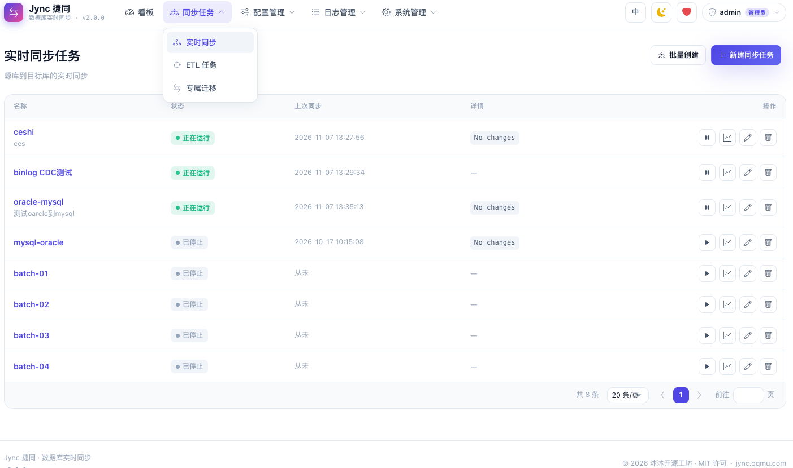
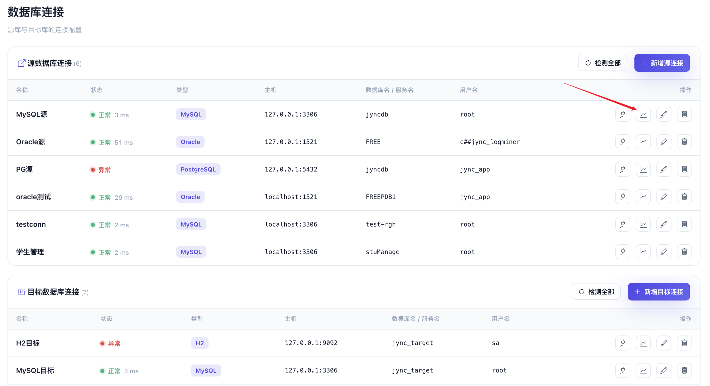

# Jync · Real-time Heterogeneous Database Synchronization

> **Jync** — **J** for Java, **ync** for sync. A single-JAR engine for heterogeneous databases:
> chunked parallel full loads, read-only incremental polling, and second-level log CDC, plus
> SQL-driven ETL, dedicated migrations and Redis cache projections.

**English** | [简体中文](README.md)

[](LICENSE)
[](https://openjdk.org/)
[](https://spring.io/projects/spring-boot)
[](https://github.com/vfaner/jync/releases/tag/v2.4.5)
[](https://hub.docker.com/r/vfaner/jync)
[](https://github.com/vfaner/jync)
[](https://gitee.com/super_rgh/jync)


Jync is an open-source tool for **database migration and heterogeneous data integration**:
start one jar, open the browser, and build continuous **schema + data** synchronization between
**35 database types** (19 domestic / Xinchuang, custom JDBC types included). Three non-JDBC **dedicated migrations** cover
Elasticsearch / OpenSearch → Easysearch, MongoDB → MongoDB, and MongoDB → KingbaseES.

No Kafka, Flink or ZooKeeper, and no job code to write. Apache-2.0 licensed and fully
self-hostable, including air-gapped networks. **v2.4.5** adds table/column comment sync and a
project-level cursor-column priority, plus fixes for Vastbase, Dameng CDC and MySQL type precision.

## Highlights

- **One JAR, zero dependencies**: Spring Boot monolith + Thymeleaf SSR + Quartz + embedded H2
  metadata store. Offline-ready.
- **Fast, safe full loads**: primary-key keyset chunks, per-table parallelism, streamed result
  sets, per-chunk commits and checkpoints — about **40 seconds for a 10M-row table** in our
  test (~250k rows/s; depends on row width, indexes, network and target write capacity).
- **Light incremental sync**: polling reads only rows after the cursor with a read-only account;
  six engines can switch to log CDC for second-level latency.
- **Schema travels with data**: missing targets are created with tables, indexes, views and
  routines; type mapping and function conversion are built in.
- **Resumable by design**: stop, network loss or kill -9 all resume from checkpoints; writes are
  idempotent and changes made while down are replayed on restart.
- **Three roles with ownership**: admin / operator / viewer. Operators see everything but only
  write their own resources.
- **Alerts that reach you**: sync failures, CDC stalls, drift and unhealthy connections can be
  pushed to DingTalk, WeCom, Feishu or a custom webhook.
- **Comments travel too**: SQL Server sources read `MS_Description`; Oracle, PostgreSQL, DB2,
  HANA and SQL Server targets write table/column comments, MySQL-family targets keep inline `COMMENT`.
- **One cursor policy for the schema**: project-level tags match candidate cursor columns per table,
  case-insensitively and with fallback; per-table overrides still win.
- **Performance you can see**: dashboard rings, per-task performance pages and Prometheus metrics
  for throughput, lag, row counts, connections and database QPS.
- **Optional AI agent**: ask about task state, per-table progress, performance and alerts in natural language,
  self-check a stalled CDC stream, **paste an error log for analysis**, or draft a task from a description.

## Screenshots

<table>
  <tr>
    <td align="center" width="33%"><a href="docs/images/jync_kanban.png" target="_blank" rel="noopener"></a><br><sub><b>Dashboard</b> · resources, tasks and a 24h trend</sub></td>
    <td align="center"><a href="docs/images/jync_xiangmu.png" target="_blank" rel="noopener"></a><br><sub><b>Sync tasks</b> · state, last sync and details</sub></td>
    <td align="center"><a href="docs/images/jync_db.png" target="_blank" rel="noopener"></a><br><sub><b>Connections</b> · source and target side by side</sub></td>
  </tr>
</table>

> More screens (log CDC, performance curves, column cleaning, alerts, dark theme) are on the
> [features page](https://jync.qqmu.com/features.html).

## AI agent (optional)

AI is only an **assistant** and never part of the sync path: with no provider enabled it makes
no outbound request, and `sync.ai.enabled=false` removes the feature entirely.

<table>
  <tr>
    <td align="center" width="50%"><a href="docs/images/jync_ai_kefu.png" target="_blank" rel="noopener"></a><br><sub><b>AI agent</b> · ask, diagnose and self-check</sub></td>
    <td align="center"><a href="docs/images/jync_xiangmu_suoyin_ai.png" target="_blank" rel="noopener"></a><br><sub><b>AI-drafted conversion</b> · candidate SQL, reviewed before saving</sub></td>
  </tr>
  <tr>
    <td align="center" width="50%"><a href="docs/images/jync_ai.png" target="_blank" rel="noopener"></a><br><sub><b>AI providers</b> · protocol, model and reasoning effort</sub></td>
    <td align="center"><a href="docs/images/jync_ai_add.png" target="_blank" rel="noopener"></a><br><sub><b>Add provider</b> · endpoint probe, encrypted key</sub></td>
  </tr>
</table>

- **Ask instead of clicking**: task details, per-table progress, throughput, row counts,
  database metrics, active alerts and the latest ETL result all have read-only tools.
- **Structured troubleshooting**: for a stalled CDC stream it checks every prerequisite
  (connection, privileges, position, skip counters) and answers evidence-first.
- **Runtime changes stay on the page**: the agent prepares the action and its impact; execution
  is started from the page button and re-checks role and ownership. It can tune project
  parameters (batch size, parallelism, poll interval, CDC idle poll, cursor columns, cron) and a
  connection's JDBC extraParams on stopped tasks via confirmation cards; it cannot run SQL, edit
  other configuration or delete tasks, and connection identity fields and application.yml
  properties are advice only.
- **Knowledge ships with the jar**: parameters, prerequisites and known limits come from the
  bundled documentation, never from the internet.
- **Any model**: OpenAI-compatible (including self-hosted), Anthropic, Ollama (native and
  compatible). Keys are encrypted at rest and never echoed.

## Supported databases

**35** preset types, 25 drivers bundled. The capability map below shows the JDBC sync / ETL matrix
and the separate dedicated-migration chains.

[](https://jync.qqmu.com/database.html)

- **Six log CDC engines**: MySQL binlog, Oracle LogMiner, DM LogMiner, PostgreSQL logical
  decoding, SQL Server CDC, YashanDB YStream.
- **Source-only engines**: Doris, ClickHouse, Hive, Impala, TDengine, Elasticsearch and MongoDB
  have no log CDC — polling or full comparison only.
- **Redis is a target**: each row is projected to a JSON / HASH entry via CDC, with TTL, prefix
  sweep and baseline rebuild.
- **Custom databases**: JDBC URL + driver class + driver jar, loaded at runtime in an isolated
  class loader.
- **Driver not bundled**: GBase, ShenTong Oscar, GaussDB, SAP HANA, ClickHouse, Hive, Impala,
  TDengine, Elasticsearch and MongoDB artifacts cannot be redistributed.

### CDC prerequisites (checked by the task-page self-check)

- **MySQL binlog**: `binlog_format=ROW`, `binlog_row_image=FULL`, and the account needs
  `REPLICATION SLAVE` and `REPLICATION CLIENT`.
- **Oracle LogMiner / DM LogMiner**: `ARCHIVELOG` enabled plus database- or table-level
  `SUPPLEMENTAL LOG DATA (ALL) COLUMNS`.
- **PostgreSQL family**: `wal_level=logical`; SQL Server needs database-level CDC; YashanDB
  YStream needs supplemental logging per table.
- The default polling mode never reads the source's binlog and installs no triggers, so a
  read-only account is enough. Full list: [configuration](docs/configuration.md).

## Quick start

| Item | Requirement |
|---|---|
| JDK | **17+** |
| Port | `8080` by default |
| Memory / disk | heap ≥ 512 MB, about 1 GB free |
| Working directory | fixed: `./data` (metadata and keys) and `./logs` |

Download `jync.jar` from [Gitee Releases](https://gitee.com/super_rgh/jync/releases/latest) or
[GitHub Releases](https://github.com/vfaner/jync/releases/latest); build from source with
`mvn clean package -DskipTests` (artifact: `target/jync.jar`).

```bash
mkdir -p /opt/jync && cd /opt/jync
java -Xms512m -Xmx2g -Duser.timezone=Asia/Shanghai \
  -jar jync.jar --spring.config.additional-location=file:./application.yml
```

Container deployment (official images built by GitHub Actions on tags, **linux/amd64 (x86_64) and linux/arm64 (aarch64)**; aarch64 is ARM64 and Docker selects it automatically):

```bash
docker pull vfaner/jync:2.4.5
docker compose -f docker-compose.release.yml up -d
# Mirror: ghcr.io/vfaner/jync:2.4.5; in a container upgrade by pulling the new image
```

Open `http://<host>:8080` and sign in with `admin / 123456`, `ops / 123456` or `view / 123456`;
the first login forces a password change. Production deployment, external metadata stores,
Docker / Kubernetes, HTTPS and upgrade/backup are covered in the
[operations guide](https://jync.qqmu.com/docs/jync-ops-guide.pdf) and
[deployment notes](docs/deploy-container.md).

> Use `--spring.config.additional-location` (layered override), not `spring.config.location`,
> or the jar's built-in configuration is lost.

## Stack and architecture

**Stack**: Java 17 · Spring Boot 4.1 · Spring Data JPA / Hibernate · Quartz · H2 / MySQL /
PostgreSQL metadata store · Thymeleaf SSR · vanilla JavaScript (no CDN, no frontend build).

```text
com.qqmu.jync
├── config / controller / dto / model / repository   configuration, MVC and models
├── service
│   ├── connection / metadata / converter            connections, metadata and dialects
│   ├── sync / cdc / etl / migration                 four data paths
│   └── alert / task / lob / ai                      alerts, scheduling and locks, LOB, AI
└── util                                             utilities
```

- **Three lock layers**: Quartz `@DisallowConcurrentExecution` → per-task JVM `ReentrantLock` →
  database lease (across restarts and instances).
- **Path isolation**: sync and ETL use JDBC connections; dedicated migrations have their own
  connection model and run history.

## Docs and tests

- **Configuration and tuning**: [docs/configuration.md](docs/configuration.md)
- **Container deployment**: [docs/deploy-container.md](docs/deploy-container.md)
- **Security and data boundary**: [docs/security-data-boundary.md](docs/security-data-boundary.md)
- **Known limitations**: [docs/known-limitations.md](docs/known-limitations.md)
- **Verification matrix**: [docs/verification-matrix.md](docs/verification-matrix.md)
- **Release notes**: [docs/release-notes/](docs/release-notes/)

`mvn test` runs 6772 unit tests (6768 pass; 3 TLS certificate cases depend on the local certificate setup and 1 Linux-only case is skipped on macOS) covering dialect and SQL rewriting, full loads and resume, the
six CDC engines, Redis projection, dedicated migration, ETL, alerts, ownership, the AI assistant
and security. Real-database `*IT` suites need Docker; commands are in the verification matrix.

## Contributing

| Channel | Account |
|---|---|
| QQ | [817094](https://wpa.qq.com/msgrd?v=3&uin=817094&site=qq&menu=yes) / [2912167928](https://wpa.qq.com/msgrd?v=3&uin=2912167928&site=qq&menu=yes) |
| QQ group | [426669837 · Mumu Open Source Workshop](https://qun.qq.com/universal-share/share?ac=1&authKey=xm%2BfgdraFGDpH8GHkV4DbuMjArg6BsPdNnXKUqcWvFXI1ocS56TcioSRYOVBvn5Q&busi_data=eyJncm91cENvZGUiOiI0MjY2Njk4MzciLCJ0b2tlbiI6Ind0V1pMYlVieXJkQmtnMVgveUFsOHFnbFhTd28wUE03dy9uVUErVExBdnlkMENnMis0UmhqWlJjcURzRHFnUEMiLCJ1aW4iOiI4MTcwOTQifQ%3D%3D&data=tZVIfZoO6N9QWSJE6ZbdZR15OmuLpSVucid5TicWYaMgb9Go1B975NZk0iZOo69AEzXQ4XucFtenImLltzFI5w&svctype=4&tempid=h5_group_info) |
| WeChat | qqmu66 |
| Email | [vfaner@88.com](mailto:vfaner@88.com) |
| Website | <https://jync.qqmu.com> |

Bug reports, feature requests and PRs are welcome. If Jync helps you, a **Star** ⭐ is appreciated.

## License

[Apache License, Version 2.0](LICENSE): commercial use, modification and private deployment are
allowed. Bundled third-party JDBC drivers keep their own licenses — see
[THIRD_PARTY_LICENSES.md](THIRD_PARTY_LICENSES.md).

Maintained by Mumu Open Source Workshop: GitHub [@vfaner](https://github.com/vfaner),
Gitee [@super_rgh](https://gitee.com/super_rgh), AtomGit [@vfaner](https://atomgit.com/vfaner).
Apache-2.0 does not grant trademark rights; use of the Jync name and logo is covered by
[TRADEMARK.md](TRADEMARK.md).
