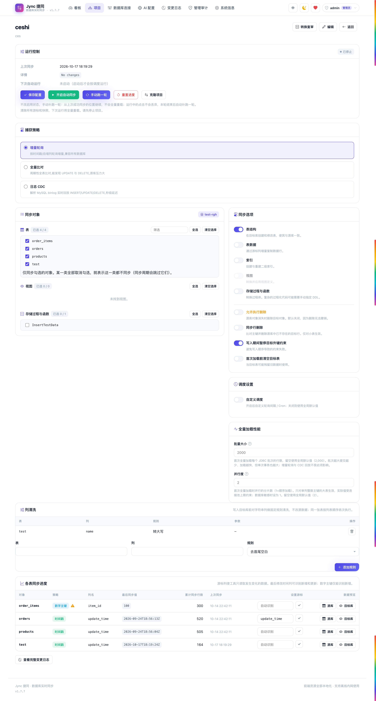
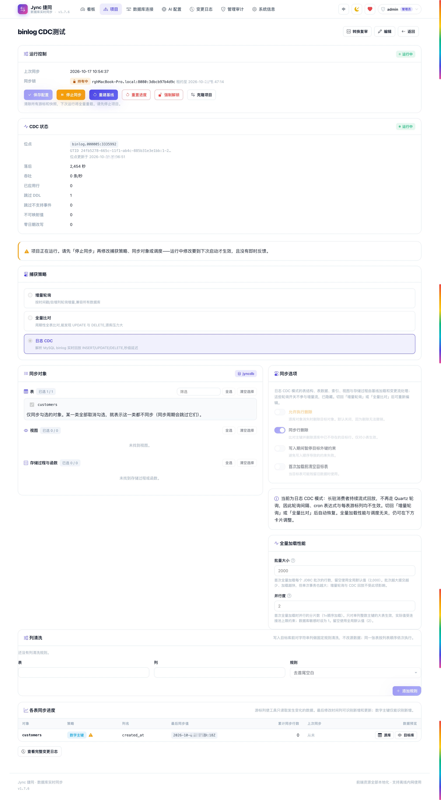

# Jync · Real-Time Heterogeneous Database Sync

> **Jync**, pronounced exactly like "sync" — the **J** stands for Java.
> A minimal four-letter coinage and a member of the J-family (sibling project: Jargus, a Java code-review platform).
> One JAR, ready to run — no Kafka, no ZooKeeper, not a single line of code.

[简体中文](README.md) | **English**

[](LICENSE)
[](https://openjdk.org/)
[](https://spring.io/projects/spring-boot)


A ready-to-run web application that keeps **schema and data** in sync **across heterogeneous databases** in real time. Start a single jar, click a few times in your browser, and **any two of the 26 built-in database types (plus a custom type)** form a continuous sync link — Oracle → PostgreSQL and MySQL → Dameng are just two examples among them — **no Kafka, no ZooKeeper, not a single line of code.**

- Releases: GitHub <https://github.com/vfaner/jync/releases/latest> · Gitee <https://gitee.com/super_rgh/jync/releases/latest>
- Website: <https://jync.qqmu.com>
- Demo video: <https://www.bilibili.com/video/BV1iHYJ6vEEd> (Bilibili, ~19 min; narration in Chinese)

Stack: Spring Boot 2.7 monolith + Thymeleaf server-side rendering + Quartz scheduling + embedded H2 metadata store. **Zero external dependencies, fully usable on an air-gapped intranet.**

---

## Project Background

- **Grown out of real migration projects.** In domestic IT localization (信创) programs, existing MySQL / Oracle / SQL Server databases must move to Chinese databases and then stay consistent for the long term. Commercial sync tools charge per node; open-source options such as Debezium require a full Kafka stack first — both the deployment and the operations burden are substantial.
- **Turning synchronization into deliverable software.** We distilled the sync logic used repeatedly in internal projects into a single-jar web application: implementation engineers create connections, pick tables and start syncing from a browser, without writing job scripts or maintaining a message queue.
- **Domestic databases as first-class citizens.** Dameng, KingBase, OceanBase, TiDB, GoldenDB, TDSQL, PolarDB, GreatDB, UPDRDB, KunDB, RASESQL, SeaboxSQL, HighGo, Vastbase, YashanDB, GBase, Oscar and OpenGauss are preset options, with Chinese-first UI and documentation.
- **Domestic open source, privately deployable.** Released under the MIT License: auditable, free of cloud dependencies, and suitable for air-gapped and localized environments. Maintained by **Mumu Open Source Workshop (沐沐开源工坊)**; official website <https://jync.qqmu.com>.

---

## Table of Contents

- [Project Background](#project-background)
- [Screenshots](#screenshots)
- [Features](#features)
- [Comparison With Existing Tools](#comparison-with-existing-tools)
- [Supported Databases](#supported-databases)
- [Deployment](#deployment)
- [Login & Roles](#login--roles)
- [Workflow](#workflow)
- [Data Preview, Project Cloning & Column Cleansing](#data-preview-project-cloning--column-cleansing)
- [Concurrency & Consistency Design](#concurrency--consistency-design)
- [Incremental Detection Strategies](#incremental-detection-strategies)
- [Binlog CDC (MySQL)](#binlog-cdc-mysql)
- [Log CDC (Oracle LogMiner)](#log-cdc-oracle-logminer)
- [Log CDC (PostgreSQL logical decoding)](#log-cdc-postgresql-logical-decoding)
- [Log CDC (SQL Server CDC)](#log-cdc-sql-server-cdc)
- [Large Objects and Streaming](#large-objects-and-streaming-v178)
- [Configuration](#configuration)
- [AI-Assisted Conversion (optional)](#ai-assisted-conversion-optional)
- [Architecture](#architecture)
- [Documentation](#documentation)
- [Tests](#tests)
- [Known Limitations](#known-limitations)
- [License](#license)

---

## Screenshots

### Sign-in — one password stands between the jar and your connections

Username and password, with theme and language switchable from the top-right corner at any time. Until the default password is changed, every page carries a red warning at the top — dismissable for the session, but back as soon as the browser reopens, and gone for good only once the password actually changes.


### Dashboard — the whole sync posture on one screen

Project count, connection count, synced tables, 24-hour change volume, and a recent activity feed. The project overview and the activity feed show **at most five rows each**, so the dashboard never grows with the log; the card headers link through to the full project list and change log.


### Dark theme — the whole palette moves, not just the background

One toggle in the top-right corner. Dashboard, cards, tables, and icons all follow, instead of a black background left studded with glaring light-mode controls. The toggle's moon / sun icon is fixed golden yellow, legible on either palette.


### Bilingual UI — one click switches the whole interface

The "中 / EN" button in the navbar flips every menu, form, status, and error message between Chinese and English; the choice is remembered in the browser. Until the user picks one explicitly, the default language is inferred from the browser timezone.


### Database connections — sources and targets in separate lists, test before you save

Connections are split by purpose into a Source table and a Target table, each paginated on its own; the project form's source and target selectors only offer connections from the matching list, so the two sides can no longer be mixed up.


### Adding a connection — 26 presets, and the URL writes itself

Choose Source (data is read from it during sync) or Target (data is written into it), then pick from 26 preset database types — including the major Chinese databases — and fill in host, port, and database name. The default port follows the type, the JDBC URL is assembled for you, and the connection can be tested before saving; the password is encrypted on the way into storage. Nearly every driver ships inside the distribution; for GBase, Oscar, Huawei GaussDB, and custom drivers, point at a jar and it loads dynamically.


### Projects — many pipelines in parallel, start and pause at will

Each project is one source → target pair, independently startable and pausable, with status and last-sync time at a glance. The list is paginated — twenty rows per page by default, with 15 / 20 / 30 / 50 / 100 selectable in the footer plus a jump-to-page box; long page ranges collapse into ellipses, and clicking an ellipsis widens that side by five pages in place instead of laying out every number at once.


### New project — one tested connection per side

Fill in the name and description, pick one tested connection from each of the source and target lists; saving lands you on the project detail page to choose sync objects.


### Project detail — per-table selection with visible cursor strategy

Tables / views / stored procedures grouped for selection, with search and bulk actions. Every table's incremental detection strategy is labeled inline — `IDENTITY` and `NONE` are called out prominently, because they mean updates may not propagate. Clicking "Sync now" while a cycle is in flight is not discarded: one extra round runs automatically once the current round releases the lock, and any number of clicks coalesce into exactly one such rerun.




### Schedule settings — polling interval or Cron, per project

Polling and full-compare projects can turn on **Custom schedule** to override the global 2-second poll interval with a millisecond value or a Quartz Cron expression (6 or 7 fields, seconds first). Cron takes precedence; leaving a field blank falls back to the global default. Streaming CDC projects hide this card entirely — their long-running consumer replays the log continuously and does not use Quartz.


### Full-load performance — batch size and parallelism

**Batch size** controls rows per JDBC batch during the initial full load (default 2000, range 1–20000). **Parallelism** controls how many chunk workers load a large table with a single-column integer primary key (default 2, up to 8); the effective value is capped again by the connection pool. Both settings apply only to the initial full load and CDC baseline rebuilds — incremental polling and CDC replay keep their own batch settings. On a database under pressure, set parallelism to 1 and lower the batch size.


### Column cleansing — rules run just before the write

Add rules per table and column; they run in the order listed, in memory, just before values are written to the target, so source data is never modified. Supported rules: trim leading/trailing whitespace, upper case, lower case, blank → `NULL`, strip prefix, strip suffix, and regex replacement (with `$1` group references). Only string columns are touched; numbers and dates pass through untouched. Regex arguments and replacement strings are validated when the rule is saved, and a damaged stored rule is skipped at runtime rather than stopping the sync.


### Change log — every change is traceable

Object name, change type, affected row count, elapsed time, and full error detail. The same pager as the project list; from page two on, auto-refresh is disabled with the reason in its tooltip — the log is newest-first, so an arriving entry would otherwise shuffle the rows you are reading downwards.


### AI providers — several configured, exactly one active

Enabling another switches the current one off. The list shows the protocol, the model, and the last probe result; rendering it never reaches out to the network.


### Adding a provider — probe the endpoint before saving

The key is encrypted like a database password. The probe sends a real request rather than a TCP check — a wrong key, a misspelled model, and a base URL that is one path segment off are invisible to anything less.


### AI drafting — the candidate streams into the editor

`Draft with AI` on the review page sends the source procedure body to the active provider and the candidate streams into the editor as it is produced, instead of arriving in one blob when the timeout is nearly up. When the draft finishes the page shows a single reminder: the output is a candidate only — run it against the target database yourself before saving it as an override. The editor renders SQL with DBeaver-style highlighting (keywords, strings, numbers and comments in separate colours); the green banner in the shot is the target accepting the statement from the temporary-object syntax check.


### System information — runtime settings and version on one page

Instance ID, Java version, scheduled project count, sync defaults, and the concurrency/recovery safeguards are gathered as read-only info. The version card shows the running version, the latest release, and this version's release notes. The update check runs in the background and never slows the page down — it queries the GitHub API first (5 s per-request budget) and falls back to the Gitee mirror on any failure; only when both are unreachable does the card report a failed check and retry later. On an air-gapped intranet the local version number and bundled notes still render normally, and `app.update-check.enabled=false` turns the whole check off.

When a newer release exists, admins get a **one-click upgrade**: pick a download mirror in the dialog (Gitee by default), and the app downloads the new `jync.jar` release asset, verifies it (byte size where the API provides one, zip integrity always) and renames it into place — the running jar survives because every supported platform allows renaming an open jar. The old file is kept as `jync.jar.bak` for a manual rollback. Afterwards choose **Restart now** (a detached helper script waits for the old process to exit, relaunches the jar, and restores the backup automatically if the new process dies or never opens the port) or restart manually later. Once the new version has really booted, the next start-up cleans up the backup and marker files.


---

## Features

| Area | Capability |
|---|---|
| **Project management** | Configure source/target databases; run many projects in parallel without interference |
| **Connection management** | Connections are classified as source or target, shown in separate paginated lists; existing connections are categorized automatically on upgrade |
| **Connection testing** | Verify connectivity before saving; preview the auto-assembled JDBC URL |
| **Object selection** | Tables / views / stored procedures, all selected by default, with search and bulk checkboxes |
| **Sync scope** | Table schema, table data, indexes, views, stored procedures and functions |
| **Auto object creation** | Missing objects are created in the target using the target's dialect |
| **SQL dialect adaptation** | Type mapping, function-name conversion, identifier quoting, pagination syntax, stored-procedure wrapping |
| **Real-time sync** | Polling (2s default), or precise orchestration via Cron expressions; four log-CDC engines (MySQL binlog / Oracle LogMiner / PG logical decoding / SQL Server CDC), each switchable per project — a drained cycle starts the next one immediately (zero extra wait) and only a truly idle cycle sleeps, for second-level latency that captures DELETEs too |
| **Crash recovery** | Resumes from the last cursor after a restart; changes made while down are backfilled |
| **Chunked initial load** | The full load commits and checkpoints per primary-key keyset chunk; an interruption resumes at the last chunk instead of re-reading the whole table |
| **Parallel full load** | Keyed tables split into disjoint ranges copied in parallel: integer leading keys arithmetically (MIN/MAX), other key shapes on sampled boundaries (`sync.full-load-parallelism`, capped at 8) |
| **Start/stop control** | Start or pause anytime; manual "Sync Now" supported |
| **Sync-now rerun** | A click during a run is not discarded: one extra round follows automatically, and repeated clicks coalesce into one |
| **Change records** | Object, change type, row count, duration, and error detail for every run |
| **Dashboard** | Projects, connections, synced tables, 24-hour change volume, recent activity; overview and feed capped at five rows each |
| **Pagination** | Project and change-log lists paginate at 20 rows/page by default, with 15/20/30/50/100 selectable, jump-to-page, and in-place ellipsis expansion |
| **i18n** | Chinese / English switch; default language inferred from browser timezone |
| **Theming** | Light/dark toggle; follows the OS until the user picks one |
| **Fully local frontend** | No CDN, no webfont, zero outbound requests at runtime — works offline |

### Frontend Design

Indigo-to-pink gradient accent (`#4f46e5` → `#ec4899`), soft shadows, glassmorphic navbar. Styles are hand-written CSS plus design tokens (CSS variables) — **no framework, no build step.**

**Theme switching**

- The theme lives on `<html data-theme="dark|light">` and only overrides CSS variables, so components need no second set of dark rules
- Storage key `jync-theme` (localStorage)
- **Follows the OS** `prefers-color-scheme` until the user has chosen explicitly, and reacts live to OS theme changes; once the toggle is clicked, the user's choice wins permanently
- An inline `<head>` script applies the theme before first paint, so dark-mode users never see a white flash

**Default language resolution** (highest priority first)

| Priority | Source | Notes |
|---|---|---|
| 1 | Language cookie | An explicit click on the language button always wins |
| 2 | **Browser timezone** | `Asia/Shanghai`, `Asia/Hong_Kong`, `Asia/Taipei`, `Asia/Macau`, … → Chinese; everything else → English |
| 3 | `Accept-Language` | Fallback for the very first request, before the timezone is reported |
| 4 | Simplified Chinese | Final default |

**Why timezone outranks `Accept-Language`:** overseas Chinese users often run an English-language browser while sitting in a Chinese timezone. Timezone is the better signal for "which language do you actually want to read."

Because rendering is server-side, the language must be decided before render, so a frontend script probes the timezone and writes the `JYNC_TZ` cookie; the server's `TimezoneAwareLocaleResolver` reads it to pick the Locale. On a first visit, if the rendered language disagrees with the timezone inference, the page refreshes once; after an explicit language choice it never refreshes again.

**Offline / intranet ready** — every frontend asset lives in the repo, and **no external request is made at runtime**:

| Asset | Notes |
|---|---|
| `css/app.css` | Hand-written styles, including design tokens and the dark theme |
| `js/theme.js`, `js/app.js` | Vanilla JS — no jQuery, no framework |
| `vendor/css/bootstrap-icons.min.css` + `vendor/fonts/*.woff2` | Icon font, self-hosted |
| `vendor/favicon.svg` | Inline gradient SVG |

Typography uses the system font stack (`PingFang SC` / `Microsoft YaHei` / …) — **no webfont**. Small graphics like dropdown arrows are inline `data:` URIs. Total static payload is roughly 440 KB. To verify: fetch any page's HTML and count external `http(s)` URLs in `src`/`href` — the answer is **0**.

---

## Comparison With Existing Tools

### At a glance

> Basis of comparison: the table below reflects each tool's official documentation / open-source edition in its default deployment (as of 2026-09), and covers only the "out-of-the-box continuous sync across heterogeneous databases" scenario. Every tool has its own positioning and strengths; for scenarios where Jync is the wrong fit, see "When **not** to use Jync" below.

| Dimension | **Jync** | Debezium + Kafka | Canal | Flink CDC | DataX | Kettle | SymmetricDS | Navicat/DBeaver transfer |
|---|---|---|---|---|---|---|---|---|
| **Deployment** | **One jar** | Kafka + Connect + ZK/KRaft | Canal Server (+MQ) | Flink cluster (JM/TM) | CLI scripts | Desktop + repository | Engine on every node | Desktop client |
| **External deps** | **None** | Kafka, ZooKeeper | ZooKeeper (cluster) | Flink, checkpoint store | None (but JSON jobs) | JVM + plugins | Triggers in source DB | None |
| **How you configure it** | **Click in a web UI** | YAML/REST + consumer code | Config file + client code | SQL/DataStream code | JSON job files | Drag-and-drop ETL | properties + create triggers | Wizard |
| **Time to first sync** | **Minutes** — download the jar, start, click | Days — stand up Kafka first, then write consumer code | Hours — server + client code | Days — Flink concepts and code | Hours — hand-written JSON jobs | Days — ETL job/transformation model | Hours — properties + triggers | Minutes — wizard, but one-shot only |
| **Continuous incremental sync** | Supported: polling/Cron & log CDC (MySQL binlog, Oracle LogMiner) | Supported: log-based | Supported: binlog | Supported: log-based | N/A (one-shot batch by design) | Partial (roll your own scheduling & delta logic) | Supported: trigger-based | N/A (one-shot transfer by design) |
| **Schema (DDL) sync** | Supported: **auto-creates tables/indexes/views/procs** | Partial (emits DDL events; applying them is your job) | Partial (events only) | Partial (custom code) | Not supported (tables must pre-exist) | Partial (manual mapping) | Partial | Supported (one-shot only) |
| **Heterogeneous dialect conversion** | Supported: types/functions/quoting/paging/procs | Not supported (positioned as event output; conversion is the consumer's job) | Not supported (positioned as binlog subscription; no dialect conversion) | Partial | Partial (limited type mapping) | Partial (manual) | Partial | Partial (one-shot mapping) |
| **Chinese domestic databases** | Supported: **DM / KingBase / OceanBase / TiDB / GoldenDB / TDSQL / PolarDB / GreatDB / UPDRDB / KunDB / RASESQL / SeaboxSQL / HighGo / Vastbase / YashanDB / GBase / Oscar / OpenGauss / GaussDB** | Partial (no official domestic-DB connector; community or DIY) | Not supported (MySQL family only, binlog-based by design) | Partial (a few) | Partial (needs custom plugins) | Partial (generic JDBC only) | Partial | Partial |
| **Intrusiveness to source** | **Default polling mode: read-only queries, zero intrusion**; Binlog CDC mode adds replication grants (still read-only binlog parsing) | binlog/WAL + replication privileges | binlog required | binlog/WAL required | read-only | read-only | **must create triggers** | read-only |
| **Idempotency / resume** | Supported: PK upsert + persisted cursor | Supported: offsets | Supported | Supported: checkpoints | N/A (one-shot batch) | Partial (roll your own delta logic) | Supported | N/A (one-shot transfer) |
| **Built-in monitoring** | Supported: dashboard + change log | Prometheus/Grafana required | DIY | Flink UI (job-level) | logs | limited | Web console | N/A (one-shot transfer, no continuous monitoring) |
| **Air-gapped** | Supported: no outbound calls | Supported | Supported | Supported | Supported | Supported | Supported | Supported |
| **Best fit** | Small/medium, departmental, domestic-DB migration | Large-scale streaming | MySQL ecosystem | Large-scale streaming | Bulk offline loads | Complex ETL | Multi-master replication | Ad-hoc data moves |

> Legend: Supported = capability provided out of the box　Partial = partial support or extra work required　Not supported = capability not provided　N/A = dimension outside that tool's positioning

### Six differences that actually matter

**1. "One jar" versus "a whole platform"**

Debezium and Flink CDC are excellent streaming frameworks, but standing up a single MySQL → PostgreSQL pipeline means Kafka, Kafka Connect, a coordination service, and then a consumer you write yourself to translate events into target-side DML. The Jync equivalent is: `java -jar jync.jar`, open a browser, create two connections, create a project, click Start. **When the size of the sync need doesn't justify the operational cost of a streaming platform, this gap is decisive.**

**2. Minutes to the first sync: configuration, not platform engineering**

Download the jar, start it, create two connections, pick the tables, press Start — the first sync is running in minutes, without learning a streaming platform. Debezium, Canal, and Flink CDC all assume platform skills (Kafka/Connect, ZooKeeper, checkpoints) before the first row moves. For a department-sized migration, that difference decides whether the work starts today or after a platform project.

**3. Schema sync is a first-class feature, not homework left for you**

Most CDC tools solve only the data stream; the target tables are yours to create. DataX explicitly requires them to pre-exist. Jync reads source metadata and creates tables, indexes, views, and stored procedures **in the target's dialect**, then propagates the diff after source-side DDL changes. In a heterogeneous migration, DDL translation and type mapping is usually more work than moving the rows.

**4. Built for Chinese domestic databases and localization migrations**

Dameng (DM), KingBase, OceanBase, TiDB, GoldenDB, TDSQL, PolarDB, HighGo, Vastbase, YashanDB, GBase, Oscar, OpenGauss, and Huawei GaussDB are preset first-class options — not "you can probably reach it over generic JDBC," but dedicated dialect implementations: the `MERGE INTO ... FROM DUAL` upsert form, type ceilings (Oracle `VARCHAR2` 4000), function-name differences, and identifier quoting rules are all handled. Oracle/SQL Server → domestic-DB replacement is this tool's home turf, and it happens to be exactly the scenario the Debezium and Canal ecosystems were not designed for — their official domestic-DB support is relatively limited.

**5. Zero intrusion into the source database (default polling mode)**

SymmetricDS requires triggers in the source. Debezium, Canal, and Flink CDC require binlog / WAL logical replication to be enabled plus replication privileges — on many production databases that is a change request with an approval workflow attached. Jync's **default polling mode** needs one **read-only account** and derives deltas from cursor-column queries — the source's schema and configuration are untouched. With [Binlog CDC](#binlog-cdc-mysql) enabled, the sync account additionally needs REPLICATION SLAVE / REPLICATION CLIENT grants — still strictly read-only (binlog parsing only: no triggers, no writes to the source), but no longer the bare minimum of a single read-only account.

**6. One-shot data movement versus staying in sync**

Navicat's and DBeaver's "data transfer", and DataX, solve "copy this data across, once." Jync solves "keep both sides consistent, indefinitely": resume from the cursor after a restart, backfill changes that happened while down, and make every row write idempotent. Those are two different problems.

### When *not* to use Jync

Being honest about the boundaries:

- **You need millisecond latency** → use Debezium / Flink CDC. The four built-in [log-CDC](#binlog-cdc-mysql) engines deliver second-level latency (busy cycles replay with zero extra wait); a polling design's floor on latency is the poll interval. Log CDC does not capture DDL.
- **You need physical-delete capture on large tables** → with any of the four log-CDC engines, DELETEs are natively visible and replicated at any table size; polling keeps the limitation — without a source-side audit table, delete detection requires comparing full primary-key sets, so it's only enabled below `full-compare-max-rows`.
- **One-time initial load of hundreds of millions of rows** → tools built for bulk throughput, like DataX, will be faster.
- **You need complex ETL transformation (cleansing, aggregation, multi-stream joins)** → use Kettle / Flink. Jync does **synchronization**, not **transformation**.
- **Bidirectional multi-master replication** → use SymmetricDS. This tool assumes it is the sole writer to the target.

---

## Supported Databases

MySQL, MariaDB, Oracle, SQL Server, DB2, PostgreSQL, OpenGauss, **Huawei GaussDB**, **Dameng (DM)**, **KingBase**, **OceanBase**, **TiDB**, **GoldenDB**, **TDSQL (MySQL)**, **PolarDB (MySQL)**, **GreatDB**, **UPDRDB**, **KunDB**, **RASESQL**, **SeaboxSQL**, **HighGo**, **Vastbase**, **YashanDB**, **GBase**, **Oscar**, H2, plus **custom databases** (supply a JDBC URL, driver class name, and driver jar path — loaded dynamically at runtime; you can also declare the SQL dialect family — GENERIC, ORACLE, MYSQL, POSTGRES, SQLSERVER or DB2 — which selects the DDL, upsert and metadata-discovery path, with GENERIC meaning plain ANSI).

Every driver above except **GBase**, **Oscar** and **Huawei GaussDB** ships inside the distribution, so those types work out of the box with no extra jar. Those three publish no redistributable artifact on Maven Central and are not redistributed here: obtain the vendor jar yourself and fill in its path; the same applies to custom types. **GreatDB**, **UPDRDB** and **KunDB** speak the MySQL protocol and reuse the bundled Connector/J; **RASESQL** and **SeaboxSQL** speak the PostgreSQL protocol and reuse the bundled PostgreSQL driver. Their dialect, metadata discovery (tables, indexes, views, routines) and upsert form are therefore the already-tested MySQL/PostgreSQL paths. KunDB's preset covers its MySQL mode only. Tencent TeleDB's MySQL and PostgreSQL editions use the MySQL and PostgreSQL presets respectively; China Mobile's PanWeiDB is openGauss-based and uses the openGauss preset; Xugu and UXDB ship their own drivers and belong in a custom connection. If the vendor jar declares a different driver class than the preset, override it in the same card (leave it blank to keep the preset) — GaussDB's `gsjdbc200.jar`, for example, uses `com.huawei.gauss200.jdbc.Driver`. GaussDB is a separate product from openGauss — it uses `com.huawei.gaussdb.jdbc.Driver` with a `jdbc:gaussdb://` URL, and the preset routes it to the PostgreSQL dialect family. External jars are loaded through a dedicated `URLClassLoader` and registered with `DriverManager` via a `DriverShim`, isolated from the application classloader so driver version conflicts can't pollute the main app. See [THIRD_PARTY_LICENSES.md](THIRD_PARTY_LICENSES.md) for the bundled drivers' versions and licenses. TDSQL and PolarDB are edition-specific: the MySQL editions have their own presets using the bundled Connector/J; the PostgreSQL editions use the PostgreSQL preset; PolarDB's Oracle-compatible edition speaks the PostgreSQL protocol with the vendor driver (`com.aliyun.polardb2.Driver`), so use the custom type with that jar. GBase 8s publishes no official artifact either, so it also uses the custom type.

---

## Deployment

### Requirements

| Item | Requirement |
|---|---|
| JDK | **17 or newer** |
| Maven | 3.6+ (build time only) |
| Memory | ≥ 512 MB heap recommended |
| Port | `8080` by default |
| Disk | Metadata store + logs; reserve ~1 GB |

### 1. Download the release jar (recommended)

Download the latest `jync.jar` from either release page:

- GitHub: <https://github.com/vfaner/jync/releases/latest>
- Gitee: <https://gitee.com/super_rgh/jync/releases/latest>

```bash
java -jar jync.jar
```

### 2. Build from source

```bash
git clone https://github.com/vfaner/jync.git
# In mainland China, use the Gitee repository:
# git clone https://gitee.com/super_rgh/jync.git

cd jync
mvn clean package -DskipTests
```

Artifact: `target/jync.jar` (executable fat jar). Omit `-DskipTests` for a full build (about 10 minutes).

### 3. Run

```bash
java -jar target/jync.jar
```

Open <http://localhost:8080>.

The first launch creates the following under the **current working directory**:

| Directory | Contents |
|---|---|
| `./data` | The tool's own metadata (H2 file DB: connections, projects, cursors, locks, change log, metadata snapshots) |
| `./logs` | Runtime logs |

> ⚠️ These are **relative paths**. Always start from the same directory, or override them with absolute paths — otherwise a restart won't find your existing data.

### 4. Production configuration (important)

Create `application.yml` next to the jar:

```yaml
server:
  port: 8080

sync:
  poll-interval: 2000              # polling interval in ms
  batch-size: 500                  # incremental polling / CDC replay batch (live traffic; keep it small)
  fetch-size: 1000                 # incremental source fetch size
  full-load-batch-size: 2000       # initial full load only: rows per batch (recommended 1000-5000)
  full-load-fetch-size: 2000       # initial full load only: source fetch size
  full-load-parallelism: 2         # parallel workers (recommended 1-4, pool-capped, max 8)
  chunk-size: 100000               # rows per full-load chunk; each commits + checkpoints; 0 = no chunking
  initial-load-insert-first: true  # empty Oracle/MySQL/PG target: plain INSERT instead of upsert
  defer-secondary-indexes: true    # build non-unique indexes after the initial load (~40% faster)
  safety-lag-ms: 1000
  lock-ttl-ms: 300000
  crypto-password: ""              # blank = generated on first boot and saved to data/jync.key
  crypto-salt: ""                  # blank = same; fill in only if you manage the key yourself
  # ai:
  #   enabled: false                 # air-gapped: uncomment to disable AI (menu hidden, no model calls)

# Air-gapped: uncomment to disable the update check (no GitHub/Gitee access, upgrade entry hidden)
# app:
#   update-check:
#     enabled: false
```

Start with:

```bash
java -jar jync.jar --spring.config.additional-location=file:./application.yml
```

> ⚠️ **Use `additional-location` (additive overlay), never `spring.config.location`**: the latter *replaces* all default config locations, so the jar-internal `application.yml` is no longer read — built-in keys such as i18n (`spring.messages.basename`), schema auto-creation (`spring.jpa.hibernate.ddl-auto`) and `app.github-url` are all lost. The symptoms are markers like `??login.title_zh_CN??` on the login page, no tables on a fresh install, or outright startup failure. The external file only needs the keys you want to **override**.

> 🔐 **Encryption keys:** `sync.crypto-password` and `sync.crypto-salt` encrypt the stored connection passwords.
> - **A fresh install needs no configuration**: the first start generates a strong key and writes it to `<store>.key` next to the database file (e.g. `data/jync.key`).
> - **Back up `<store>.key` together with `./data`**: without it, previously saved connection passwords cannot be decrypted and must be re-entered in the UI.
> - **Keep the defaults when upgrading an existing install**: the first v1.7.8 start uses them to read the old ciphertext, then generates a new key, re-encrypts every stored password and writes `<store>.key`; the public defaults are not used again. Changing them by hand invalidates every stored password.
> - Set the two keys explicitly (environment variables or a Kubernetes Secret) if you prefer to manage them yourself; `crypto-salt` must be valid hexadecimal.

> 🔇 **Air-gapped / offline:** uncomment `sync.ai.enabled` and `app.update-check.enabled` above and restart — the application then makes no outbound requests at all. The AI menu is hidden and AI drafting is blocked before any request; the boot-time update pre-check is disabled and Settings shows "update check disabled". Both default to enabled, so networked deployments need no change.

### 5. Loading external driver jars (GBase / Oscar / GaussDB / custom)

Drivers for MySQL, MariaDB, Oracle, SQL Server, DB2, PostgreSQL, OpenGauss, Dameng, KingBase, OceanBase, HighGo, Vastbase, YashanDB, and H2 ship inside the distribution (TiDB, GoldenDB, TDSQL, PolarDB, GreatDB, UPDRDB and KunDB speak the MySQL protocol and reuse the MySQL driver; RASESQL and SeaboxSQL reuse the PostgreSQL driver), so **this step is not needed for them**. Only **GBase**, **Oscar**, **Huawei GaussDB**, and **custom databases** require an external jar. Place the vendor jar on the server, for example:

```bash
mkdir -p /opt/jync/drivers
cp gbase-jdbc.jar oscar.jar /opt/jync/drivers/
```

When one of these types is selected, the form automatically shows a **Driver jar** card. Just fill in the **driver jar path** — either a single jar file or a directory of jars, e.g. `/opt/jync/drivers`. Custom types also need a JDBC URL and a driver class; the **Detect driver classes** button can read candidate class names straight from the jar. Click **Test Connection** to confirm it loads, then save.

### 6. Running as a service

**Option A: systemd (recommended)**

`/etc/systemd/system/jync.service`:

```ini
[Unit]
Description=Jync Database Sync
After=network.target

[Service]
Type=simple
User=jync
WorkingDirectory=/opt/jync
ExecStart=/usr/bin/java -Xms512m -Xmx1g -jar /opt/jync/jync.jar \
  --spring.config.additional-location=file:/opt/jync/application.yml
Restart=always
RestartSec=10

[Install]
WantedBy=multi-user.target
```

```bash
sudo systemctl daemon-reload
sudo systemctl enable --now jync
sudo systemctl status jync
```

**Option B: nohup (quick trial)**

```bash
cd /opt/jync
nohup java -jar jync.jar --spring.config.additional-location=file:./application.yml \
  > /dev/null 2>&1 &
```

Omit the `additional-location` argument only for a throwaway trial that runs purely on the jar's built-in defaults.

### 7. Docker deployment (Docker / Compose / Kubernetes)

The repo ships a multi-stage `Dockerfile` (the runtime image contains just the JRE, runs as a non-root user and includes a HEALTHCHECK), a `docker-compose.yml`, and `deploy/k8s/` (Kustomize). One command brings the service up; metadata and logs live in the host's `./data` and `./logs`, so rebuilding or replacing the image never loses data:

```bash
docker compose up -d --build

# or, without Compose:
docker build -t jync:1.7.8 .
docker run -d --name jync -p 8080:8080 \
  -v "$PWD/data:/app/data" -v "$PWD/logs:/app/logs" \
  -e TZ=Asia/Shanghai --restart unless-stopped jync:1.7.8
```

Environment-variable overrides (HTTPS cookies, external MySQL for multi-instance setups), TLS, horizontal scaling with more than one replica, image upgrades and troubleshooting are covered in [docs/deploy-container.md](docs/deploy-container.md).

**Kubernetes (Kustomize)**

```bash
# 1) Build and push the image (kind / minikube can load it locally instead)
docker build -t registry.example.com/qqmu/jync:1.7.8 .
docker push registry.example.com/qqmu/jync:1.7.8

# 2) Point the manifests at your image — the default image is jync:1.7.8.
#    Either edit deploy/k8s/deployment.yaml, or use the images transform:
# images:
#   - name: jync
#     newName: registry.example.com/qqmu/jync
#     newTag: "1.7.8"

# 3) Deploy Namespace / PVC / Deployment / Service / Ingress
kubectl apply -k deploy/k8s/
kubectl -n jync get pods
```

- Manifests live in [deploy/k8s/](deploy/k8s/); the default tag is `jync:1.7.8`.
- `ingress.yaml` is optional — remove it from `kustomization.yaml` if you do not run an Ingress, or adjust the host name and TLS.
- The Service is `ClusterIP`. From outside the cluster use `kubectl -n jync port-forward svc/jync 8080:80` or an Ingress.
- The H2 metadata store uses a `ReadWriteOnce` PVC, so **`replicas` must stay at 1**. For more replicas, first point the metadata store at an external MySQL / PostgreSQL (`SPRING_DATASOURCE_*`), then scale up.

### 8. Upgrading

```bash
sudo systemctl stop jync
cp target/jync.jar /opt/jync/jync.jar
sudo systemctl start jync
```

The metadata store uses `ddl-auto: update`, so its schema evolves automatically. **Back up `./data` before upgrading.** Source-side changes that occur while the tool is down are backfilled by the cursor mechanism on restart — nothing is lost.

---

## Login & Roles

Every page and every endpoint requires a signed-in session. There is no anonymous entry point.

On first start two accounts are seeded into the `app_user` table of the metadata store (skipped entirely if the table already has rows — nobody's password is ever reset):

| Username | Role | Initial password | Permissions |
|---|---|---|---|
| `admin` | Administrator | `123456` | Everything |
| `view` | Viewer | `123456` | Read-only |

> ⚠️ **The initial password is not a secret** — the jar is publicly downloadable. Both seeded accounts must therefore change it on first sign-in: until they do, every other page and API is refused and only the change-password form is reachable. An account still on the initial password also shows a yellow banner at the top of every page.

### What the two roles differ on

Authorization is not a list of paths — it is decided **by HTTP method**. Every write in this tool is a POST and no GET mutates state, so there is exactly one rule: **a POST requires the administrator role.** New endpoints therefore cannot be forgotten.

- **Administrator**: create/edit/delete database connections, projects and AI providers; select sync objects, start/pause sync, sync now, reset progress; draft and save procedure conversions; clear the change log.
- **Viewer**: sees every page and all of the data (dashboard, connection list, the checked state on project detail, the change log, and the SQL on the conversion review page — all viewable, selectable and copyable), but no write control is rendered anywhere, and hand-crafting the request to hit the endpoint directly is refused too. The config block on project detail is kept visible and natively greyed out rather than hidden, because the selection state is itself useful read-only information.

Both roles can change their own password.

### Changing your own password

Click your username in the top-right → **Change password**, or go straight to `/account/password`. The current password is required; the new one must be at least 6 characters and must differ from the current one. The change signs you out immediately — sign back in with the new password.

Login passwords are stored as one-way BCrypt hashes, unlike the database and AI credentials, which must be recoverable in cleartext to hand to a driver. **A forgotten password cannot be recovered.** If it really is lost, delete that row from `app_user`; the initial password is re-seeded on the next restart.

---

## Workflow

1. **Database Connections** → create a source and a target connection → click **Test Connection**
2. **Projects** → create a project → pick the source and target
3. Open **project detail** → check the tables/views/procedures to sync → configure sync options → save
4. Click **Sync Now** for a one-off verification (a click during a run queues exactly one extra round once the current one finishes), or **Start Sync** to begin continuous polling
5. Inspect each run in the **Change Log**

---

## Data Preview, Project Cloning & Column Cleansing

- **Read-only preview** — on the project detail page, inspect the current source and target rows, the column list, and the candidate cursor columns. Admin-only; viewers never see the entry points.
- **Project cloning** — derive a new project from an existing one, copying every sync setting (the target connection may differ). "Truncate target before first load" is forced off for the clone, so copied settings can never wipe target data.
- **Column cleansing** — per-table, per-column rules applied before rows are written: `TRIM`, `UPPER`, `LOWER`, blank → `NULL`, strip prefix, strip suffix, and regex replacement. Rules apply to **string columns only**; numeric and date columns pass through untouched.
- **Validation at save time** — a regex replacement string is checked against Java's own semantics (`$n` group references, `${name}` named groups, backslash escaping) when the rule is saved, not on every sync cycle.
- **Editing while running** — stop the project first; cleansing rules cannot be changed mid-run.

---

## Full-Load Performance Settings

The project detail page exposes two settings that are independent of the schedule:

- **Batch size** — rows per JDBC batch for the initial full load, default **2000** (1–20000). Larger batches mean fewer commits and higher throughput, at the cost of larger transactions and longer rollback.
- **Parallelism** — chunk workers for a large table with a single-column integer primary key, default **2** (1–8). Each worker borrows one source and one target connection, so the effective value is capped by the connection pool; set it to 1 when the databases are load-sensitive.

Both apply only to the initial full load and CDC baseline rebuild; incremental polling and CDC replay continue to use the global `sync.batch-size` / `sync.fetch-size`. The global defaults are `sync.full-load-batch-size=2000`, `sync.full-load-fetch-size=2000`, and `sync.full-load-parallelism=2`.

---

## Concurrency & Consistency Design

This is the heart of the tool and deserves its own section.

### Initial full load: chunked, resumable, parallel

The initial full load is no longer "one big query that reads the whole table". Tables with a primary key are paged by keyset (`WHERE pk > ? ORDER BY pk` — no OFFSET, so deep pagination does not decay); every `sync.chunk-size` rows (100,000 by default) are committed and the page boundary is written to the `chunk_checkpoint` table:

- **Crash / killed process** → on restart, committed chunks are skipped and the load resumes at the checkpoint boundary; the small overlap at the boundary converges through the idempotent upsert
- **A completed full load** → the table's checkpoints are deleted; checkpoint rows exist only while a load is in flight
- `sync.chunk-size: 0` disables chunking and restores the classic single streamed read
- **Keyless tables** page by OFFSET (`ORDER BY` every orderable column, `OFFSET/LIMIT`) when the target was still empty and at least one column is orderable. Each page is committed and checkpointed, and a restarted load resumes at the **target's row count**, not at the checkpoint: a crash between a page's commit and the checkpoint write would otherwise copy that page again, and a keyless table has no unique key to absorb it. Every other keyless case — a target that already holds rows, only LOB columns, or a source whose offset form needs a server release it cannot verify (SQL Server before 2012, DB2 before 11.1) — keeps the classic single streamed read and is badged "no checkpointed resume". OFFSET locates rows by position, so concurrent inserts or deletes in the source during a keyless load can shift the window and skip or repeat rows; keyed loads page on key values and are immune

On top of chunking, tables with a primary key can also load in parallel: an **integer leading key** (including Oracle `NUMBER(p≤18,0)` zero-scale keys) is bounded by `SELECT MIN(pk), MAX(pk)` and split arithmetically, while every other key shape (text/UUID, fractional numbers, composite keys without an integral lead) gets boundaries sampled from the source's own key order with two window functions. Up to `sync.full-load-parallelism` workers (capped at 8) page through the disjoint ranges independently. Workers borrow and return their connection per chunk, so parallelism beyond `sync.max-pool-size` (5 by default) simply queues on the pool. A key span wider than a long can safely express, bounds that cannot be read, or a product without window functions (MySQL 5.7) fall back to sequential; keyless tables stay sequential — parallelism is enabled only where splitting is provably safe. While a load runs, the project detail page shows "x of y ranges done, n chunks committed" live.

### The incremental window is a closed interval

Each cycle, when syncing table data:

1. **First**, read `MAX(cursor column)` from the source as this window's upper bound (the high watermark)
2. Query rows where `cursor > last cursor AND cursor <= this watermark`
3. Write to the target and commit
4. **Only after a successful commit**, advance the cursor to the watermark

The upper bound in step 2 is the crux. Without it, a long-running read could advance the cursor past data it never actually read — those rows would be skipped forever. With the bound in place, rows written to the source during the sync fall naturally outside the window and get picked up next cycle.

### The cursor advances only after data is committed

Source and target are two separate heterogeneous databases; there is no cross-database transaction. So the chosen order is: **commit target data first, then persist the cursor.**

- Crash between the two → the same window is replayed next time
- Crash before the target commit → the transaction rolls back, and it is likewise replayed

Neither case loses data. The cost is that a row may be delivered twice, which the next point absorbs.

### Every write is idempotent

Every row is written via a primary-key-based upsert, so repeated execution converges to the same state:

| Database | Statement |
|---|---|
| MySQL / MariaDB | `INSERT ... ON DUPLICATE KEY UPDATE` |
| PostgreSQL family | `INSERT ... ON CONFLICT (pk) DO UPDATE` |
| Oracle / DM | `MERGE INTO ... USING (SELECT ? FROM DUAL)` |
| SQL Server | `MERGE ... WITH (HOLDLOCK)` |
| DB2 | `MERGE INTO ... USING (VALUES (?))` |
| Generic / custom | UPDATE-then-INSERT (fallback where no native upsert exists, with unique-conflict retry) |

This turns "at-least-once delivery" into "effectively exactly-once." Deletes are likewise primary-key-conditional, so replaying them has no side effects.

> **Tables without a primary key:** existing rows cannot be identified, so idempotency cannot be guaranteed. The tool warns explicitly and recommends adding a primary key.

### Timestamp safety lag

A timestamp is fixed when the statement executes, but a row only becomes visible to us when its transaction commits. A source transaction that **starts early and commits late** may carry a timestamp below a watermark we have already passed — and would then be skipped forever.

So when persisting the watermark, we roll it back by `sync.safety-lag-ms` (1 second by default). The cost is that a few already-synced rows inside that window are re-delivered, which idempotent writes absorb; the benefit is that late-committing transactions are never lost.

### Single-instance execution: three layers of locking

| Layer | Coverage | Gap |
|---|---|---|
| `@DisallowConcurrentExecution` | The same job never fires concurrently within one scheduler | Quartz only, not manual runs; lost on process restart |
| JVM `ReentrantLock` (per project) | Manual "Sync Now" and scheduled runs are mutually exclusive in-process | Useless across processes |
| Database lock row (with expiry) | Cross-process, cross-node | — |

The database lock is the layer that survives restarts: in-memory locks die with the process, and with only in-memory locking a new instance could not tell whether a hard-killed predecessor is still running. The lock row carries a lease (`sync.lock-ttl-ms`, 5 minutes by default) so a crashed instance's lock can be taken over instead of blocking the project forever; on startup, an instance also proactively releases locks it left behind.

Acquisition uses a conditional UPDATE (`WHERE lock_owner IS NULL OR lock_owner = ? OR lock_expires_at < ?`), so when two instances race, only one UPDATE can match — they can never both hold the lock.

### Clicks during a run: coalesced into one rerun

"Sync Now" and the scheduled trigger share the three locks above. A click that finds the lock held no longer ends at a curt "already running" — the request registers a **rerun**: once the current round finishes and releases the lock, a background thread runs one more round. N clicks during a run coalesce into **one** rerun, never a queue of N; and if the rerun itself finds the lock taken again (a scheduled trigger got there first, say), it re-registers until it is consumed. A scheduled fire that lands mid-run takes the same path, so "the round I missed" is made up as well.

### Recovering from schema changes

Metadata snapshots are persisted in the `metadata_snapshot` table, and each object updates its own snapshot immediately after its DDL is applied successfully. Therefore:

- DDL changes that happened on the source while the tool was down are detected on restart via snapshot comparison
- If a run crashes partway, already-applied objects keep their snapshots and the rest are re-detected next cycle
- `CREATE TABLE` tolerates "already exists" errors, making schema sync replayable too

### Row-count auditing

A cursor can prove "how far I read," but not "the target still holds those rows." So every `sync.row-count-audit-interval-ms` (60 seconds by default), a row-count audit reconciles the target's actual row count against what the cursor claims was delivered, recording any drift in the change log.

---

## Incremental Detection Strategies

### What actually triggers a sync

Incremental sync is one query:

```sql
SELECT * FROM table WHERE cursor_col > last_cursor AND cursor_col <= watermark ORDER BY cursor_col
```

**Whether a row gets synced depends on one thing only: whether its cursor column value has risen above the last recorded value.** Everything below follows from that:

- Cursor on a **single numeric primary key** (`id`): an UPDATE does not change `id`, so the row's cursor value stays put → **updates never propagate**. Only inserts get through.
- Cursor on a **creation timestamp** (`create_time`): same story — a creation time does not move when the row is modified → **updates never propagate**.
- Cursor on a **last-modified timestamp** (`update_time`): updates are detected, but **only if that column is actually changed**. If the DDL has no `ON UPDATE CURRENT_TIMESTAMP` and your statement is `UPDATE t SET name = 'x' WHERE id = 1` (never setting `update_time`), the column does not move and the row is never picked up.

In other words, **the cursor column must be one that increases whenever a row is touched.** Otherwise modifications are invisible to the sync. This is not a defect; it is the unavoidable price of doing incremental replication with ordinary queries. Nothing in the source tells us a row was modified, so the column value has to say it. The default polling mode never reads the source's binlog and never installs triggers; with [Binlog CDC](#binlog-cdc-mysql) enabled, Jync parses the source's binlog read-only (REPLICATION SLAVE / REPLICATION CLIENT grants required) — still no triggers and no writes to the source, while UPDATEs and DELETEs become directly visible and the cursor-column caveats above no longer apply.

### Auto-detection order

Chosen in descending order of reliability:

| Strategy | Trigger | Inserts | Updates |
|---|---|:---:|---|
| `TIMESTAMP` | A temporal-typed column matching the **last-modified** naming convention | ✅ | ✅ provided that column really is updated |
| `ROW_SCN` | Oracle source, and the table was created `WITH ROWDEPENDENCIES` (row-level `ORA_ROWSCN`) | ✅ | ✅ deletes are not detected; each cycle reads `MAX(ORA_ROWSCN)`, a full scan |
| `IDENTITY` | A column matching the **creation-time** convention, or a single numeric primary key | ✅ | ❌ never detected |
| `FULL_COMPARE` | No usable cursor column, and row count ≤ `sync.full-compare-max-rows` (default 20000) | ✅ | ✅ full-table upsert every cycle |
| `NONE` | No usable cursor column and the table is too large | ❌ | ❌ initial full load only, then skipped with a stated reason |

`ROW_SCN` is the Oracle-only fallback: a table with no timestamp columns at all can still use per-row commit SCNs as its cursor when it was created `WITH ROWDEPENDENCIES` — no DBA table change required. A real last-modified column still wins (portable, index-friendly). Block-level SCNs (tables built without `ROWDEPENDENCIES`) are too coarse and are **never** offered; DM and YashanDB reuse the Oracle metadata reader, but the probe is whitelisted by product name to real Oracle only.

Names accepted as **last-modified** (16, resolve to `TIMESTAMP`):

`UPDATE_TIME` `UPDATED_AT` `UPDATETIME` `UPDATED_TIME` `LAST_MODIFIED` `LASTMODIFIED` `LAST_UPDATE` `LAST_UPDATED` `MODIFY_TIME` `MODIFIED_AT` `MODIFIED_TIME` `GMT_MODIFIED` `ROW_VERSION` `ROWVERSION` `SYS_UPDATE_TIME` `DATA_CHANGE_TIME`

Names accepted as **creation-time** (7, resolve to `IDENTITY`, updates undetectable):

`CREATE_TIME` `CREATED_AT` `CREATETIME` `CREATED_TIME` `GMT_CREATE` `INSERT_TIME` `ADD_TIME`

Matching rules: case-insensitive, `-` treated as `_`, matched as a **substring** (`biz_update_time_utc` counts as a hit), and the lists are tried in the order above so the most specific convention wins. **The column's type must also genuinely be temporal** — a `VARCHAR` named `update_time` is not used as a cursor, because string comparison ordering is unreliable. By the same rule `ROW_VERSION` / `ROWVERSION` only matches when its type really is temporal; SQL Server's `rowversion` is a binary type and does not qualify.

### Setting the cursor column manually

**You can set a cursor column per table** on the project detail page; it takes precedence over auto-detection. But what you pick is a **column**, not a strategy — the column's type decides which strategy you end up with:

| Type of the chosen column | Resulting strategy | Note |
|---|---|---|
| Temporal (`DATETIME` / `TIMESTAMP` / `DATE` / `TIME`) | `TIMESTAMP` | Detects updates |
| Numeric (`INT` / `BIGINT` / `DECIMAL`, …) | `IDENTITY` | **Still cannot detect updates** |
| Anything else, or the column does not exist | Ignored, falls back to auto-detection | Logged as a WARN |

So there is **no way** to force a table into `FULL_COMPARE` from the UI: it is selected automatically only when no usable cursor column exists at all and the table is small enough.

Tables resolving to `IDENTITY` or `NONE` are flagged on the project detail page along with the reason, because it means updates may not propagate.

### When updates are not propagating

**The durable fix** — give the source table a last-modified column that genuinely moves:

```sql
-- MySQL
ALTER TABLE your_table ADD COLUMN update_time DATETIME
  DEFAULT CURRENT_TIMESTAMP ON UPDATE CURRENT_TIMESTAMP;
```

With that name you do not need to configure anything; the next cycle resolves it to `TIMESTAMP` automatically. On databases without an equivalent "rewrite on update" clause, the writer (application code or a trigger) has to maintain the column.

**Catching up on updates already missed** — **stop the sync first**, then hit **Reset progress** on the project detail page (resetting is refused while the project is enabled, with a message telling you to stop it). This deletes all cursor progress and structure snapshots for the project, so the next cycle performs a full load: the table is re-read and every row upserted, previously missed updates go across, and the structure is re-baselined. It is a one-time catch-up though: unless the cursor column itself is fixed, the next UPDATE will be missed again.

---

## Binlog CDC (MySQL)

Polling derives increments from a cursor column: it inherently cannot see DELETEs and depends on a column that grows whenever a row is touched (previous chapter). Since v1.5.0, MySQL sources can switch per project to the **Binlog CDC** capture strategy: Jync poses as a read-only replica, parses the source's binlog and streams the changes into the target — second-level latency, capturing INSERT / UPDATE / DELETE alike. It **installs no triggers and writes nothing to the source**; the binlog is read only.

Switch strategies on the capture-strategy card of the project detail page. Before switching, the tool runs a **readiness probe** that itemizes which prerequisites pass or fail. The detail page also carries a CDC status panel: position, lag, throughput, rows applied, skip counters and the last error.

### How it works

1. **Record the position** — on start, the current binlog position (file + offset, plus GTID set (when GTID mode is on)) is persisted to the `cdc_position` table *before* the full load begins, so changes made during the baseline are already covered by the resume point.
2. **Chunked full baseline** — existing rows are loaded into the target in primary-key keyset chunks (reusing the polling mode's chunk/checkpoint machinery). A crash mid-baseline reruns the whole baseline; no half-seeded state survives.
3. **Streamed replay** — once the baseline completes, the binlog is consumed from the recorded position and replayed transaction by transaction.

The consistency contract is **at-least-once** with a data-first position discipline: each binlog transaction is committed to the target first, the daemon lease is re-checked, and only then does the persisted position advance. A crash anywhere in between replays the overlap window after restart, and the idempotent upserts (the same write engine polling uses) absorb the replay — nothing is lost and nothing duplicates.

### Source prerequisites

The probe's seven checks; any failure is itemized with its reason on the strategy card:

| # | Check | Requirement |
|---|---|---|
| 1 | Version | MySQL ≥ 5.7 (8.0+ recommended); **MariaDB is rejected outright** (its binlog dialect differs) |
| 2 | `log_bin` | `ON` — binary logging must be enabled on the source |
| 3 | `binlog_format` | `ROW` — row events are what make per-row replay possible |
| 4 | `binlog_row_image` | `FULL` — replay applies full after-images |
| 5 | `server_id` | Non-zero, and not colliding with the fake id Jync will present — Jync uses `sync.cdc.server-id-offset + project id` (default offset `612000`) as its replica id, so parallel projects never collide |
| 6 | Replication grants | The sync account needs `REPLICATION SLAVE` + `REPLICATION CLIENT` |
| 7 | Binlog retention | `binlog_expire_logs_seconds` (MySQL 8) / `expire_logs_days` (5.7) must keep at least 24 hours, or the probe fails the check — retention shorter than an outage window lets the position be purged away; `0` (never auto-purge) passes the probe but is flagged with a disk-usage warning |

The probe runs both on the connection-test page and on the project's strategy card; when every check passes, the card marks CDC as recommended.

### Scope and limitations

- **MySQL only**: MariaDB / TiDB / OceanBase / GBase / GoldenDB / TDSQL / PolarDB are family members, but their binlog dialects differ — **none are supported**; later releases will evaluate them.
- **DDL is not captured**: DDL statements in the stream are logged as WARN and skipped (the detail page shows a "DDL skipped" count), and cached table metadata is invalidated. After a source-side schema change, align the target schema manually; when the drift is too large to align, use **Rebuild baseline** to reseed.
- **Tables without a primary key** are seeded once during the baseline, then skipped in the streaming phase, and flagged per table in the CDC status panel ("No-PK tables, seeded once only") — without a key there is no idempotent replay.

### Failure handling

| Failure | Behavior | Remedy |
|---|---|---|
| Binlog purged (position no longer available) | The project is parked in **ERROR** immediately; no endless retry | Click **Rebuild baseline** on the detail page: stops the consumer, clears the position, reloads in chunks — one-click recovery |
| `server_id` collides with Jync's fake id | The project is parked in **ERROR** | Raise `sync.cdc.server-id-offset`, or change the source's `server_id` |
| Network drop / source restart | Exponential reconnect backoff: starts at 1s, doubles per attempt, capped at 60s; the backoff resets only after a connection has demonstrably stayed up | Nothing to do — the position does not move while disconnected, and the gap is replayed on reconnect |

ERROR is a "wait for a human" hat: fatal failures never hot-loop against the source or the logs. After fixing the cause, recover via **Rebuild baseline** or a plain restart.

### Multi-instance deployment

CDC consumers are mutually exclusive by **lease**: at most one node consumes a project's binlog stream at any moment (lease TTL `sync.cdc.lock-ttl-ms`, default 30s). When the holder dies, its lease expires within ≤ 30s and the other nodes' supervise tick (`sync.cdc.supervise-interval-ms`, default 10s) grabs it and resumes from the persisted `cdc_position` — total takeover **≤ 60s**, with at-least-once replay covering the seam, so no event is lost.

### Switch semantics

Three things to know about switching:

- **CDC replicates DELETEs** — rows deleted at the source are deleted at the target; polling never sees deletes, and this is the biggest behavioral difference between the strategies.
- **Switching triggers a full re-sync** — switching to binlog CDC invalidates the old position and reruns the chunked baseline; the target may briefly lag during the reload.
- **Switching back to polling keeps the position** — the `cdc_position` row is retained (switching to CDC again still re-baselines), while the polling cursors are cleared and re-parsed: the next polling round realigns with a full load before resuming increments.

---

## Log CDC (Oracle LogMiner)

Since v1.6.0, Oracle sources can switch per project to the **LogMiner CDC** capture strategy: Jync uses Oracle's built-in LogMiner engine to mine redo logs and stream INSERT / UPDATE / DELETE changes into the target — second-level latency. It installs no triggers and writes nothing to the source's business tables; it relies solely on Oracle's official log-mining interface.

The switch entry is the same as for MySQL binlog CDC: the capture-strategy card on the project detail page. A readiness probe runs before switching, listing each prerequisite's status item by item.

### How it works

1. **Record position** — at startup, read the source's current SCN (`V$DATABASE.CURRENT_SCN`) and persist it to the `cdc_position` table. The position is written **before** the full load, so changes that occurred during baseline are covered by the subsequent mining pass.
2. **Chunked full baseline** — load existing data in primary-key keyset chunks, reusing the same chunking / checkpoint machinery as MySQL binlog CDC.
3. **Stream replay** — after baseline completes, mine `V$LOGMNR_CONTENTS` from the recorded SCN and replay each transaction (ordered by commit SCN) into the target.

The consistency contract is the same **at-least-once**: each transaction commits to the target, the lease is re-checked, and only then is the SCN position advanced (**data before position**). After a crash, replay resumes from the previous SCN; the overlap window is absorbed by idempotent upserts.

### Source prerequisites

The probe's seven checks correspond one-to-one:

| # | Check | Requirement |
|---|---|---|
| 1 | Source reachable | Oracle connection OK, version ≥ 11g |
| 2 | `ARCHIVELOG` mode | `LOG_MODE = ARCHIVELOG` — LogMiner needs archived redo |
| 3 | Database-level supplemental logging | `ALTER DATABASE ADD SUPPLEMENTAL LOG DATA` — minimal supplemental (PK + ROWID) |
| 4 | Table-level supplemental logging | `ALTER TABLE ... ADD SUPPLEMENTAL LOG DATA (ALL) COLUMNS` — UPDATE must carry the full after-image of every column |
| 5 | Mining privileges | Sync account needs `SELECT ANY TRANSACTION` + `EXECUTE ON SYS.DBMS_LOGMNR` + `SELECT ON V_$DATABASE / V_$LOG / V_$LOGFILE / V_$ARCHIVED_LOG / V_$LOGMNR_CONTENTS` |
| 6 | No LONG columns | Selected tables must not contain LONG columns (unsupported by LogMiner) |
| 7 | Archive retention | Archived logs retained ≥ 24h (recommended), otherwise the position can be purged |

**CDB-mode note:** in a CDB, `ADD_LOGFILE` / `START_LOGMNR` may only run in CDB$ROOT as a common user (with the `C##` prefix). The sync account must be that common user with mining privileges; a PDB-local account receives `ORA-65040`.

### Scope and limitations

- **Oracle only:** 11g and above (11g uses `EXECUTE_CATALOG_ROLE` / `SELECT_CATALOG_ROLE`; 12c+ uses the `LOGMINING` role plus explicit view grants).
- **DDL not captured:** DDL rows from LogMiner are logged as WARN and skipped; the cached table metadata is invalidated.
- **No-PK tables:** seeded once at baseline; row events are skipped during streaming.
- **LONG columns / oversized LOBs:** LogMiner's support for LONG types and very large LOBs is limited; such tables are skipped and counted.
- **Archive retention:** archived logs must be retained long enough (≥ 24h recommended), otherwise the position is purged and the project parks in ERROR.

### Failure handling

| Failure | Behavior | Action |
|---|---|---|
| Archived log deleted (position lost) | Project parks in **ERROR** immediately | Click **Rebuild baseline** on the detail page: stop consumer, clear position, re-run full load |
| Network drop / source restart | Exponential backoff reconnect | No manual action — mining resumes from the last SCN |
| Parse failure > 5 times | Project parks in **ERROR** (defensive circuit breaker) | Investigate the SQL_REDO dialect, then rebuild baseline |

### Multi-instance deployment

Same lease-mutual-exclusion semantics as MySQL binlog CDC: at most one node consumes a given project's LogMiner stream. When the holder crashes, its lease expires, another node supervises and takes over, resuming from the persisted SCN in `cdc_position`.

### Switch semantics

Identical to MySQL binlog CDC: switching triggers a full reload, CDC replicates DELETEs, and switching back to polling retains the position.

---

## Log CDC (PostgreSQL logical decoding)

Since v1.7.0, PostgreSQL sources can switch per project to a **logical-decoding CDC** capture strategy: Jync consumes the `test_decoding` text stream through PostgreSQL's built-in logical-decoding machinery and replays INSERT / UPDATE / DELETE events into the target — second-level latency. It **installs no triggers and writes nothing to the source's business tables**; it relies solely on PostgreSQL's official logical-decoding interface.

The entry point is the same strategy card as MySQL binlog / Oracle LogMiner. A **readiness probe** enumerates each prerequisite before switching.

### How it works

1. **Record the position** — on start, the current LSN (`pg_current_wal_lsn()` as text, e.g. `0/167D3F8`) is persisted to `cdc_position.lsn` *before* the full load, so changes made during the baseline are already covered by the slot's later reads.
2. **Chunked full-load baseline** — keyset chunked load of existing rows, reusing the same chunk/checkpoint machinery as MySQL binlog and Oracle LogMiner.
3. **Streamed replay** — from the recorded LSN, cycle `pg_logical_slot_get_changes('jync_<projectId>', NULL, <batch-size>, 'include-xids', '1')` and parse each row against the `test_decoding` text protocol (`BEGIN/COMMIT` boundaries, single-quoted strings with `''` escapes, lower-case `null` columns, UPDATE `old-key:` / `new-tuple:` images with the new image applied, `unchanged-toast-datum` placeholders skipped), replaying events transaction by transaction into the target.

The same **at-least-once** contract: commit to target → re-check lease → advance LSN. Crash replay absorbs the overlap window with idempotent upserts.

### Source-side prerequisites

| # | Check | Requirement |
|---|---|---|
| 1 | Source reachable | PostgreSQL connection healthy, version ≥ 9.4 |
| 2 | `wal_level` | `logical` — set in `postgresql.conf` and restart |
| 3 | `REPLICATION` role | Sync account needs `REPLICATION` privilege (or superuser) |
| 4 | `test_decoding` plugin | Probe creates and drops a throwaway slot to confirm plugin availability |
| 5 | Table `REPLICA IDENTITY` | Selected tables must not be `NOTHING` (UPDATE/DELETE would lose the old image); default (PK) suffices when a PK exists, otherwise `ALTER TABLE ... REPLICA IDENTITY FULL` |

### Support and limits

- **PostgreSQL only**: 9.4+ natively supports logical decoding; 12+ recommended. OpenGauss / HighGo / Vastbase PG-compatible variants are not yet validated.
- **Slot lifecycle**: consumer auto-creates `jync_<projectId>` on first connect and **never drops it on stop** (dropping would lose the watermark and WAL retention becomes unbounded). Long-idle slots should be cleaned up by DBA: `SELECT pg_drop_replication_slot('jync_<projectId>')`.
- **DDL not captured**: DDL rows degrade to an unsupported-table counter; cached metadata is invalidated.
- **Keyless tables**: seeded once during baseline; the stream skips their changes, because every replay path locates the target row by primary key. Add a primary key (and rebuild the baseline) for ongoing replication.
- **Unchanged TOASTed values**: `test_decoding` prints `unchanged-toast-datum` instead of the value for a TOASTed column the UPDATE did not touch, and for inserts that reuse another tuple's on-disk value. Jync skips those rows (counted as unsupported, never written as the placeholder); the real value is not recoverable from the slot stream.

### Failure handling

| Failure | Behavior | Action |
|---|---|---|
| WAL recycled (LSN out of range) | Project parks in **ERROR** | Click **Rebuild baseline** on the detail page |
| Network drop / source restart | Exponential backoff reconnect | Auto-resumes from the last LSN |
| Table `REPLICA IDENTITY` changed | Related row events degrade to a counter, other tables unaffected | Fix the identity or rebuild baseline |

### Multi-instance deployment

Same lease-mutual-exclusion semantics as MySQL / Oracle CDC: at most one node consumes a given project's logical slot stream. `pg_logical_slot_get_changes` also advances the slot's consume-side position, naturally excluding concurrent pulls.

### Switch semantics

Same as MySQL / Oracle: switching triggers a full reload, CDC replicates DELETEs, and switching back to polling retains the position.

---

## Log CDC (SQL Server CDC)

Since v1.7.0, SQL Server sources can switch per project to a **SQL Server CDC** capture strategy: Jync reads the change tables (`cdc.<schema>_<table>_CT`) through `cdc.fn_cdc_get_all_changes_<capture_instance>`, filtered by LSN range, and replays row-level changes into the target — second-level latency. It **installs no triggers and writes nothing to the source's business tables**; it relies solely on SQL Server's official CDC interface.

### How it works

1. **Record the position** — on start, `sys.fn_cdc_get_max_lsn()` is persisted to `cdc_position.lsn` as a 20-character hex string (`CONVERT(varchar(32), lsn, 1)`) *before* the full load.
2. **Chunked full-load baseline** — keyset chunked load of existing rows.
3. **Streamed replay** — cycle `cdc.fn_cdc_get_all_changes_<capture_instance>(@from, @to, 'all update old')` and dispatch by `__$operation`: `1` = DELETE, `2` = INSERT, `4` = UPDATE-after (upsert), `3` = UPDATE-before (skipped — upsert semantics do not need it). Rows sharing `__$start_lsn` are flushed as one transaction.

The same **at-least-once** contract applies.

### Source-side prerequisites

| # | Check | Requirement |
|---|---|---|
| 1 | Source reachable | SQL Server connection healthy, version ≥ 2012 |
| 2 | Database-level CDC enabled | `sys.databases.is_cdc_enabled = 1` — requires `EXEC sys.sp_cdc_enable_db` |
| 3 | SQL Server Agent running | Capture / cleanup jobs depend on Agent; without it the change tables stay empty |
| 4 | CDC role | Sync account must be in `cdc_Admin` or `cdc_reader` (or sysadmin) |
| 5 | Per-table capture instance | Selected table must exist in `cdc.change_tables` — otherwise the probe shows the DDL to run: `EXEC sys.sp_cdc_enable_table ...` |

### Support and limits

- **SQL Server only**: 2012+ natively supports CDC; 2017+ recommended (Agent on Linux is officially supported from this release).
- **Agent dependency**: when Agent stops, the change tables do not grow and the consumer idles. The project does not park in ERROR, but latency grows unbounded.
- **DDL not captured**: DDL causing capture-instance structure changes degrades related row events to a counter.
- **Keyless tables**: seeded once during baseline; UPDATE/DELETE still locate rows because the change table carries the full image.

### Failure handling

| Failure | Behavior | Action |
|---|---|---|
| CDC retention window expired (LSN purged) | Project parks in **ERROR** | Click **Rebuild baseline** |
| Agent stopped | Consumer idles, change tables frozen | Start SQL Server Agent; no restart needed |
| Network drop / source restart | Exponential backoff reconnect | Auto-resumes from the last LSN |

### Multi-instance deployment

Same lease-mutual-exclusion semantics as MySQL / Oracle / PostgreSQL CDC.

### Switch semantics

Same as the other three CDC strategies: switching triggers a full reload, CDC replicates DELETEs, and switching back to polling retains the position.

### Polling cadence and aggregated change logging

The three polling engines (LogMiner, logical decoding, SQL Server) run their mining cycles back-to-back: **when a cycle drains rows, the next one starts immediately with zero extra wait** — the engine sleeps only on a truly idle cycle, and a failed cycle still uses exponential backoff. Engine defaults for the idle sleep are LogMiner / SQL Server 1s and PostgreSQL 500ms; each project can override the value on the project-detail page (floor 50ms; `cdcIdlePollMs`). The MySQL binlog engine is push-based and has no polling wait at all.

While CDC runs, the change log is **aggregated per table**: at most one row per table every 10 seconds, shaped `N upserts / M deletes (through SCN/LSN/binlog position)`, and the last partial window is flushed when the consumer stops — so peak traffic cannot flood the metadata database with per-row entries. Set `sync.cdc.change-window-ms=0` to disable aggregated entries.

---

## Large Objects and Streaming (v1.7.8)

Large text (`LONGTEXT` / `CLOB` / `TEXT` / `NVARCHAR(MAX)`) and large binary (`LONGBLOB` / `BLOB` / `BYTEA` / `VARBINARY(MAX)`) values can dwarf an ordinary column. Before 1.7.7 every value was read whole into the heap and bound whole, which both hit Oracle's bind limit and exhausted memory on large tables. v1.7.8 separates reading, binding and CDC buffering:

- **Read** — columns declared as large objects go through `getCharacterStream` / `getBinaryStream`. Values up to `inline-max-bytes` (64 KB by default) still sit in memory; larger ones are consumed in chunks.
- **Write** — an Oracle target binds through a temporary `CLOB` / `BLOB` (the `USING` projection of `MERGE` caps a `String` bind at 32767 bytes, which is `ORA-01461`; a temporary LOB is the only working form, and plain `INSERT` uses it too). Other dialects bind streams. An empty string bound to an Oracle `CLOB` target becomes an empty `CLOB` instead of `NULL` (`VARCHAR2` / `CHAR` targets keep Oracle's `NULL` semantics).
- **Batches** — committed by `batch-max-bytes` as well as row count; a value over the budget gets a batch of its own. A one-shot stream never enters a JDBC batch: the batch flushes first and the row executes alone.
- **CDC** — a buffered transaction value above `cdc-spill-threshold-bytes` (1 MB by default) is written to `spill-dir` and deleted on commit, rollback, DDL, a dropped stream or stop. Total spill is bounded by `spill-max-bytes`. Files left by an abnormal exit are removed at the next startup per `spill-retention-hours`, and only `jync-lob-*` prefixed files are touched.
- **Source transaction** — PostgreSQL / openGauss sources hold a read-only transaction for the duration of the read; under autocommit the JDBC driver ignores fetch size and buffers the whole result set. The cost is that the source's vacuum is held off while the read runs; `enable-source-streaming=false` turns it off.

**Limits you must know**

- **Not zero-copy.** Oracle `MERGE` requires a server-side temporary LOB; emulated upserts (dialects without a native upsert) and CDC replay bind the same value more than once, so those values must be replayable (in memory or on disk). MySQL still caps a single value at `max_allowed_packet`, which must exceed the largest row on the source.
- **Memory is bounded by "one value × fetch size", not by the table.** Jync no longer accumulates the result set, the batch or the whole transaction, but a JDBC driver always materializes the current value. PostgreSQL's `getCharacterStream` decodes the value into a `String` inside the driver (roughly 2-3x its UTF-8 size), and with a fetch size the driver holds up to `full-load-fetch-size` rows' raw bytes. A PostgreSQL source with multi-megabyte values should therefore also lower `full-load-fetch-size` (1-10), and the heap must hold at least 3x the largest single value.
- **Out-of-line LOBs cannot be reconstructed by LogMiner.** When the LOB is stored out of line, `SQL_REDO` carries no value, and querying it back would break transaction order — so the change is either skipped or fails. Default `skip` counts it, warns per table with a throttle and continues; `fail` parks at the first such change without advancing the position. Both are visible on the CDC status panel; recover by rebuilding the baseline or switching to polling.
- **SQL Server sources spill large values as they are read.** mssql-jdbc closes the previous column's stream when the next column's stream is requested, so a value above `inline-max-bytes` from a SQL Server source is written to `spill-dir` while its own column is being read instead of staying open across columns. The spill partition needs room; the volume is still capped by `spill-max-bytes`.
- **PK, cursor and cleansed columns must be materialized.** Exceeding `force-inline-max-bytes` fails with the table, column and config key named — never a silent truncation.
- Vendor primitives degrade: `ENUM` / `SET` → `VARCHAR`, `XMLTYPE` / `XML` → `CLOB`, geometry → `WKB` binary, `SQL_VARIANT` loses its type.

---

## Configuration

Under `sync.*` in `application.yml`:

| Key | Default | Description |
|---|---|---|
| `poll-interval` | `2000` | Polling interval (ms) |
| `batch-size` | `500` | Rows per JDBC batch for incremental polling and CDC replay |
| `fetch-size` | `1000` | Source result-set fetch size for incremental polling |
| `full-load-batch-size` | `2000` | Initial full load only: rows per batch; recommended 1000-5000, capped at 20000 |
| `full-load-fetch-size` | `2000` | Initial full load only: source result-set fetch size |
| `chunk-size` | `100000` | Rows per chunk of the initial full load; each chunk commits and checkpoints on its own (keyless tables use it as the OFFSET page size); `0` disables chunking (classic streamed read) |
| `full-load-parallelism` | `2` | Parallel workers per full load; integer leading keys split arithmetically, other key shapes on sampled boundaries, recommended 1-4, capped at 8 and by the connection pool |
| `initial-load-insert-first` | `true` | Empty Oracle/MySQL/PostgreSQL target: plain INSERT instead of the upsert (Oracle MERGE measured ~2.5x); a non-empty table keeps the idempotent upsert. The old key `oracle-initial-load-insert-first` still binds |
| `defer-secondary-indexes` | `true` | Build a new table's non-unique secondary indexes after its initial load (~40% faster end to end); the PK and unique indexes are still created immediately |
| `max-pool-size` | `5` | Maximum connections per database connection pool |
| `max-retries` | `3` | Consecutive failures before a task is marked ERROR |
| `safety-lag-ms` | `1000` | Timestamp watermark rollback; see above |
| `row-count-audit-interval-ms` | `60000` | Row-count audit interval (ms) |
| `full-compare-max-rows` | `20000` | Row ceiling for full-table comparison |
| `lock-ttl-ms` | `300000` | Sync lock lease duration (ms) |
| `sync.cdc.reconnect-backoff-ms` | `1000` | Initial reconnect backoff (ms) after a dropped binlog stream; doubles per attempt |
| `sync.cdc.reconnect-backoff-max-ms` | `60000` | Cap for the exponential reconnect backoff (ms) |
| `sync.cdc.server-id-offset` | `612000` | Base of the fake replica server id: effective id = offset + project id; raise it when the source's `server_id` collides |
| `sync.cdc.lock-ttl-ms` | `30000` | CDC consumer lease TTL (ms); a crashed holder's lease expires within this window so another node can take over |
| `sync.cdc.supervise-interval-ms` | `10000` | How often each node supervises and grabs wanted CDC leases (ms) |
| `sync.cdc.connect-timeout-ms` | `10000` | BinaryLogClient handshake timeout (ms) |
| `sync.cdc.logminer.batch-size` | `10000` | V$LOGMNR_CONTENTS batch fetch size for LogMiner |
| `sync.cdc.logminer.idle-poll-ms` | `1000` | Idle sleep (ms) when LogMiner has no new data; a busy cycle resumes immediately with zero wait |
| `sync.cdc.pg.idle-poll-ms` | `500` | Idle sleep (ms) for PG logical decoding |
| `sync.cdc.mssql.idle-poll-ms` | `1000` | Idle sleep (ms) for SQL Server CDC |
| `sync.cdc.change-window-ms` | `10000` | Per-table CDC change-log aggregation window (ms); `0` disables aggregated entries |
| `sync.cdc.logminer.missing-lob-policy` | `skip` | When an out-of-line LOB cannot be reconstructed from redo: `skip` counts it, warns and continues; `fail` parks at the first such change without advancing the position |
| `sync.lob.streaming-enabled` | `true` | Master switch for large-field streaming; `false` restores the 1.7.7 whole-value read |
| `sync.lob.inline-max-bytes` | `65536` | Values up to this many bytes stay on the heap |
| `sync.lob.cdc-spill-threshold-bytes` | `1048576` | A single value above this many bytes spills to disk while a CDC transaction is buffered |
| `sync.lob.batch-max-bytes` | `16777216` | Approximate byte budget per JDBC batch; reaching it commits early; `0` disables the check |
| `sync.lob.force-inline-max-bytes` | `1048576` | Materialization ceiling for PK, cursor and cleansed columns; exceeding it fails with the table and column named |
| `sync.lob.spill-dir` | `${java.io.tmpdir}/jync-lob` | Spill directory, created on demand; only this tool's prefixed files are cleaned up |
| `sync.lob.spill-max-bytes` | `1073741824` | Disk ceiling for one CDC session; `0` means unlimited |
| `sync.lob.spill-retention-hours` | `24` | Startup cleanup removes leftover temp files older than this |
| `sync.lob.enable-source-streaming` | `true` | PostgreSQL/openGauss sources hold a read-only transaction during the read (without it fetch size is ignored) |
| `sync.lob.oracle-empty-string-as-empty-clob` | `true` | An empty string bound to an Oracle CLOB target becomes an empty CLOB, not NULL |
| `sync.lob.metrics-log-interval-ms` | `60000` | Interval for LOB statistics logs and throttled warnings (ms) |
| `crypto-password` | *(default)* | Password encryption key. Blank/generated on a fresh install; an existing store with the defaults is re-encrypted under a generated key on first boot (v1.7.8). Set explicitly to manage it yourself |
| `crypto-salt` | *(default)* | Encryption salt (hex). Same behaviour as `crypto-password`; explicit values must be valid hexadecimal |
| `ai.enabled` | `true` | Whether AI-assisted conversion may be configured. `false` removes the menu and its endpoints |
| `app.update-check.enabled` | `true` | New-version check (GitHub first, Gitee fallback). `false` also removes the in-app upgrade entry point |
| `app.update-check.timeout-ms` | `5000` | Per-request timeout (ms) of the update check; on timeout the other platform takes over |

Connection passwords are stored encrypted with AES-256 via Spring Security Crypto, marked with an `enc:` prefix to avoid double encryption, and remain compatible with plaintext written before encryption was enabled.


---

## AI-Assisted Conversion (optional)

Textual substitution only goes so far with incompatible stored-procedure syntax. `SqlBodyConverter`
deliberately refuses to translate procedural control flow, because getting it wrong yields SQL that
is valid but returns different results — a silent wrong answer, which is far worse than a failure
that names the object. The `AI` menu offers another route: let a model draft a candidate that you
review before it is stored.

**The boundaries here are hard:**

- AI **only produces candidates**. It never participates in a sync; `StructureSyncService` calls no
  AI code at all.
- A candidate is written to the project's `ddlOverrides` only after you confirm it, using the manual
  override path that was already supported.
- With no provider enabled, the tool makes **no outbound request whatsoever**, exactly as before.
- Setting `sync.ai.enabled=false` removes the feature entirely — menu and REST endpoints alike.

### Configuration

The `AI` page accepts several providers, of which **exactly one is active at a time**. Enabling
another switches the current one off; the exclusivity is enforced server-side inside a transaction,
so two open browser tabs cannot leave two providers enabled.

| Field | Notes |
|---|---|
| Protocol | `OpenAI-compatible`, `Anthropic`, `Ollama (local)`, or `Ollama (native API)`. The last two are two routes into the same local server: `Ollama (local)` speaks the OpenAI shape on `http://localhost:11434/v1`, while `Ollama (native API)` uses Ollama's own `/api/chat` on `http://localhost:11434` — no `max_tokens` but `options.num_predict`, and a stream that is one JSON object per line. Pick the native one when only `/api` is reachable through a proxy, or when the compatibility layer is too old. Either way the address is prefilled, the key field is hidden (a local model needs none), and the timeout is relaxed to 300s. Nearly every self-hosted endpoint is OpenAI-compatible |
| Base URL | Endpoint root. Vendors disagree about whether `/v1` belongs here, so the form shows the request path that will actually be used |
| Model | Model name, e.g. `deepseek-chat` |
| API key | Encrypted with AES-256 like a database password; leave blank when editing to keep the stored value |
| Max tokens / timeout | A long procedure needs room for the whole rewritten body |
| Reasoning | `Follow the model default` / `Off` / `Low` / `High`. Turning thinking **off** is not merely faster: thinking tokens come out of the output budget, so a small `max_tokens` leaves the reply empty — the UI spins and then reports an empty model reply. Measured locally against Ollama with `qwen3:8b`, the same request came back ~14× faster with thinking off. The OpenAI shape gets `reasoning_effort`; Anthropic gets `thinking.budget_tokens` (it rejects `reasoning_effort` with a 400). Anthropic requires the budget to be **strictly less than** `max_tokens`, so a Low/High choice means raising max tokens too — refused at save time with a message saying so. `Follow the model default` sends nothing at all, so upgrading never changes an existing provider's requests |

Every provider can be **probed**. The probe sends a real request with `max_tokens: 1`: a TCP or
`HEAD` check would report success for a wrong key, a misspelled model, or a base URL that is one
path segment off — the three things that actually go wrong. The outcome is stored and shown as a
status badge, so rendering the list itself never reaches out to the network. The probe never
carries a reasoning setting: at `max_tokens: 1` a thinking budget would be rejected outright, and
probing before saving is the whole point of the form.

Enabling a provider makes AI-assisted conversion available. A failed probe does **not** block
enabling — a transient network problem should not make the setting unsavable — and the list shows
a red badge instead.

### Conversion review

The `Conversion review` entry on the project detail page (it appears once both the source and the
target are configured) lists every view and stored procedure the project has selected, marking which
ones already carry a manual override. Opening one object leads to the review page:

| Area | Contents |
|---|---|
| Side-by-side | The source's original definition on the left, `SqlBodyConverter`'s mechanical conversion on the right — that is, **the statement the sync would actually execute if you did nothing** |
| Uncertainties | The model's own list of what it cannot guarantee is equivalent, placed above the SQL. This is the first thing to read |
| Editor | What gets stored. If an override already exists it opens with that content, which a fresh mechanical conversion will not overwrite |
| Syntax check | Takes the editor's current content and really creates it on the **target**, then drops it |

The mechanical column calls the same `StructureSyncService` methods the sync itself uses, not a
second simplified implementation — the moment the two drift, this page is lying, and "the SQL shown
to the reviewer differs from the SQL the sync runs" is worse than showing nothing.

Two things need saying plainly:

**The uncertainty list is worth more than the SQL.** If a two-hundred-line procedure comes back with
no uncertainties at all, that is a signal the model did not look carefully — not a signal the
conversion is good. Read the list before reading the SQL.

**The syntax check writes to the target.** It really creates an object there named
`JYNC_AI_CHECK_<timestamp>`, then drops it in a `finally`. This is the only place any AI-related
code writes to the target, so it runs only when you click the button, and only after a confirmation
dialog; the sync path never calls it. Why create it for real: no database offers a portable
"parse but do not execute" call, and Oracle-family products create PL/SQL that fails to compile as
an `INVALID` object rather than raising an error — hence the `USER_ERRORS` readback for those
products, without which every check would report a false success.

Passing the check **only proves the target accepts this DDL**, not that it behaves the same. A
recursive object is verified only as a renamed copy, whose self-call resolves to whatever already
exists on the target; that is reported explicitly as a caveat.

### Before you use it

Probing and conversion both send requests to the endpoint you configure, and a conversion includes
**the procedure's source code**, which often encodes business rules and even the full table
structure. On an intranet or a regulated deployment, prefer a local or in-house inference endpoint,
and confirm you are permitted to send this code off-site.

Also note that **no tool can guarantee the converted procedure behaves identically**, and an LLM is
no exception. Procedure differences are usually semantic rather than syntactic: cursor behaviour,
implicit transaction boundaries, `NO_DATA_FOUND`-style exception control flow, the
non-determinism of pagination without an explicit sort, or `NULL` in string concatenation — treated
as an empty string by Oracle but poisoning the whole expression in MySQL. So the role here is
**drafting**, not **guaranteeing**: every candidate needs human review, and critical procedures
should be tested against the target for real.

---

## Architecture

```
com.qqmu.jync
├── config           Configuration: i18n, Quartz, Jackson, SecurityConfig, SyncProperties
├── controller       MVC controllers; controller/api holds the REST endpoints
├── service
│   ├── connection   DataSourceManager, DriverLoader, DriverShim, connection testing
│   ├── metadata     MetadataReader dialect implementations + snapshot service
│   ├── monitor      ChangeDetector (schema diffing), CursorStrategyResolver
│   ├── converter    SqlDialect implementations, type mapping, SQL body conversion
│   ├── sync         SyncEngine, DataSyncService, StructureSyncService, DdlExecutor
│   ├── ai           Provider config, shared HTTP layer, candidate drafting, candidate validation, review orchestration
│   ├── task         Quartz scheduling, three-layer locking, context assembly, startup recovery
│   └── auth         Account seeding, BCrypt password change, UserDetailsService
├── model            JPA entities and enums
├── repository       Spring Data JPA
├── dto              SyncConfig, ChangeEvent, SyncResult, meta/* metadata models
└── util             CryptoUtil
```

### One deliberate `@Transactional` decision

`SyncStateWriter`, `SyncLockStore`, and `SyncTaskStore` are separate beans rather than methods on `SyncEngine` / `SyncLockService`. The reason is that Spring's `@Transactional` is proxy-based: self-invocation within the same class bypasses the proxy, and `REQUIRES_NEW` and `@Modifying` queries lose their transactional semantics. Only a cross-bean call makes those semantics real — and cursor advancement and lock acquisition depend on exactly that.

---

## Documentation

- **Container deployment & operations** — [docs/deploy-container.md](docs/deploy-container.md) (environment variables, TLS, multiple instances, upgrades, troubleshooting)
- **Oracle → Dameng migration walkthrough** — [docs/migration-harness-oracle-to-dm.md](docs/migration-harness-oracle-to-dm.md)
- **Project article** — [docs/jync-article.md](docs/jync-article.md)
- **Release notes** — [GitHub Releases](https://github.com/vfaner/jync/releases) · [Gitee Releases](https://gitee.com/super_rgh/jync/releases)
- **Third-party driver licenses** — [THIRD_PARTY_LICENSES.md](THIRD_PARTY_LICENSES.md)

---

## Tests

```bash
mvn test
```

1643 unit tests: 1642 pass, 1 skipped on an environment condition. Coverage includes:

- **Dialect invariants** — every dialect produces a conflict-handling idempotent upsert; bind order matches placeholder count; type mapping never exceeds per-product ceilings (Oracle `VARCHAR2` 4000, SQL Server 4000, DB2 DECIMAL 31, precision-less `NUMBER` never yields `DECIMAL(0,0)`); declared precision is clamped to the ceiling without losing fractional digits; non-portable defaults are dropped rather than emitted as invalid DDL
- **SQL body rewriting** — string literals, quoted identifiers, line comments, and block comments are never rewritten; escaped quotes inside a literal do not end it early; unterminated literals are preserved verbatim; `SUBSTR` → `SUBSTRING` does not double-hit itself
- **Cursor strategies** — resolution priority; `IDENTITY` correctly flagged as "may miss updates"; graceful downgrade rather than an error when a configured column becomes invalid; a `VARCHAR` `update_time` is never misused; Oracle row-level SCN probing (`ROWDEPENDENCIES` whitelist, block-level never offered, DM/Yashan not probed)
- **Cursor serialization** — timestamps round-trip as UTC ISO-8601 without losing millisecond precision; oversized numbers downgrade to `BigDecimal`; corrupt values are treated as "not yet synced" instead of throwing
- **Password encryption** — round-trip, no double encryption, backward compatibility with legacy plaintext, distinct ciphertexts for identical passwords
- **AI configuration** — enabling one provider necessarily disables every other (the enabled set is asserted to be exactly one); the global switch masks even an enabled provider; keys are stored encrypted, a blank field on edit keeps the stored one, and the probe receives the plaintext rather than the ciphertext; changing the endpoint clears a stale "reachable" badge; the key appears neither in the probe result nor in the edit page source; OpenAI sends `Authorization: Bearer` while Anthropic sends `x-api-key` and no `Authorization`; a trailing slash or an already-complete endpoint path never produces a doubled path; the Ollama preset resolves to `/v1/chat/completions` and an unknown protocol name falls back to the OpenAI shape rather than failing; the native Ollama protocol speaks `/api/chat` with `options.num_predict` instead of `max_tokens`, always states `stream` (Ollama defaults it to true), switches thinking with a top-level `think` boolean, and delivers its NDJSON one delta at a time rather than buffering the reply; the reasoning setting splits by protocol (OpenAI shape → `reasoning_effort`, Anthropic → `thinking.budget_tokens` and never `reasoning_effort`); a budget that does not fit under `max_tokens` is omitted rather than sent to fail with a 400, while the same combination is refused at save time so the omission never becomes the normal path; the setting rides along on the streaming path the draft actually uses; the probe carries neither form
- **AI reply parsing** — SQL is recovered from bare JSON, from a ```` ```json ```` fence, and from half a fence truncated by the token limit; a reply that ignores the output format entirely still has its SQL used, but gains an extra uncertainty entry (a model that would not follow the format probably did not follow "do not invent columns" either); when the model declines the conversion outright its stated reasons are kept rather than discarded as a network error; an empty reply never silently clears the editor; an unconfigured provider throws rather than masquerading as "conversion failed"
- **Candidate validation** (against real H2) — a same-named object is **byte-identical before and after** a check, including the two forms easiest to get wrong (`CREATE OR REPLACE` and a schema-qualified name); no object is left behind afterwards, and a failed `CREATE` is cleaned up just the same; a statement whose `CREATE` header cannot be parsed is refused rather than forwarded verbatim to the target; the temporary name stays within Oracle's 30-byte limit and two consecutive checks never collide; "the database is unreachable" and "the statement was rejected" do not share one message
- **Override storage** — the key matches the one `StructureSyncService` actually looks up (`FUNCTION` folds onto `PROCEDURE`); a blank override is refused (an empty-string override is worse than none — the sync would execute it and the object would silently disappear); deleting a key that does not exist writes nothing; overrides whose object was dropped at the source or deselected in the project are flagged as orphans and can be cleared
- **Page rendering** — every conditional branch of both review pages (override present/absent, model available/not, same dialect family/not, orphans/none) is actually rendered, asserting that no `??` appears in the output — a message key added to only one bundle shows up here as `??key_en_US??`; every English page is swept for Chinese text (visible markup, the upgrade-status JSON, and the English bundle itself — the three places a hardcoded string can reach a user, which the `??` assertions structurally cannot see; the release notes are publisher-authored prose and are excluded as one container, not as a page); the two bundles are asserted to define the same key set, since nothing else in the suite reads the Chinese one; an object name containing a dot is not truncated as a file extension by Spring
- **Login & roles** — the initial accounts are seeded only into an empty table, so a restart does not re-seed and a table that already has rows has nobody's password reset; the stored hash starts with `$2a$` and does not contain the cleartext; the five rejection reasons for a password change (wrong current password, too short, mismatch, same as the current one, no such account) each return their own message key; the "using the initial password" flag flips to false after a successful change
- **Authorization rules** — an unauthenticated page request redirects to `/login`, while an unauthenticated `/api/**` request answers 401 JSON rather than handing a login page to `fetch()`; every POST by a viewer is refused; `/account/password` is permitted for both roles, and that rule *must* precede "a POST requires admin" or a viewer would be shown a password form they are forbidden to submit; a POST missing its CSRF token is refused even for an administrator
- **JSON endpoints** — both a rejected request and a server-side exception return 200 with `success:false`, because the caller is `fetch()` and a 500 carrying an HTML error page reaches the user as nothing but a blank toast
- **Pager window** — an unusable page size falls back to the default and an out-of-range page clamps to the last; an ellipsis widens only its own side by five pages; the chosen page size really reaches the repository query; a single page renders just that one number
- **Sync-now rerun** — repeated clicks during a run produce exactly one extra round; a click with nothing in flight executes immediately and queues nothing; a request for a missing project runs nothing
- **Dialect defaults** — a MySQL temporal column's default must carry the column's fractional precision (`CURRENT_TIMESTAMP(6)`), or MySQL rejects the CREATE TABLE with error 1067

- **Chunked full load & resume** (real H2) — keyset paging SQL shapes (composite-PK OR chains, watermark upper bound, the `ORA_ROWSCN` pseudo-column emitted unquoted and without the IS NULL rescue, Oracle offset-0 pagination never leaking the `RNUM_` helper column); checkpoint lifecycle (per-chunk commits, completed ranges/chunks skipped, cleared on success); parallel range splits disjoint and contiguous, with a long-overflow-safe fallback; the parallelism gate (zero-scale `NUMERIC(18,0)` admitted, fractional keys refused, composite keys stay sequential); keyless tables page by OFFSET when the target is empty (resume point taken from the target's row count) and keep the streamed pull otherwise, badged "no checkpointed resume"; `chunk-size: 0` disables chunking entirely; the row-count audit bows out for pseudo-column cursors
- **Real-Oracle integration test** — `OracleMigrationHarnessIT` (testcontainers + an Oracle 23ai Free container; named `*IT` so the default suite skips it, and it disables itself without Docker) proves against a live database: parallel ranged full load of a `NUMBER(18)` key, resume from a checkpoint after an interruption, and the complete `ORA_ROWSCN` chain on a `ROWDEPENDENCIES` table (probe → strategy resolution → an incremental cycle delivering an UPDATE to an already-synced row); run explicitly with `mvn test -Dtest=OracleMigrationHarnessIT` (add `-Dapi.version=1.44` on Docker Engine ≥ 29)
- **Binlog CDC** — the readiness probe's seven verdicts (version, `log_bin` / `binlog_format` / `binlog_row_image`, `server_id` collision, replication grants, retention, MariaDB rejected); fake server id = offset + project id; row events mapped to idempotent upserts with transaction buffering (DDL invalidates the cached table metadata and drops the buffer, keyless tables skipped, a moved PK upserts the new key *and* deletes the old one, unmappable values skipped pairwise and counted); position discipline (data committed before the position advances; a lost lease never advances it); failure classification (binlog purge / `server_id` collision / auth failure park the project in ERROR until a human acts, transient faults back off exponentially 1s→60s and reset only after a demonstrably live connection); lease mutual exclusion with ≤ 60s takeover; the strategy-switch sequences (to CDC: position cleared, re-baseline; back to polling: position kept, cursors cleared); the README documentation guards
- **Real-MySQL container integration tests (binlog CDC)** — `CdcBaselineStreamingIT` / `CdcVolumeAndTypesIT` / `CdcResilienceIT` (testcontainers + a real MySQL 8 binlog source; named `*IT` so the default suite skips them, and they **require Docker**, disabling themselves without it) prove against a live database: baseline → streamed continuation, a mid-baseline crash rerunning the whole baseline, 100k-row consistency, the full type-matrix round trip, and the binlog-purge / disconnect failure paths; run explicitly with `mvn test -Dtest=CdcBaselineStreamingIT -Dapi.version=1.44`
- **Update check & one-click upgrade** — GitHub → Gitee fallback (any GitHub failure flips to the mirror immediately; only a double failure surfaces, naming both feeds); the Gitee v5 payload is parsed with no size field and no `html_url`, so jar verification leans on zip integrity and the browser link is derived; an explicitly chosen download mirror is never silently rerouted; the upgrade rename-dance (a declared-size mismatch or garbage bytes never touch the running jar, the old jar survives as `.bak`, a READY state is rebuilt from the marker file across process restarts, boot cleanup removes the backup only when the target version really booted); bash and PowerShell restart-script generation (wait for the old PID, readiness probe when the port is known, automatic rollback to the backup otherwise); the status poll is admin-only like the rest of the flow
- **Hidden-attribute contract** — the stylesheet must keep `[hidden] { display: none !important; }`, since author display rules on `.badge` / `.alert` / `.modal-actions` would otherwise override the UA rule and leave "hidden" elements (e.g. the restart-pending badge) permanently visible
- **Column-cleansing & clone guards** — a cleansing rule that rewrites a string primary key no longer corrupts the chunked keyset boundary: the next-page parameter is captured before the row is rewritten, so the following page does not skip rows; a replacement string is validated against Java's own semantics at save time (`$n` backs off to a group prefix, `${name}` accepts named groups only, a trailing backslash or an overlong group number is refused) instead of failing on every sync cycle; cloning a project happens in one transaction, forces "truncate before the first load" off while copying the stored settings verbatim (unknown fields survive); the preview, column-list and cursor-candidate endpoints are admin-only, and a viewer's page does not render their buttons
- **Last-sync semantics** — the "Last sync" timestamp advances only on a cycle that actually delivered something (rows inserted/updated/deleted, or a structure change); idle polling rounds and failed rounds leave it where the last real sync put it, at both the project and the per-table level, so the dashboard timestamp can no longer tick forward while the row counter stands still; a CDC change window that really committed rows advances it too
- **Running-project edit guards** — a project counts as running while its enabled flag is set or a live cycle still holds an unexpired lease; changing its source/target or its table selection/name mapping is refused in that state (a mid-flight cycle would read one database and write another), as is saving a connection a running project depends on; changing endpoints while stopped clears the old pair's cursors, chunk checkpoints, structure snapshots and CDC position so the next start is a full reload; saving an unchanged form writes nothing at all (no timestamp bump, no `PROJECT_SAVE` audit row, no trigger re-creation); each CDC consumer records a start line paired with its stop line, and a recovery clears the stale fatal-failure summary instead of leaving it on the detail page forever

There is also an end-to-end script (H2 source and target, 20 assertions) covering initial full load, incremental inserts, incremental updates, idempotency across repeated syncs, DDL column-addition propagation, **matching row counts with no duplicates under concurrent writes**, concurrent invocations rejected by the lock, **writes made during downtime backfilled after restart**, automatic polling, and change-log / cursor-strategy reporting.

---

## Known Limitations

- **Stored procedure conversion** — mechanical differences (function names, identifier quoting, `FROM DUAL`, pagination syntax) are converted automatically, but PL/SQL, T-SQL, and PL/pgSQL have different procedural control-flow constructs, so complex procedures cannot be translated reliably. Such objects are attempted with their original source; on failure the specific error is reported. You can review them one by one on the `Conversion review` page and save a manual override there (with a provider configured, a model can draft the candidate for you) — but **a candidate still needs human confirmation**, and passing the syntax check does not mean semantic equivalence.
- **What AI drafting is and is not** — the model only produces candidates and never participates in a sync; `StructureSyncService` calls no AI code. Semantic equivalence cannot be guaranteed by any tool — cursor behaviour, implicit transaction boundaries, exception control flow, and `NULL` concatenation semantics do not show up in the syntax, so critical procedures must be tested against the target for real.
- **What the syntax check costs** — it really creates a temporary object on the target and then drops it. It runs only on a manual click (behind a confirmation), but killing the process between those two steps leaves a `JYNC_AI_CHECK_*` object behind, and the list page will not discover it for you. Upgrading from before v1.3.0: orphans left by older releases use the prefix `SYNCTOOL_AI_CHECK_*` — look for the old prefix when cleaning up.
- **Row-delete detection** — without a source-side audit table this requires comparing the full primary-key sets on both sides, so it is only enabled for tables below `full-compare-max-rows`.
- **Tables without a primary key** — idempotency cannot be guaranteed and replay may produce duplicate rows; the tool warns.
- **Target writers** — the target database is assumed to be written only by this tool.
- **Latency** — a polling design's latency floor is the poll interval. Sources that need lower latency can switch to one of the four built-in log-CDC strategies (MySQL binlog, Oracle LogMiner, PG logical decoding, SQL Server CDC; streamed replay with busy cycles running back-to-back, second-level latency).

---

## Contributing

Questions, feature requests and feedback are all welcome:

| Channel | Account |
|---------|---------|
| QQ | [817094](https://wpa.qq.com/msgrd?v=3&uin=817094&site=qq&menu=yes) (opens a temporary chat) |
| QQ | [2912167928](https://wpa.qq.com/msgrd?v=3&uin=2912167928&site=qq&menu=yes) (opens a temporary chat) |
| QQ Group | [426669837 · Mumu Open Source Workshop](https://qun.qq.com/universal-share/share?ac=1&authKey=xm%2BfgdraFGDpH8GHkV4DbuMjArg6BsPdNnXKUqcWvFXI1ocS56TcioSRYOVBvn5Q&busi_data=eyJncm91cENvZGUiOiI0MjY2Njk4MzciLCJ0b2tlbiI6Ind0V1pMYlVieXJkQmtnMVgveUFsOHFnbFhTd28wUE03dy9uVUErVExBdnlkMENnMis0UmhqWlJjcURzRHFnUEMiLCJ1aW4iOiI4MTcwOTQifQ%3D%3D&data=tZVIfZoO6N9QWSJE6ZbdZR15OmuLpSVucid5TicWYaMgb9Go1B975NZk0iZOo69AEzXQ4XucFtenImLltzFI5w&svctype=4&tempid=h5_group_info) (opens the group join page) |
| WeChat | qqmu66 |
| Email | [vfaner@88.com](mailto:vfaner@88.com) |
| Website | <https://jync.qqmu.com> |

Clicking a QQ number opens a temporary chat in the QQ client; clicking the group opens the join page for **Mumu Open Source Workshop (沐沐开源工坊)**. The contact card in the app's Settings page is clickable too.

In the app's **Settings → Project & author** card, the QQ accounts and the QQ group are clickable deep links that launch the QQ client (a direct chat for a personal account, the group card for the group).

Release downloads:

- GitHub Releases: <https://github.com/vfaner/jync/releases/latest>
- Gitee Releases: <https://gitee.com/super_rgh/jync/releases/latest>

Bug reports, feature requests and pull requests are welcome through any channel above. If this project helps you, a Star ⭐ is appreciated.

---

## License

Released under the [MIT License](LICENSE) — free for commercial and non-commercial use.

The distribution bundles fourteen third-party JDBC drivers (Oracle, DB2, Dameng, KingBase, OceanBase, HighGo, Vastbase, YashanDB, and others), each under its vendor license — see [THIRD_PARTY_LICENSES.md](THIRD_PARTY_LICENSES.md) for versions, links, and the Oracle/IBM redistribution terms. **GBase**, **Oscar**, and **Huawei GaussDB** drivers are not distributed with this project; obtain them from the vendors and confirm your own usage rights.
