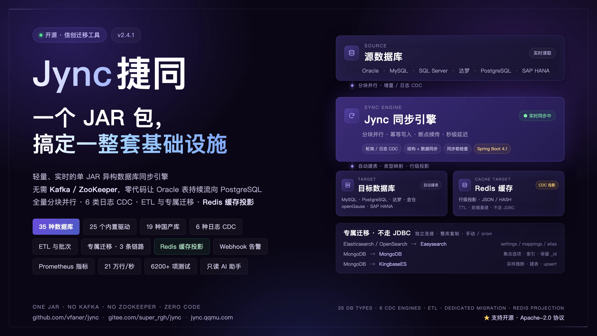
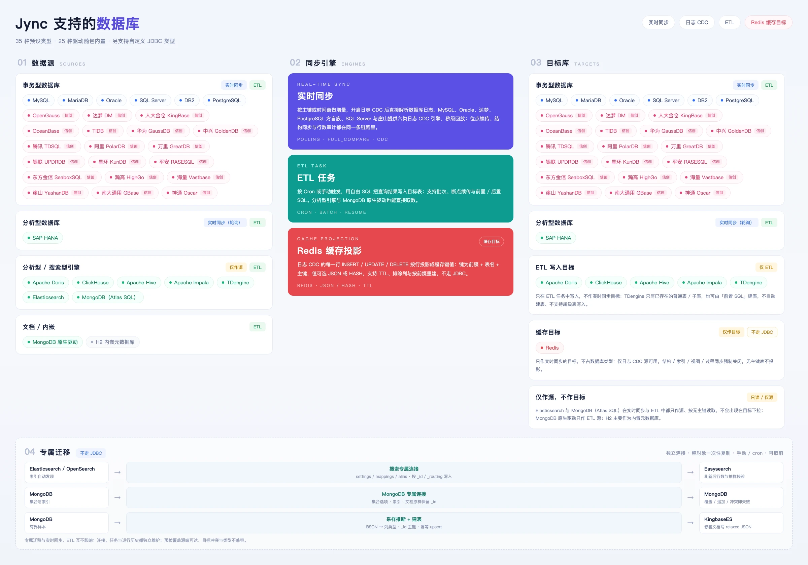
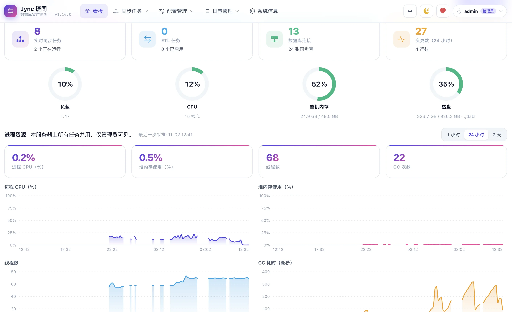
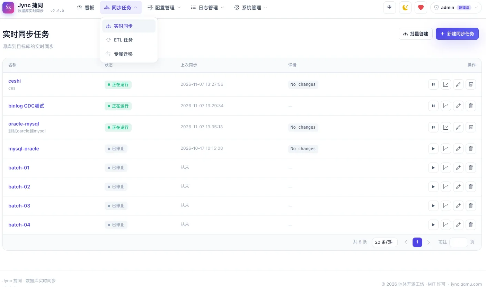
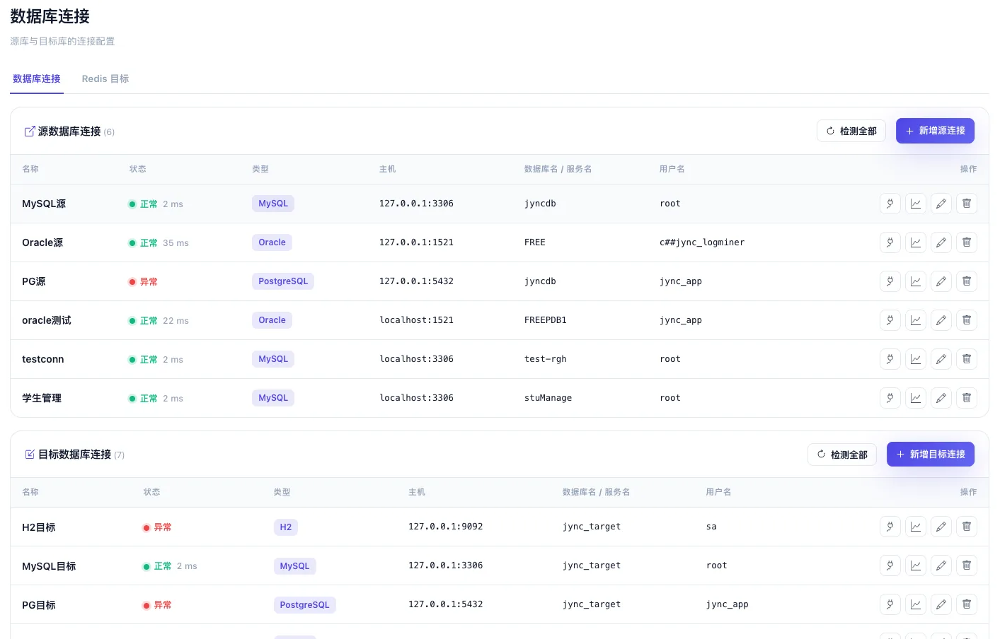
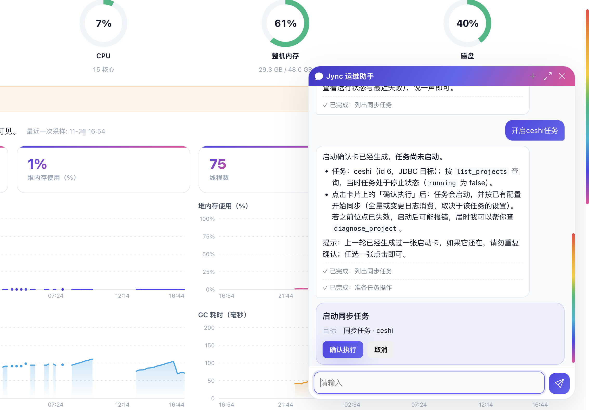

# Jync · Heterogeneous Database Real-Time Sync

> **Jync**: **J** for Java, **ync** from "sync"; the Chinese name 捷同 means "swift and identical" — data stays the same on both sides.
> A single-JAR database synchronization engine: **chunked parallel full load, read-only incremental capture, second-level log CDC**, plus SQL-driven ETL and Webhook alerting.

[简体中文](README.md) | **English**

[](LICENSE)
[](https://openjdk.org/)
[](https://spring.io/projects/spring-boot)
[](https://github.com/vfaner/jync)
[](https://github.com/vfaner/jync)
[](https://gitee.com/super_rgh/jync)
[](https://gitee.com/super_rgh/jync)



An out-of-the-box web application that keeps **structure and data** in sync between **heterogeneous databases**: start one jar, pick **34 built-in database types (plus custom types)** in a browser, and a sync or ETL pipeline is running — search and document data additionally gets three **dedicated migration** chains that skip JDBC (Elasticsearch / OpenSearch → Easysearch, MongoDB → MongoDB, MongoDB → KingbaseES). No Kafka, no Flink, no ZooKeeper, and not a line of job code.

- **Zero external dependencies**: a Spring Boot monolith with Thymeleaf server-side rendering, Quartz and an embedded H2 metadata store. Runs air-gapped.
- **Full load is not a bulk query import**: keyset chunking, in-table parallelism, streamed result sets, per-chunk commits and checkpoints — single-table throughput reaches the **200,000 rows/second** range.
- **Incremental is one indexed query**: the default polling mode reads only rows past the cursor, so one read-only account is enough. Six source families can switch to log CDC for second-level latency.
- **Structure travels with data**: missing tables, indexes, views and procedures are created automatically, with built-in dialect type mapping and function conversion.
- **Resumable by design**: crashes, network drops and killed processes resume from the last checkpoint; every write is idempotent, and changes made while Jync was down are caught up on restart.
- **Dedicated migration too**: three whole-index / whole-collection copy chains outside JDBC, each with its own connection model, leaving sync and ETL untouched.
- **Failures reach you**: seven fault categories — sync failures, CDC stalls, data drift and more — can be pushed to DingTalk, WeCom, Feishu or a custom Webhook.
- **An optional AI operations assistant**: with a model connected, ask the floating panel about task state, database health and current alerts in plain language, and self-check a stalled change log; the assistant is read-only and never part of sync, and creating a task stops at a draft.

| Resource | Link |
|---|---|
| **Download** | [Gitee release (split assets)](https://gitee.com/super_rgh/jync/releases/latest) · [GitHub Releases (single jar)](https://github.com/vfaner/jync/releases/latest) |
| **Docs** | [Website](https://jync.qqmu.com) · [User Guide](https://jync.qqmu.com/docs/jync-user-guide.pdf) · [Operations Guide](https://jync.qqmu.com/docs/jync-ops-guide.pdf) · [Overview](https://jync.qqmu.com/docs/jync-overview.pdf) |
| **Demo** | [Bilibili · 14 minutes, from connection to real-time sync](https://www.bilibili.com/video/BV1iHYJ6vEEd) |
| **Changelog** | [Release notes by version](docs/release-notes/) (in Chinese) |
| **Source** | [GitHub](https://github.com/vfaner/jync) · [Gitee](https://gitee.com/super_rgh/jync) · [AtomGit mirror](https://atomgit.com/vfaner/jync) (synced code and release assets) |

> Downloads, issues and pull requests belong on Gitee / GitHub; AtomGit is a read-only mirror.

---

## Background

When a public-sector or enterprise system moves from MySQL, Oracle or SQL Server to a domestic database such as DM (达梦), Kingbase or OceanBase, the migration rarely ends when the data is copied. Old and new systems run side by side, cutover happens in batches, and read-only archives coexist with live services — all of which require the two databases to **stay consistent for weeks or months**.

Existing tools always leave one gap. Commercial sync products are licensed per node, with long procurement cycles and high cost. Log-based tools such as Debezium and Flink CDC are capable, but require Kafka, Flink and job orchestration before the first row moves. DataX and Kettle excel at one-off transfers, but long-running incremental sync, structure synchronization and resume-from-checkpoint usually need to be orchestrated yourself. **Jync turns that logic into a product**: one jar, a browser for connections, tables, scheduling and start/stop, and no scripts or message queues to operate. It is open source under the Apache License, Version 2.0 and fully self-hostable.

---

## Capabilities

| Area | What Jync does |
|---|---|
| Full load | Keyset chunking + in-table parallelism + streamed reads + per-chunk checkpoints; INSERT-first into empty targets, deferred secondary indexes; 200,000 rows/s range |
| Incremental sync | Timestamp, row SCN, identity column or full comparison, selected automatically; one cursor-range query; safety-lagged watermark; cursor advances only after commit |
| Log CDC | MySQL binlog, Oracle LogMiner, DM LogMiner, PostgreSQL-family logical decoding, SQL Server CDC, YashanDB YStream; long-lived streaming replay with second-level latency; when source DDL leaves the target short of columns, rows are pruned in-stream and a DDL task is filed — the stream keeps running; a deleted target table is recreated and reloaded on its own without moving the position (bounded attempts) |
| Redis cache projection | A real-time sync target can be Redis: CDC projects each row to `<prefix><table>:<primary key>` as JSON or HASH, with baseline, replay and prefix-scoped rebuild; log CDC only — see [Known limitations](docs/known-limitations.md) |
| Structure sync | Tables, indexes, views, procedures and functions; type mapping, function conversion, identifier quoting, pagination and DDL overrides |
| ETL | Copy result rows from a customer SQL query; `${name}` variables in the extraction, pre-sql, post-sql and range condition, with built-in date values plus `${runIndex}` (successful runs so far); 7 analytic engines; multi-statement scripts; overwrite / append / range overwrite / upsert by key; resumable runs; tables sharing a source and target can form a **batch** with one connection pair and one schedule |
| Dedicated migration | Elasticsearch / OpenSearch → Easysearch, MongoDB → MongoDB and MongoDB → KingbaseES copy whole objects over a connection model independent of JDBC; precheck, manual or cron runs, cancellation and run history |
| System management | Configuration package export/import (passphrase-encrypted, optional runtime state, re-encrypted with the target key), page-level force-HTTPS switch, in-app TLS certificates (upload PKCS#12 / JKS / PEM, or point at a server path for in-place renewal), in-app update check and one-click upgrade (GitHub / Gitee, switchable off) |
| Roles and ownership | System administrator / operator / viewer; an operator sees every resource but may create, edit, delete or run only what they own, and a viewer is read-only; external authentication can name administrator and operator users |
| Data shaping | Column cleansing (13 rule types, including phone/ID/name/email masking and SHA-256 hashing), table-name mapping, read-only data preview, on-demand row-count audit, task cloning, bulk task creation (binned by table size) |
| AI assist (optional) | The model drafts candidate SQL for procedures and functions; nothing is stored until a person approves it, and AI never takes part in synchronization |
| AI assistant (optional) | Embedded panel (ADMIN/OPS): streamed answers on task status, source/target row counts, database metrics and throughput, plus current alerts, the latest ETL result and a change-log prerequisite self-check; how-to answers from the bundled knowledge base; creating a task stops at a draft for human confirmation |
| Alerting | Webhook pushes for sync failures, stuck polling, projects not running, CDC stalls, data drift, unhealthy connections and PG slot backlog, plus "CDC target table repaired" and "CDC DDL skipped"; DingTalk / WeCom / Feishu / generic JSON; cooldown and recovery notices |
| Reliability and observability | Idempotent upsert, checkpoint resume, database leases, at-least-once; dashboard, change / audit / system logs, performance charts, optional Prometheus scrape endpoint |
| Delivery | jar / Docker / Kubernetes; Chinese and English UI, light and dark themes; responsive layout; local accounts plus three SSO modes |

---

## Supported databases

**34 built-in types**, 25 of them with bundled drivers. The map below is from the website: the upper part is the JDBC real-time sync / ETL matrix, the bottom is the separate **dedicated migration** chain; click it for the full reference.

[](https://jync.qqmu.com/database.html)

- **Custom types**: JDBC URL, driver class and driver jar path, loaded at runtime in an isolated `URLClassLoader`; pick a dialect family.
- **Drivers to supply yourself**: GBase, Oscar, Huawei GaussDB, SAP HANA, ClickHouse, Hive, Impala, Elasticsearch and MongoDB (Atlas SQL) publish no redistributable artifact, so provide the jar and path; the driver class can be overridden on the same card.
- **Analytic / search engines**: Doris, ClickHouse, Hive, Impala, Elasticsearch and MongoDB have no log-based CDC, so they are **real-time sync sources only** (polling / full compare); in ETL all but Elasticsearch and MongoDB can be written.
- **Redis is a sync target, not a database**: pick "Target type = Redis" on the project page and manage Redis targets separately (standalone or Cluster; Sentinel is not supported). The source stays a database connection and must use log CDC. Redis is not a `DatabaseType`, so it does not appear in the database matrix or the ETL engine list.
- **Dedicated migration is not JDBC**: the three chains use dedicated connections and tasks, outside the capability matrix above; boundaries are in [Known limitations](docs/known-limitations.md). The GaussDB vs openGauss distinction, TDSQL / PolarDB editions and HANA's CDC limits are on the [website's database page](https://jync.qqmu.com/database.html).

---

## Screens

<table>
  <tr>
    <td align="center" width="33%"><a href="docs/images/jync_kanban.webp" target="_blank" rel="noopener"></a><br><sub><b>Kanban</b> · resources, tasks and a 24h trend</sub></td>
    <td align="center"><a href="docs/images/jync_xiangmu.webp" target="_blank" rel="noopener"></a><br><sub><b>Sync tasks</b> · state, last sync and details</sub></td>
    <td align="center"><a href="docs/images/jync_db.webp" target="_blank" rel="noopener"></a><br><sub><b>Connections</b> · source and target side by side</sub></td>
  </tr>
</table>

> More screens (log CDC, performance charts, column cleansing, alerting, AI drafting, dark theme …) are on the [features page](https://jync.qqmu.com/features.html).

---

## AI capabilities (optional)

AI is an **assistant** in Jync, never part of the sync path: with no provider enabled nothing leaves the machine, and `sync.ai.enabled=false` removes the feature entirely.

<table>
  <tr>
    <td align="center"><a href="docs/images/jync_ai_kefu.png" target="_blank" rel="noopener"></a><br><sub><b>AI operations assistant</b> · ask about task state, database health and alerts in plain language; self-check the change log</sub></td>
  </tr>
</table>

- **Ask instead of hunting**: task state, progress and throughput, source/target row counts, database metrics (sessions, QPS, cache hit, locks), current alerts and the latest ETL result each have a **read-only tool**; ids come from list tools, never guessed.
- **A fixed diagnosis order**: for a stalled change log it self-checks the prerequisites item by item (connectivity, privileges, position, skipped events; this one opens the source, so it is capped per conversation). Alerts → task → log stream → self-check → docs, and every answer names the tool it relied on.
- **Read-only with budgets**: the assistant cannot run SQL, change configuration, start, stop or delete a task. Creating a task stops at a **draft** for a person to review and save. Tool results are capped and each conversation has round and time budgets.
- **Bundled knowledge**: usage, prerequisites and limitations come from the bundled documentation, not a web search; when the docs do not cover a question it says so instead of inventing an answer.
- **AI-drafted structure conversion**: the model drafts candidate SQL for procedures and functions; a person reviews and edits before anything is stored.
- **Any model**: OpenAI-compatible endpoints (self-hosted and most Chinese providers included), Anthropic, and Ollama (native or compatibility layer); keys are encrypted at rest and never shown back.

---

## Sync engine

There are three data paths: **how the first copy moves**, **how changes are followed afterwards**, and **how to reach second-level latency**:

```
First full load:  keyset chunks → N workers in parallel → streamed reads → per-batch commit → checkpoints
Incremental:      cursor > last value AND cursor <= watermark → batched upsert → advance cursor
Log CDC:          record position → chunked baseline → long-lived replay → advance position after commit
```

- **Full load**: the result set is fetched in `fetch-size` increments, so heap use does not grow with the table. Keyed tables are paged by keyset, single-column integer keys are split into disjoint ranges and loaded in parallel, and every chunk commits and checkpoints on its own — a crash re-reads at most one chunk.
- **Incremental**: one cursor-range query per table per cycle; the cursor column is detected automatically (`TIMESTAMP` / `ROW_SCN` / `IDENTITY`); a safety-lagged watermark lets late commits be absorbed idempotently next cycle. **The cursor advances only after the target commits**, so recovery is at-least-once.
- **Log CDC**: six source families can switch per task and see `INSERT / UPDATE / DELETE` straight from the source log. Record the position → chunked baseline → long-lived replay; a database lease serializes streams across instances and a failed holder is replaced within 60s.
- **YashanDB goes through YStream, not LogMiner**: 23.4.7.100 has no `DBMS_LOGMNR`; its logical log engine is YStream, used without triggers or table changes. DML on a table lacking supplemental logging **silently never enters the stream**, so both the probe and startup check every table and print the exact ALTER statement.
- **The default polling mode never reads the source's binlog** and installs no triggers — one read-only account is enough.
- **CDC prerequisites** (checked item by item): MySQL `binlog_format=ROW`, `binlog_row_image=FULL`, and account grants `REPLICATION SLAVE` / `REPLICATION CLIENT`; Oracle `ARCHIVELOG` plus database-level and table-level `SUPPLEMENTAL LOG DATA (ALL) COLUMNS` for LogMiner; DM archive mode and `RLOG_APPEND_LOGIC=2`; PostgreSQL-family `wal_level=logical`; SQL Server database-level CDC; YashanDB YStream supplemental logging per table. Full list: [configuration notes](docs/configuration.md).

A single-host container benchmark (500k-row Oracle table) measured **216k rows/s** for full load; log CDC end-to-end latency is **second-level**. Tuning parameters, scheduling rules and performance charts: [configuration notes](docs/configuration.md) and the [Operations Guide (PDF)](https://jync.qqmu.com/docs/jync-ops-guide.pdf).

---

## Quick start

| Item | Requirement |
|---|---|
| JDK | **17+** |
| Port | `8080` by default |
| Memory / disk | Heap ≥ 512 MB recommended, 1 GB free; LOB sync scales with the largest value |
| Working directory | Fixed: `./data` (metadata store and key) and `./logs` are created relative to it |

Download the release from [Gitee Releases](https://gitee.com/super_rgh/jync/releases/latest) or [GitHub Releases](https://github.com/vfaner/jync/releases/latest) (Gitee ships split assets; see below); build from source with `mvn clean package -DskipTests` (output `target/jync.jar`).

> **Gitee split assets**: Gitee caps one attachment at 100 MB, so since v2.0.0 the jar ships as `jync.jar.part00` / `jync.jar.part01`. Fetch both and run `cat jync.jar.part00 jync.jar.part01 > jync.jar`; the in-app upgrade assembles them automatically. GitHub / AtomGit carry the whole `jync.jar`.

```bash
mkdir -p /opt/jync && cd /opt/jync
java -Xms512m -Xmx2g -Duser.timezone=Asia/Shanghai \
  -jar jync.jar --spring.config.additional-location=file:./application.yml
```

> ⚠️ Use `--spring.config.additional-location` (layered override). The replacing form `spring.config.location` drops the jar's built-in settings — the login page then shows `??login.title_en_US??` and a fresh deployment creates no tables.
>
> 🕐 `-Duser.timezone` also decides how Cron expressions are evaluated. Set it explicitly when the host defaults to UTC.

Minimal `application.yml` (full key reference: [configuration notes](docs/configuration.md)):

```yaml
server:
  port: 8080
sync:
  poll-interval: 2000
  full-load-parallelism: 2
  max-pool-size: 5
  crypto-password: ""   # empty = generated on first start, stored in data/<db>.key
  crypto-salt: ""
```

Open `http://<server>:8080` and sign in as the built-in `admin / 123456` (system administrator), `ops / 123456` (operator) or `view / 123456` (viewer); **you must change the password on first sign-in** (until then, only the change-password page is reachable). The three roles are described below; an upgraded installation can delete the `ops` account with SQL and it will not come back on restart.

| Account | Role | What it may do |
|---|---|---|
| `admin` | System administrator | Everything, including system settings, external auth, AI, alerting, audit and upgrades |
| `ops` | Operator | Read every resource; create, edit, delete and run only resources it owns; no system settings, external auth, alerting, audit, AI configuration or configuration packages |
| `view` | Viewer | Read-only: sees every resource and the process metrics, all write requests are refused |

> Ownership is recorded per creating account. Resources created before the upgrade have no owner (system-owned): operators can only read them and cannot reference them from new tasks; administrators are unaffected.

Production settings, external metadata store, systemd, Docker / Kubernetes, reverse proxy and HTTPS, upgrades and backups: [Operations Guide](https://jync.qqmu.com/docs/jync-ops-guide.pdf), the website's [deployment page](https://jync.qqmu.com/deploy.html) and [container notes](docs/deploy-container.md). HTTPS works two ways: terminate TLS at a reverse proxy (recommended), or upload a PKCS#12 / JKS keystore or PEM certificate and key under System → System settings and let Jync serve HTTPS itself; changes apply after a restart. The same page toggles force-HTTPS, exports/imports configuration packages and tests a candidate metadata database. See [configuration](docs/configuration.md).

> 🔐 Back up `./data` (including `<db>.key`), `./logs` and `application.yml` before upgrading. Without the key, saved connection passwords, AI keys and alert URLs cannot be decrypted.

---

## Workflow

1. **Connections** → create source / target connections → "Test connection" before saving.
2. **Real-time sync → New task** and choose the source and target.
3. **Task detail** → tick tables / views / procedures; type a different target table name on the right (blank keeps the name).
4. Configure **capture strategy, schedule, full-load performance and column cleansing** as needed.
5. "**Sync now**" for one verification run, or "**Start automatic sync**" for continuous increments.
6. Read each round in the **change log** and the overall state on the **dashboard**; use **Row-count audit** on the task page when you need to confirm both sides match.

**ETL**: **Sync tasks → ETL tasks** → create a task or a batch → extraction SQL and target table → write mode and schedule → start.

**Dedicated migration**: **Sync tasks → Dedicated migration** → manage connections → pick a migration type → choose objects, target naming and write mode → run the precheck → save, then "Run now" or enable a cron. All three types copy the data as it stood when the run started; rerunning OVERWRITE makes the target converge.

**Alerting**: **Configuration → Alert notifications** → Webhook URL, message format and categories → save, then send a test message.

---

## Architecture and stack

**Stack**: Java 17 · Spring Boot 4.1 · Spring Data JPA / Hibernate · Quartz · H2 / MySQL / PostgreSQL metadata store · Thymeleaf server-side rendering · vanilla JavaScript (no CDN, no front-end build).

```text
com.qqmu.jync
├── config / controller / dto / model / repository   configuration, MVC and data model
├── service
│   ├── connection / metadata / converter            connections, metadata, dialect conversion
│   ├── sync / cdc / etl / migration                 the four data paths
│   └── alert / task / lob / ai                      alerting, scheduling and locks, LOBs, AI
└── util                                             utilities
```

- **Three-layer lock**: Quartz `@DisallowConcurrentExecution` → per-task JVM `ReentrantLock` → database lease (across restarts and instances).
- **Chain isolation**: sync and ETL use JDBC connections and tasks; dedicated migration has its own connection model and run records, so it never touches the JDBC pools or the JDBC capability matrix.

---

## Docs and tests

- **Configuration, scheduling and tuning**: [docs/configuration.md](docs/configuration.md) (`sync.*` / `sync.cdc.*` keys, scheduling rules, column cleansing, CDC prerequisites and performance settings; in Chinese)
- **Container deployment and operations**: [docs/deploy-container.md](docs/deploy-container.md)
- **Data boundary and air-gapped deployment**: [docs/security-data-boundary.md](docs/security-data-boundary.md) (outbound endpoints, air-gap checklist, encryption/masking/crypto capability limits; in Chinese)
- **Known limitations**: [docs/known-limitations.md](docs/known-limitations.md)
- **Real-database verification matrix**: [docs/verification-matrix.md](docs/verification-matrix.md) (what was verified per product: version/image, driver, strategies, verification level and run commands)

```bash
mvn test
```

The suite has 6,100+ unit tests and covers dialect and SQL rewriting, full load and resume, CDC prerequisites and position discipline for six engines, Redis projection and dedicated migration, ETL variables and alerting, roles and resource ownership, the AI assistant, security (encrypted storage, viewer POST rejection, CSRF), UI i18n, and the dual-channel upgrade fallback.

Real-database integration tests (`*IT`, excluded from the default suite, require Docker): Oracle 23ai parallel full load with `ROWDEPENDENCIES`; MySQL 8 binlog baseline → streaming, crash rerun, 100k-row consistency and fault injection. Run with `-Dapi.version=1.44` (Docker Engine ≥ 29).

---

## Contributing

| Channel | Account |
|------|------|
| QQ | [817094](https://wpa.qq.com/msgrd?v=3&uin=817094&site=qq&menu=yes) / [2912167928](https://wpa.qq.com/msgrd?v=3&uin=2912167928&site=qq&menu=yes) |
| QQ group | [426669837 · 沐沐开源工坊](https://qun.qq.com/universal-share/share?ac=1&authKey=xm%2BfgdraFGDpH8GHkV4DbuMjArg6BsPdNnXKUqcWvFXI1ocS56TcioSRYOVBvn5Q&busi_data=eyJncm91cENvZGUiOiI0MjY2Njk4MzciLCJ0b2tlbiI6Ind0V1pMYlVieXJkQmtnMVgveUFsOHFnbFhTd28wUE03dy9uVUErVExBdnlkMENnMis0UmhqWlJjcURzRHFnUEMiLCJ1aW4iOiI4MTcwOTQifQ%3D%3D&data=tZVIfZoO6N9QWSJE6ZbdZR15OmuLpSVucid5TicWYaMgb9Go1B975NZk0iZOo69AEzXQ4XucFtenImLltzFI5w&svctype=4&tempid=h5_group_info) |
| WeChat | qqmu66 |
| Email | [vfaner@88.com](mailto:vfaner@88.com) |
| Website | <https://jync.qqmu.com> |

Issues, feature requests and pull requests are welcome through any channel above. If Jync helps you, a **Star** ⭐ is appreciated.

### Sponsorship

[](https://jync.qqmu.com/donate.html)

Every Jync feature is free and open source. If it saved you time, use the button above to buy me a coffee; leave a note when sponsoring and you will be listed among the supporters.

---

## License

[Apache License, Version 2.0](LICENSE), for commercial and non-commercial use. Bundled third-party JDBC drivers keep their vendors' licenses; see [THIRD_PARTY_LICENSES.md](THIRD_PARTY_LICENSES.md).

Maintained by 沐沐开源工坊: GitHub [@vfaner](https://github.com/vfaner), Gitee [@super_rgh](https://gitee.com/super_rgh), AtomGit [@vfaner](https://atomgit.com/vfaner). The one request is not to replace the "Jync / 捷同" name, logo and author attribution with your own — see [TRADEMARK.md](TRADEMARK.md).
